---
tags:
  - op/doc/report
planType:
  - Workpackage
source: "[[HerStory UIs]]"
---

# HerStory UI map — how the interfaces connect

Which primary surface opens which secondary, and **through which control**. Structure from the live Subframe project *HS - Design System* (106 secondary pages, checked 2026-11-18); scopes from `HerStory UIs.md` §16.

> **Caveat.** The boards are static. The trigger on each arrow is the control the secondary is reached from — inferred from the secondary's action and resolved against the parent board's component inventory (`uis.yaml`). `Button:Name` is a control that exists; `:pending` marks one the board does not contain yet. It is what should be wired, not proof that a wiring exists: Subframe interactions are manual (`HerStory UI Interaction Audit.md`).

## How to read it

| Element | Meaning |
|---|---|
| Rounded node | primary surface |
| Rectangle node | secondary interface |
| Solid arrow | reachable from a control in the primary |
| Dotted arrow | not reached from a control (role gate / composed chrome) |

Components are named by content — `Button:InviteUser` is the button labelled “Invite user”; `:pending` marks a control the source board does not contain yet. Tokens: `row / node click` · `IconButton` = row pen · `Button` = header action · `Dialog` = modal opened by it · `Tabs` = in-page switch · `DropdownMenu` = overflow · `header control` = selector in the top bar. Semantic aliases: the two UI-17 review buttons are both labelled `Review`, named `Button:ReviewHuman` (person icon) and `Button:ReviewLLM` (bot icon) here; the UI-10/UI-15 `DropdownMenu` is opened by `Button:More`. Each diagram is set to `useMaxWidth` so it scales to the pane.

## 1. Overview

| Cluster | Primary surfaces | Secondary | Diagram |
|---|---|---|---|
| Governance & administration | 01, 02, 03, 04, 05, 06, 07, 08 | 24 | §2.1 |
| Ontology | 11 | 6 | §2.2 |
| Pipeline & mapping | 09, 10, 12, 13, 14, 15, 16, 17, 18, 19 | 19 | §2.3 |
| Participation & justice | 20, 21, 22, 23, 24, 25, 26, 27 | 16 | §2.4 |
| Exploration | 28, 29, 30, 31, 32, 33, 34 | 16 | §2.5 |
| Help & feedback | 35, 36 | 10 | §2.6 |
| Shell | 37 | 8 | §2.7 |
| Provenance, observability & personalisation | 38, 39, 40 | 5 | §2.8 |

## 2. Connections per cluster

### 2.1 Governance & administration

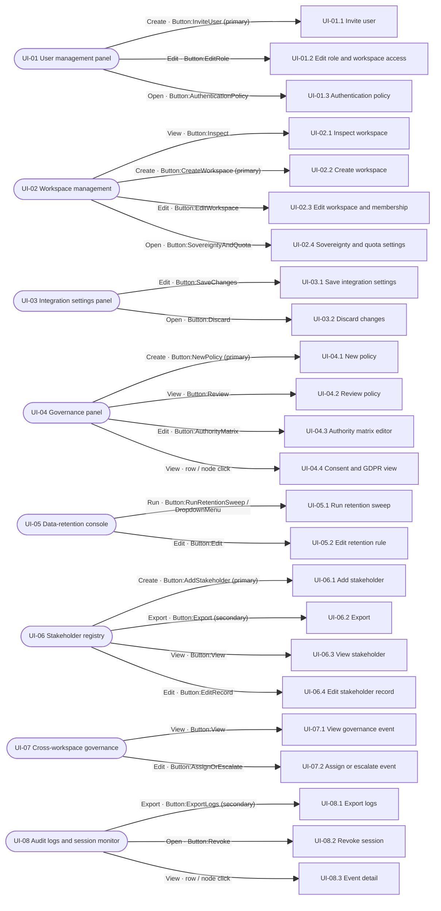

### 2.2 Ontology

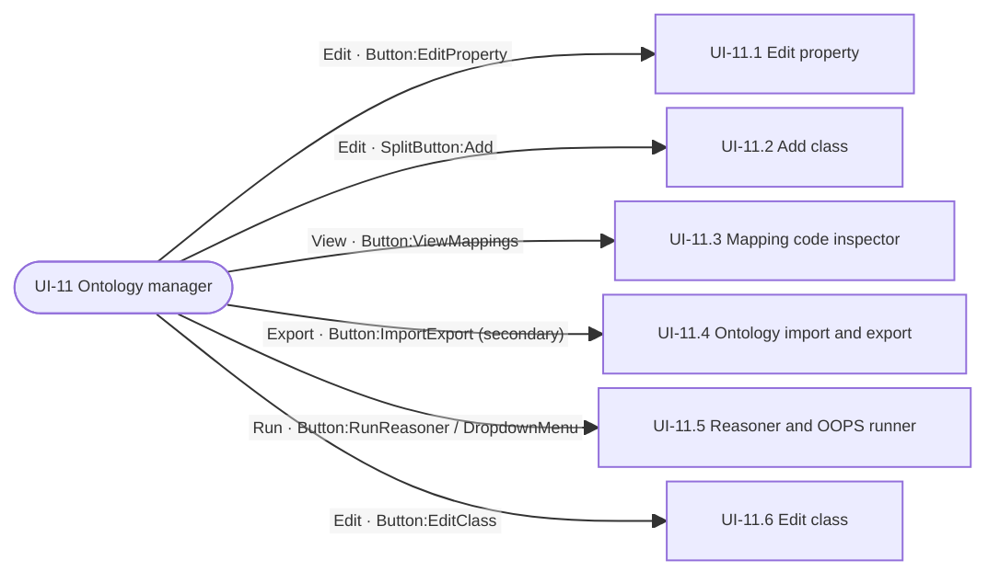

### 2.3 Pipeline & mapping

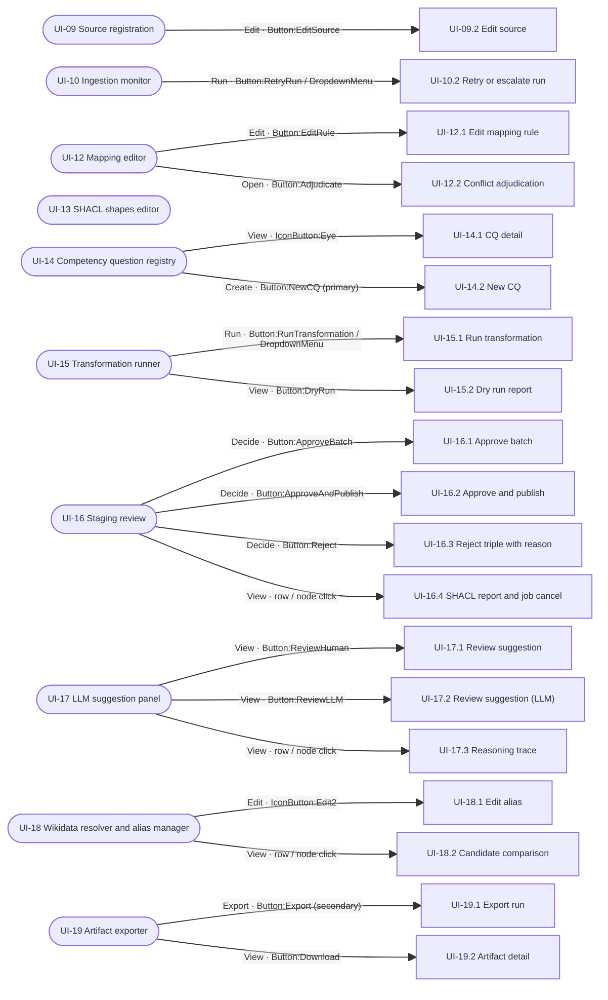

### 2.4 Participation & justice

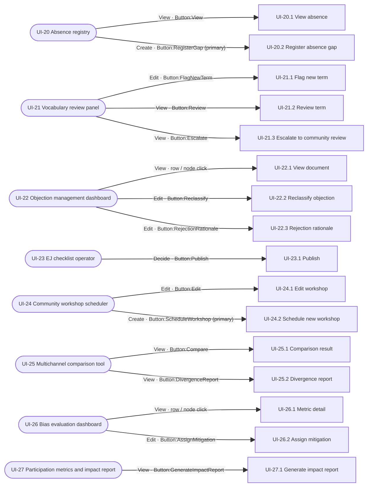

### 2.5 Exploration

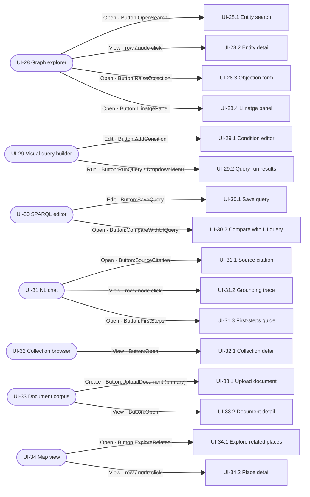

### 2.6 Help & feedback

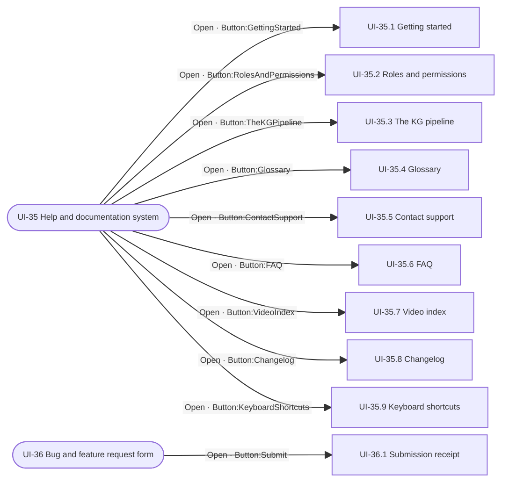

### 2.7 Shell

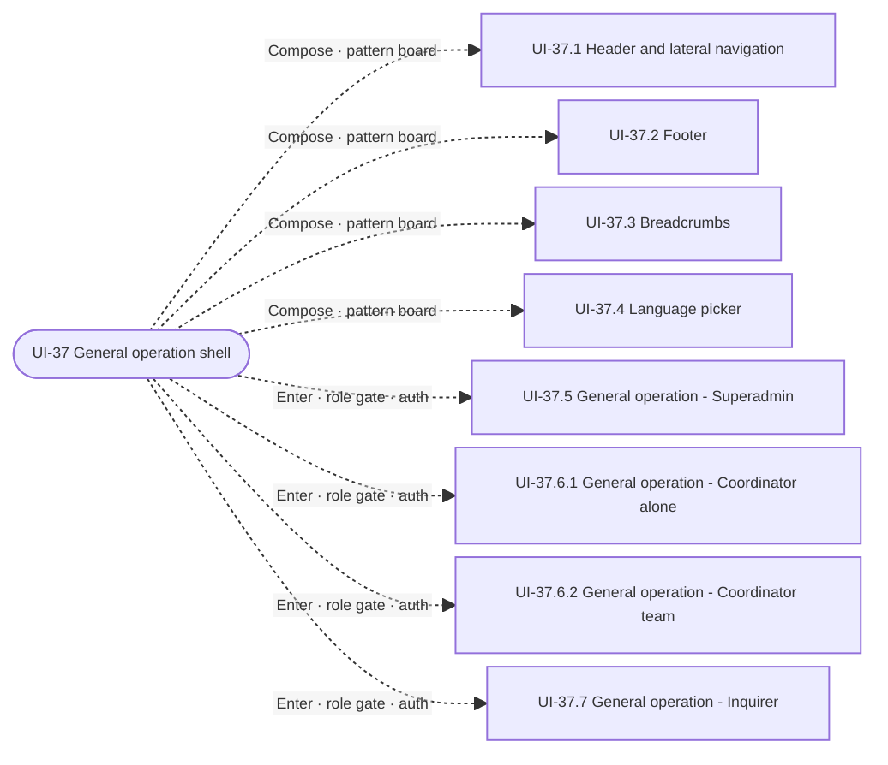

### 2.8 Provenance, observability & personalisation

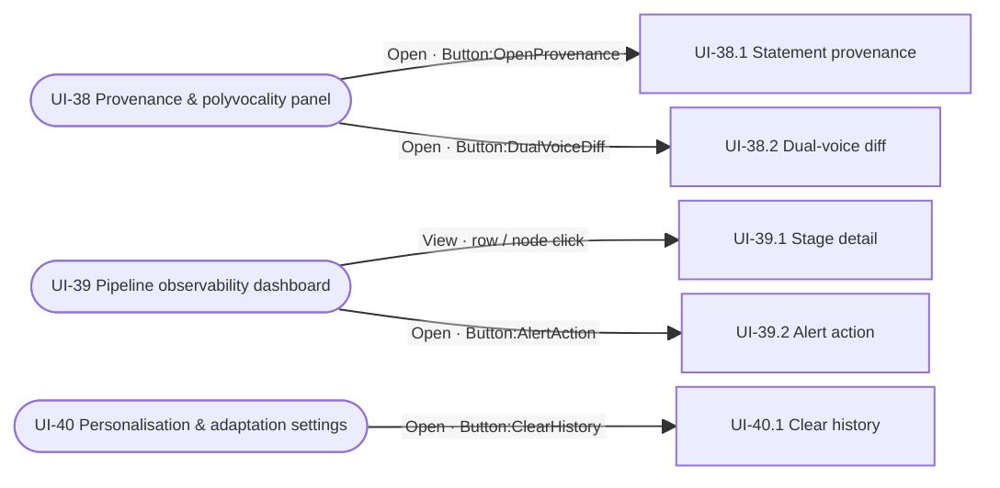

## 3. Secondary → onward (simulated)

Buttons inside the secondary screens continue the workflow. The diagrams show only **forward** links — hand-offs, decisions and next steps; plain “close/save → back to parent” returns are in the table at the end of this section. **All links are simulated**: neither the page code nor the MCP carries interaction data, so they are derived from the flows in `HerStory UIs.md` §13 and each secondary's scope in §16.

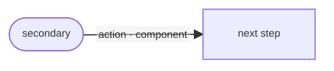

### 3.1 Ontology

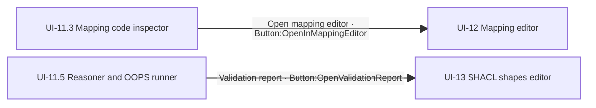

### 3.2 Pipeline & mapping

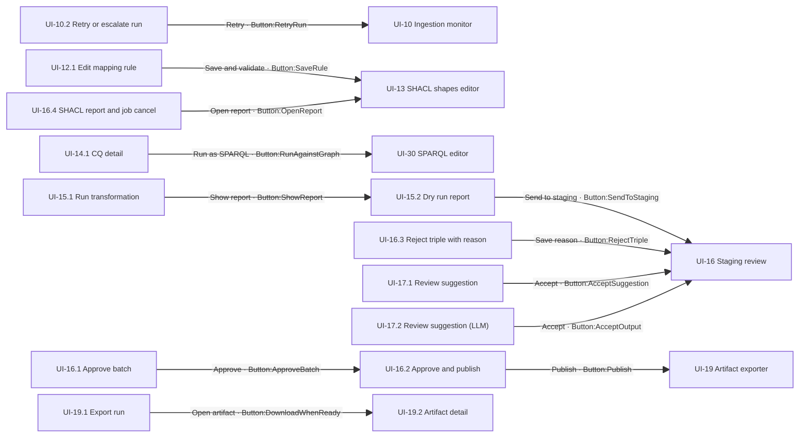

### 3.3 Governance & administration

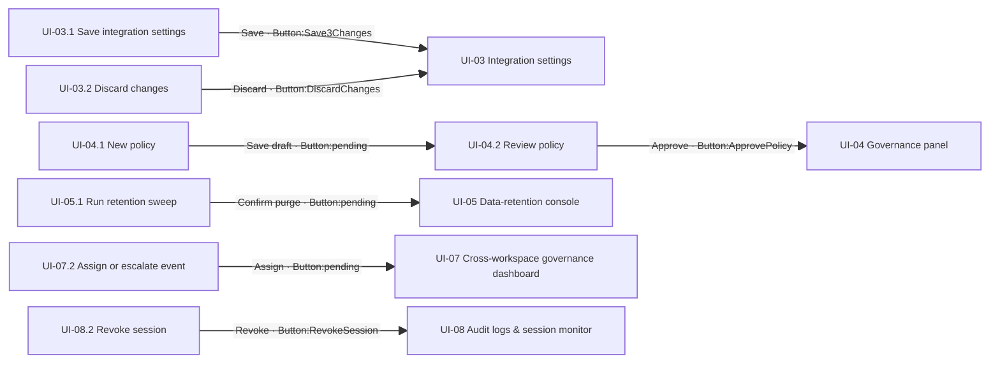

### 3.4 Participation & justice

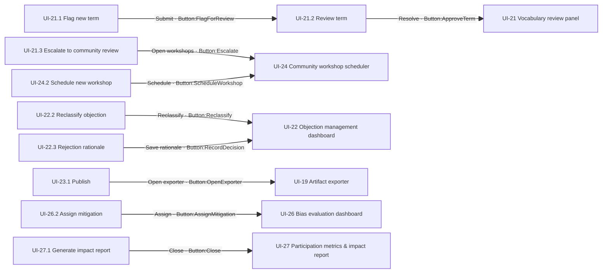

### 3.5 Exploration

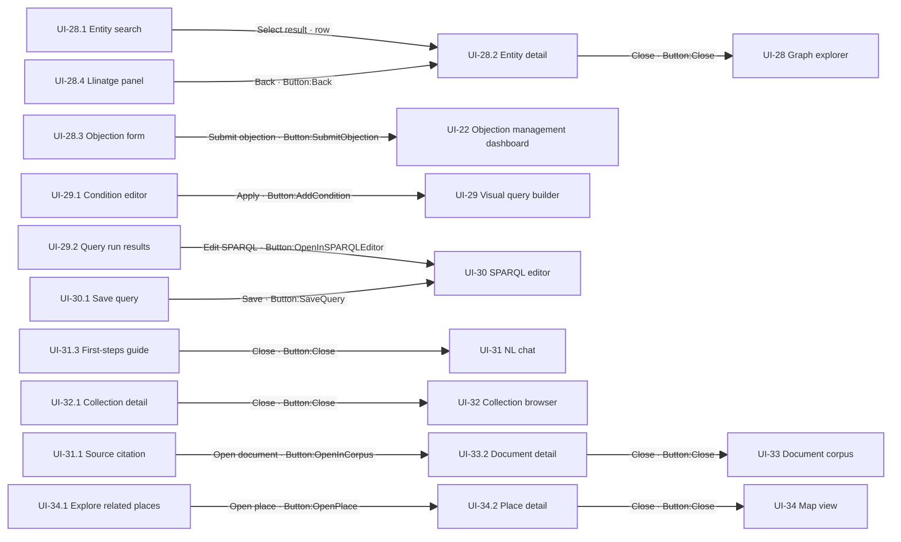

### 3.6 Help & feedback

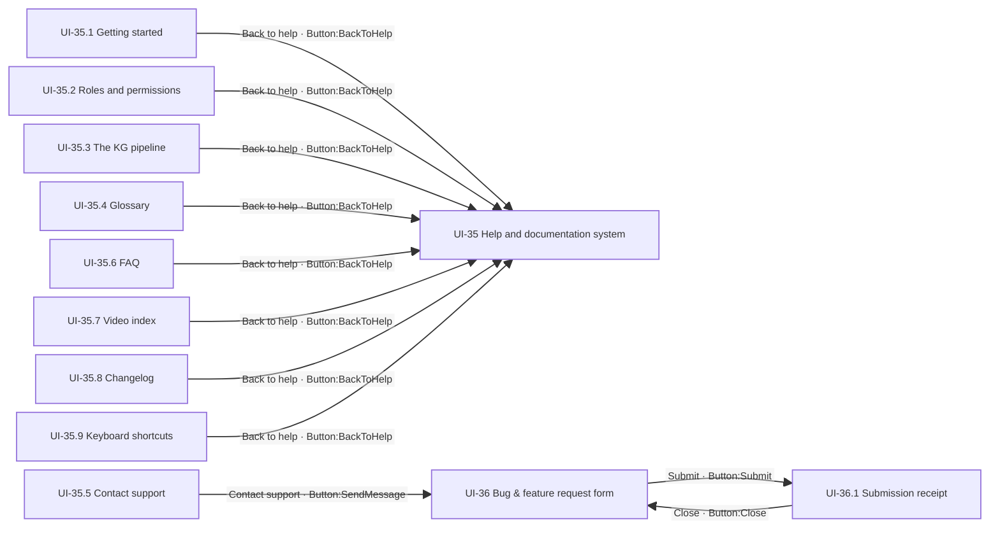

### 3.7 Provenance, observability & personalisation

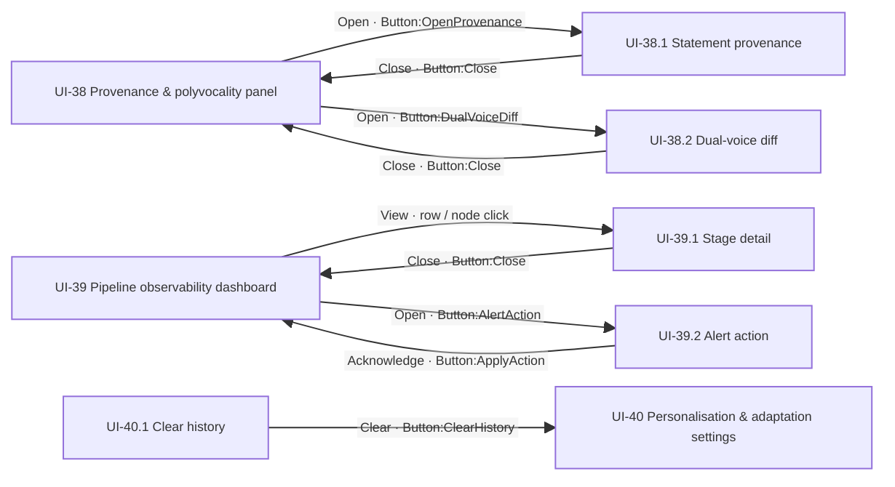

### 3.8 Onward table (all links, including returns)

| From | To | Action · component | Basis |
|---|---|---|---|
| UI-11.1 | UI-11S | Save · Button:SaveProperty | return to manager |
| UI-11.2 | UI-11S | Create · Button:AddClass | return to manager |
| UI-11.3 | UI-12 | Open mapping editor · Button:OpenInMappingEditor | hand-off to mapping |
| UI-11.4 | UI-11S | Import · Button:StartImport | return to manager |
| UI-11.5 | UI-13 | Validation report · Button:OpenValidationReport | hand-off to SHACL report |
| UI-11.6 | UI-11S | Save · Button:Guardar | return to manager |
| UI-09.2 | UI-09 | Save · Button:SaveChanges | return to list |
| UI-10.2 | UI-10 | Retry · Button:RetryRun | flow: retry run |
| UI-12.1 | UI-13 | Save and validate · Button:SaveRule | hand-off to SHACL |
| UI-12.2 | UI-12 | Resolve · Button:SaveDecision | return to editor |
| UI-14.1 | UI-30 | Run as SPARQL · Button:RunAgainstGraph | cross-feature |
| UI-14.2 | UI-14 | Save · Button:SaveAndRun | return to registry |
| UI-15.1 | UI-15.2 | Show report · Button:ShowReport | flow: dry-run report |
| UI-15.2 | UI-16 | Send to staging · Button:SendToStaging | workflow step |
| UI-16.1 | UI-16.2 | Approve · Button:ApproveBatch | flow: approve batch |
| UI-16.2 | UI-19 | Publish · Button:Publish | flow: publish to graph |
| UI-16.3 | UI-16 | Save reason · Button:RejectTriple | flow: mark rejected |
| UI-16.4 | UI-13 | Open report · Button:OpenReport | hand-off to SHACL |
| UI-17.1 | UI-16 | Accept · Button:AcceptSuggestion | workflow step |
| UI-17.2 | UI-16 | Accept · Button:AcceptOutput | workflow step |
| UI-18.1 | UI-18 | Save · Button:SaveAlias | return to resolver |
| UI-19.1 | UI-19.2 | Open artifact · Button:DownloadWhenReady | flow: artifact detail |
| UI-19.2 | UI-19 | Close · Button:Close | return to exporter |
| UI-01.1 | UI-01 | Send invitation · Button:SendInvite | return to list |
| UI-01.2 | UI-01 | Save · Button:SaveChanges | return to list |
| UI-01.3 | UI-01 | Save policy · Button:SavePolicy | return to list |
| UI-02.1 | UI-02 | Close · Button:Close | return to list |
| UI-02.2 | UI-02 | Create · Button:CreateWorkspace | return to list |
| UI-02.3 | UI-02 | Save · Button:SaveWorkspace | return to list |
| UI-02.4 | UI-02 | Save · Button:SaveSettings | return to list |
| UI-03.1 | UI-03 | Save · Button:Save3Changes | flow: save settings |
| UI-03.2 | UI-03 | Discard · Button:DiscardChanges | flow: discard changes |
| UI-04.1 | UI-04.2 | Save draft · Button:CreatePolicy | flow: review policy |
| UI-04.2 | UI-04 | Approve · Button:ApprovePolicy | flow: policy active |
| UI-04.3 | UI-04 | Save matrix · Button:SaveMatrix | return to panel |
| UI-04.4 | UI-04 | Close · Button:Close | return to panel |
| UI-05.1 | UI-05 | Confirm purge · Button:DeleteFiles | flow: sweep runs |
| UI-05.2 | UI-05 | Save · Button:SaveRule | return to console |
| UI-06.1 | UI-06 | Save · Button:AddStakeholder | return to registry |
| UI-06.2 | UI-06 | Download · Button:Export | return to registry |
| UI-06.3 | UI-06 | Close · Button:Close | return to registry |
| UI-06.4 | UI-06 | Save · Button:SaveRecord | return to registry |
| UI-07.1 | UI-07 | Close · Button:Close | return to dashboard |
| UI-07.2 | UI-07 | Assign · Button:Apply | flow: route event |
| UI-08.1 | UI-08 | Download · Button:ExportLogs | return to logs |
| UI-08.2 | UI-08 | Revoke · Button:RevokeSession | flow: end session |
| UI-08.3 | UI-08 | Close · Button:Close | return to logs |
| UI-20.1 | UI-20 | Close · Button:Close | return to registry |
| UI-20.2 | UI-20 | Register · Button:RegisterGap | return to registry |
| UI-21.1 | UI-21.2 | Submit · Button:FlagForReview | flow: review term |
| UI-21.2 | UI-21 | Resolve · Button:ApproveTerm | flow: reviewed |
| UI-21.3 | UI-24 | Open workshops · Button:Escalate | hand-off to scheduler |
| UI-22.1 | UI-22 | Close · Button:Close | return to dashboard |
| UI-22.2 | UI-22 | Reclassify · Button:Reclassify | flow: reclassify |
| UI-22.3 | UI-22 | Save rationale · Button:RecordDecision | flow: rejection recorded |
| UI-23.1 | UI-19 | Open exporter · Button:OpenExporter | hand-off to publication |
| UI-24.1 | UI-24 | Save · Button:Save | return to scheduler |
| UI-24.2 | UI-24 | Schedule · Button:ScheduleWorkshop | flow: new workshop |
| UI-25.1 | UI-25 | Close · Button:Close | return to comparison |
| UI-25.2 | UI-25 | Close · Button:Close | return to comparison |
| UI-26.1 | UI-26 | Close · Button:Close | return to dashboard |
| UI-26.2 | UI-26 | Assign · Button:AssignMitigation | flow: re-measure |
| UI-27.1 | UI-27 | Close · Button:Close | flow: impact report |
| UI-28.1 | UI-28.2 | Select result · row | flow: open entity |
| UI-28.2 | UI-28 | Close · Button:Close | return to graph |
| UI-28.3 | UI-22 | Submit objection · Button:SubmitObjection | hand-off to objections |
| UI-28.4 | UI-28.2 | Back · Button:Back | return to entity |
| UI-29.1 | UI-29 | Apply · Button:AddCondition | return to builder |
| UI-29.2 | UI-30 | Edit SPARQL · Button:OpenInSPARQLEditor | hand-off to editor |
| UI-30.1 | UI-30 | Save · Button:SaveQuery | flow: save query |
| UI-30.2 | UI-30 | Close · Button:Close | return to editor |
| UI-31.1 | UI-33.2 | Open document · Button:OpenInCorpus | hand-off to corpus |
| UI-31.2 | UI-31 | Close · Button:Close | return to chat |
| UI-31.3 | UI-31 | Close · Button:Close | return to chat |
| UI-32.1 | UI-32 | Close · Button:Close | return to browser |
| UI-33.1 | UI-33 | Upload · Button:Upload | return to corpus |
| UI-33.2 | UI-33 | Close · Button:Close | return to corpus |
| UI-34.1 | UI-34.2 | Open place · Button:OpenPlace | flow: place detail |
| UI-34.2 | UI-34 | Close · Button:Close | return to map |
| UI-35.1 | UI-35 | Close · Button:BackToHelp | return to help |
| UI-35.2 | UI-35 | Close · Button:BackToHelp | return to help |
| UI-35.3 | UI-35 | Close · Button:BackToHelp | return to help |
| UI-35.4 | UI-35 | Close · Button:BackToHelp | return to help |
| UI-35.5 | UI-36 | Contact support · Button:SendMessage | hand-off to request form |
| UI-35.6 | UI-35 | Close · Button:BackToHelp | return to help |
| UI-35.7 | UI-35 | Close · Button:BackToHelp | return to help |
| UI-35.8 | UI-35 | Close · Button:BackToHelp | return to help |
| UI-35.9 | UI-35 | Close · Button:BackToHelp | return to help |
| UI-36.1 | UI-36 | Close · Button:Close | return to form |
| UI-38.1 | UI-38 | Close · Button:Close | return to panel |
| UI-38.2 | UI-38 | Close · Button:Close | return to panel |
| UI-39.1 | UI-39 | Close · Button:Close | return to dashboard |
| UI-39.2 | UI-39 | Acknowledge · Button:ApplyAction | return to dashboard |
| UI-40.1 | UI-40 | Clear · Button:ClearHistory | flow: clear history |

## 4. Full connection table

| Parent | Secondary | Action | Trigger component (named) |
|---|---|---|---|
| UI-01 | UI-01.1 Invite user | Create | Button:InviteUser (primary) |
| UI-01 | UI-01.2 Edit role and workspace access | Edit | Button:EditRole |
| UI-01 | UI-01.3 Authentication policy | Open | Button:AuthenticationPolicy |
| UI-02 | UI-02.1 Inspect workspace | View | Button:Inspect |
| UI-02 | UI-02.2 Create workspace | Create | Button:CreateWorkspace (primary) |
| UI-02 | UI-02.3 Edit workspace and membership | Edit | Button:EditWorkspace |
| UI-02 | UI-02.4 Sovereignty and quota settings | Open | Button:SovereigntyAndQuota |
| UI-03 | UI-03.1 Save integration settings | Edit | Button:SaveChanges |
| UI-03 | UI-03.2 Discard changes | Open | Button:Discard |
| UI-04 | UI-04.1 New policy | Create | Button:NewPolicy (primary) |
| UI-04 | UI-04.2 Review policy | View | Button:Review |
| UI-04 | UI-04.3 Authority matrix editor | Edit | Button:AuthorityMatrix |
| UI-04 | UI-04.4 Consent and GDPR view | View | row / node click |
| UI-05 | UI-05.1 Run retention sweep | Run | Button:RunRetentionSweep / DropdownMenu |
| UI-05 | UI-05.2 Edit retention rule | Edit | Button:Edit |
| UI-06 | UI-06.1 Add stakeholder | Create | Button:AddStakeholder (primary) |
| UI-06 | UI-06.2 Export | Export | Button:Export (secondary) |
| UI-06 | UI-06.3 View stakeholder | View | Button:View |
| UI-06 | UI-06.4 Edit stakeholder record | Edit | Button:EditRecord |
| UI-07 | UI-07.1 View governance event | View | Button:View |
| UI-07 | UI-07.2 Assign or escalate event | Edit | Button:AssignOrEscalate |
| UI-08 | UI-08.1 Export logs | Export | Button:ExportLogs (secondary) |
| UI-08 | UI-08.2 Revoke session | Open | Button:Revoke |
| UI-08 | UI-08.3 Event detail | View | row / node click |
| UI-09 | UI-09.2 Edit source | Edit | Button:EditSource |
| UI-10 | UI-10.2 Retry or escalate run | Run | Button:RetryRun / DropdownMenu |
| UI-11 | UI-11.1 Edit property | Edit | Button:EditProperty |
| UI-11 | UI-11.2 Add class | Edit | SplitButton:Add |
| UI-11 | UI-11.3 Mapping code inspector | View | Button:ViewMappings |
| UI-11 | UI-11.4 Ontology import and export | Export | Button:ImportExport (secondary) |
| UI-11 | UI-11.5 Reasoner and OOPS runner | Run | Button:RunReasoner / DropdownMenu |
| UI-11 | UI-11.6 Edit class | Edit | Button:EditClass |
| UI-12 | UI-12.1 Edit mapping rule | Edit | Button:EditRule |
| UI-12 | UI-12.2 Conflict adjudication | Open | Button:Adjudicate |
| UI-14 | UI-14.1 CQ detail | View | IconButton:Eye |
| UI-14 | UI-14.2 New CQ | Create | Button:NewCQ (primary) |
| UI-15 | UI-15.1 Run transformation | Run | Button:RunTransformation / DropdownMenu |
| UI-15 | UI-15.2 Dry run report | View | Button:DryRun |
| UI-16 | UI-16.1 Approve batch | Decide | Button:ApproveBatch |
| UI-16 | UI-16.2 Approve and publish | Decide | Button:ApproveAndPublish |
| UI-16 | UI-16.3 Reject triple with reason | Decide | Button:Reject |
| UI-16 | UI-16.4 SHACL report and job cancel | View | row / node click |
| UI-17 | UI-17.1 Review suggestion | View | Button:ReviewHuman |
| UI-17 | UI-17.2 Review suggestion (LLM) | View | Button:ReviewLLM |
| UI-17 | UI-17.3 Reasoning trace | View | row / node click |
| UI-18 | UI-18.1 Edit alias | Edit | IconButton:Edit2 |
| UI-18 | UI-18.2 Candidate comparison | View | row / node click |
| UI-19 | UI-19.1 Export run | Export | Button:Export (secondary) |
| UI-19 | UI-19.2 Artifact detail | View | Button:Download |
| UI-20 | UI-20.1 View absence | View | Button:View |
| UI-20 | UI-20.2 Register absence gap | Create | Button:RegisterGap (primary) |
| UI-21 | UI-21.1 Flag new term | Edit | Button:FlagNewTerm |
| UI-21 | UI-21.2 Review term | View | Button:Review |
| UI-21 | UI-21.3 Escalate to community review | View | Button:Escalate |
| UI-22 | UI-22.1 View document | View | row / node click |
| UI-22 | UI-22.2 Reclassify objection | Edit | Button:Reclassify |
| UI-22 | UI-22.3 Rejection rationale | Edit | Button:RejectionRationale |
| UI-23 | UI-23.1 Publish | Decide | Button:Publish |
| UI-24 | UI-24.1 Edit workshop | Edit | Button:Edit |
| UI-24 | UI-24.2 Schedule new workshop | Create | Button:ScheduleWorkshop (primary) |
| UI-25 | UI-25.1 Comparison result | View | Button:Compare |
| UI-25 | UI-25.2 Divergence report | View | Button:DivergenceReport |
| UI-26 | UI-26.1 Metric detail | View | row / node click |
| UI-26 | UI-26.2 Assign mitigation | Edit | Button:AssignMitigation |
| UI-27 | UI-27.1 Generate impact report | View | Button:GenerateImpactReport |
| UI-28 | UI-28.1 Entity search | Open | Button:OpenSearch |
| UI-28 | UI-28.2 Entity detail | View | row / node click |
| UI-28 | UI-28.3 Objection form | Open | Button:RaiseObjection |
| UI-28 | UI-28.4 Llinatge panel | Open | Button:LlinatgePanel |
| UI-29 | UI-29.1 Condition editor | Edit | Button:AddCondition |
| UI-29 | UI-29.2 Query run results | Run | Button:RunQuery / DropdownMenu |
| UI-30 | UI-30.1 Save query | Edit | Button:SaveQuery |
| UI-30 | UI-30.2 Compare with UI query | Open | Button:CompareWithUIQuery |
| UI-31 | UI-31.1 Source citation | Open | Button:SourceCitation |
| UI-31 | UI-31.2 Grounding trace | View | row / node click |
| UI-31 | UI-31.3 First-steps guide | Open | Button:FirstSteps |
| UI-32 | UI-32.1 Collection detail | View | Button:Open |
| UI-33 | UI-33.1 Upload document | Create | Button:UploadDocument (primary) |
| UI-33 | UI-33.2 Document detail | View | Button:Open |
| UI-34 | UI-34.1 Explore related places | Open | Button:ExploreRelated |
| UI-34 | UI-34.2 Place detail | View | row / node click |
| UI-35 | UI-35.1 Getting started | Open | Button:GettingStarted |
| UI-35 | UI-35.2 Roles & permissions | Open | Button:RolesPermissions |
| UI-35 | UI-35.3 The KG pipeline | Open | Button:TheKGPipeline |
| UI-35 | UI-35.4 Glossary | Open | Button:Glossary |
| UI-35 | UI-35.5 Contact support | Open | Button:ContactSupport |
| UI-35 | UI-35.6 FAQ | Open | Button:FAQ |
| UI-35 | UI-35.7 Video index | Open | Button:VideoIndex |
| UI-35 | UI-35.8 Changelog | Open | Button:Changelog |
| UI-35 | UI-35.9 Keyboard shortcuts | Open | Button:KeyboardShortcuts |
| UI-36 | UI-36.1 Submission receipt | Open | Button:Submit |
| UI-37 | UI-37.1 Header and lateral navigation | Compose | composed · pattern board |
| UI-37 | UI-37.2 Footer | Compose | composed · pattern board |
| UI-37 | UI-37.3 Breadcrumbs | Compose | composed · pattern board |
| UI-37 | UI-37.4 Language picker | Compose | composed · pattern board |
| UI-37 | UI-37.5 General operation - Superadmin | Enter | role gate · auth |
| UI-37 | UI-37.6.1 General operation - Coordinator alone | Enter | role gate · auth |
| UI-37 | UI-37.6.2 General operation - Coordinator team | Enter | role gate · auth |
| UI-37 | UI-37.7 General operation - Inquirer | Enter | role gate · auth |
| UI-38 | UI-38.1 Statement provenance | Open | Button:OpenProvenance |
| UI-38 | UI-38.2 Dual-voice diff | Open | Button:DualVoiceDiff |
| UI-39 | UI-39.1 Stage detail | View | row / node click |
| UI-39 | UI-39.2 Alert action | Open | Button:AlertAction |
| UI-40 | UI-40.1 Clear history | Open | Button:ClearHistory |

## 5. Component load

| Trigger | Transitions |
|---|---|
| Button (named) | 82 |
| row / node click | 11 |
| composed · pattern board | 4 |
| role gate · auth | 4 |
| IconButton (named) | 2 |
| SplitButton (named) | 1 |

> Counts over the 104 primary->secondary transitions. `pending` = the control is not in the board yet; `present` = the board has that component type but no content match to this action.

## 6. Structural observations

- **102 active secondary interfaces** (104 connections) over **40 primary surfaces**.
- Densest parents: UI-35 (9), UI-37 (8), UI-11 (6), UI-02 (4), UI-06 (4), UI-04 (4).
- **UI-37 is chrome, not a screen flow**: 37.1–37.4 are composed into the shells and never navigated to; 37.5, 37.6.1, 37.6.2 and 37.7 are entered by role, not by a button.
- **UI-11 splits by workspace mode**: 11S and 11C are the entry boards; the six editors 11.1–11.6 hang off the manager and are shared by both.
- **UI-28 is the only graph-driven navigation**: entity detail opens from a node click; everything else starts from a row, a header button or a tab.

## 7. Gaps between the documentation and the live project

> **Applied 2026-11-23 (gate §7.1-§7.8):** `UI-13.1` and `UI-13.2` deleted (functions folded into UI-13); their links removed or retargeted to UI-13; pending triggers relabelled where a board control exists; `uis.yaml` regenerated from 147 active boards (151 surfaces). **Backlog controls added to Subframe the same day** (10/15 overflow, 12 adjudicate, 15.1 report, 15.2 staging, 16.1/16.2 actions, 16.4 open report, 17.1 accept); 9 boards re-pulled. **All seven gate sessions closed 2026-11-24:** 104/104 incoming and 94/94 onward connections resolved; validator reports 0 pending / 0 issues. The audits in §7.1-§7.8 remain the pre-gate record.

- **Documented and deleted:** `UI-09.1 View source` and `UI-10.1 View ingestion run` — removed from §16 on 2026-11-24; the project has no page and no edge.
- **Shell secondaries live in §16.4, not in the §16.1–16.2 batches:** `UI-37.6.1` and `UI-37.6.2` are documented in the dedicated shell table; the map includes them under UI-37.
- The remaining surfaces match one-to-one: 147 board files ↔ 147 routes; no missing-source.

### 7.1 Flow audit — cluster 2.3 Pipeline & mapping (2026-11-23)

Checks whether §2.3 (primary → secondary), §3.2 (onward) and §3.8 (returns) accomplish the behavior flows in `HerStory UIs.md` §13.2. Evidence: those flows, this map, and the board inventory in `uis.yaml` for control existence only — boards are static (`onClick` no-ops). An inline step in a flow (alert, progress, in-page decision) is not expected as an edge. Verdict per surface: **achieved** = every cross-screen hand-off is routed and the named control exists; **partial** = a hand-off is missing, unrouted, or mislabelled.

**Summary.** 10 primaries, 23 documented secondaries, 21 board-backed. All 21 board-backed secondaries are routed in §2.3, but **1 of 10 flows is achieved and 9 are partial**.

| Surface                     | Cross-screen hand-offs in the UIs.md flow                 | Routed | Control exists             | Verdict      | Explanation                                                                                                        |
| --------------------------- | --------------------------------------------------------- | ------ | -------------------------- | ------------ | ------------------------------------------------------------------------------------------------------------------ |
| UI-09 Source registration   | edit source; view source                                  | 1/2    | edit yes, view no board    | Partial      | the UI-09 now includes the monitoring of the sources. That's why the View source is not necessary, can be deleted. |
| UI-10 Ingestion monitor     | run → retry/escalate; retry → monitor                     | 2/2    | 2/2                        | **Achieved** |                                                                                                                    |
| UI-12 Mapping editor        | edit rule; conflict adjudication; validate → staging      | 2/3    | 1/3 (edit only)            | Partial      | ne                                                                                                                 |
| UI-13 SHACL shapes editor   | edit shape; validation report; violations → edit          | 2/3    | 2/3 (loop missing)         | Partial      | confirm how a shape can be edited. For now the UI13.1 and UI13.2 are deleted from the workflow                     |
| UI-14 CQ registry           | CQ detail/run; new CQ; run → compare/approve              | 2/3    | 2/3 (run path wrong)       | Partial      | How would it work?                                                                                                 |
| UI-15 Transformation runner | run; dry-run report; fix mapping; send to staging         | 3/4    | 2/4                        | Partial      | confirm how can be the process if the transformation run doesn't work.                                             |
| UI-16 Staging review        | approve batch; approve+publish; reject; EJ gate → publish | 3/4    | 3/4 (gate missing)         | Partial      |                                                                                                                    |
| UI-17 LLM suggestions       | review; trace; accept → staging; reject → mapping         | 2.5/4  | 2/4                        | Partial      |                                                                                                                    |
| UI-18 Wikidata resolver     | compare candidates; edit alias; confirm/keep              | 2/3    | 2/3 (confirm path missing) | Partial      |                                                                                                                    |
| UI-19 Artifact exporter     | export run; artifact detail                               | 2/2    | 2/2, one mislabelled       | Partial      |                                                                                                                    |

**UI-09 Source registration — partial.** `P09 → UI-09.2` is routed as `IconButton / Dialog:pending`, but the board exposes `Button:EditSource` and `Button:ReIngest` — the trigger is under-reported. New registration, duplicate warning and queued state are inline (`Button:RegisterSource`, `Alert:PossibleDuplicate…`, `Badge:Ingesting`). `UI-09.1 View source` is documented in §16 but has no board and no edge, so the review/view branch cannot leave the parent.

**UI-10 Ingestion monitor — achieved.** `P10 → UI-10.2` (`Button:RetryRun`) and `UI-10.2 → UI-10` (Retry; 10.2 has `Button:RetryRun` and `Button:EscalateToEngineer`). Escalate is terminal, so no destination is required. Only fully accomplished flow in the cluster.

**UI-12 Mapping editor — partial.** `UI-12.1` is routed, but labelled pending while `Button:EditRule` / `Button:Edit` exist. `UI-12.2` is routed; only `Alert:14QTypingSlipsPendingAdjudication` exists, no opener, so pending is accurate but unopenable from the board. The flow's save → validate sample → send to staging is unrepresented: the map jumps `UI-12.1 → UI-13` as “Save and validate”, but UI-13 is the SHACL shapes editor, not a sample-validation result, and 12.1 only has `Button:SaveRule`; there is no `UI-12.x → UI-16` staging edge. The LLM branch has no link to UI-17.

**UI-13 SHACL shapes editor — partial.** `UI-13.1` is routed but pending while `Button:EditShape` / `Button:Edit` exist. `UI-13.2` is routed as `row / node click`, while the board exposes `Button:ViewValidationReport` / `Button:View`. `UI-13.1 → UI-13.2` “Run validation” is pending and 13.1 only has Cancel / Save shape — accurate. The failure loop `UI-13.2 → UI-13.1` is missing even though 13.2 has `Button:EditShape`. `UI-13.2 → UI-13` “Close” is wrong: 13.2 has no Close control.

**UI-14 Competency question registry — partial.** `UI-14.1` is routed as a row while the board exposes `IconButton:Eye` and `IconButton:Edit2`. `UI-14.2` with `Button:NewCQ` is correct; the return is `Button:SaveAndRun` (mapped as “Save”). The flow's run → expected-vs-actual → approve/revise loop is not mapped: `UI-14.1 → UI-30` is labelled “Run as SPARQL” while 14.1 has `Button:RunAgainstGraph`, and UI-30 is the SPARQL editor, not a results comparison.

**UI-15 Transformation runner — partial.** `UI-15.1` with `Button:RunTransformation` is correct. `UI-15.2` is routed as a row while the board exposes `Button:DryRun`. `UI-15.1 → UI-15.2` “Show report” is pending (15.1 has only Cancel / Run). Rows skipped → fix mapping rule has no edge to UI-12. Output staged → `UI-15.2 → UI-16` exists but is pending; 15.2 has `Button:Close` and `Button:ExportReport`, no Send to staging.

**UI-16 Staging review — partial.** `UI-16.1/16.2/16.3` are routed and the parent buttons `Button:ApproveBatch`, `Button:ApproveAndPublish`, `Button:Reject` exist. Inside 16.1 (no design-system components) and 16.2 (`TextField:EditSummary` only), Approve and Publish are correctly pending. The 16.3 return is labelled “Save reason” but the control is `Button:RejectTriple`. The EJ gate is missing: `UI-16.2 → UI-19` publishes directly, with no edge to UI-23 (EJ checklist operator). Conflict resolution (drift/coupling) has no screen or edge. `UI-16.4 → UI-13.2` “Open report” is pending; 16.4 has `Button:ExportReport`, `Button:CancelJob`, `Button:Close`.

**UI-17 LLM suggestion panel — partial.** `UI-17.1/17.2/17.3` are routed as row clicks while the board exposes `Button:Review` per suggestion. Accept → staging works only from 17.2 (`Button:AcceptOutput`); 17.1 has only `Badge:High`, so its Accept is correctly pending. UI-17.3 has `Button:ApproveSuggestion` and `Button:BackToSuggestions` but no outward edges. Reject → returned to the mapping team (`UI-17.x → UI-12`) is missing.

**UI-18 Wikidata resolver & alias manager — partial.** `UI-18.1` is routed with bare `IconButton` while the board exposes `IconButton:Edit2`. `UI-18.2` is routed as a row with no evident opener on the parent. The comparison is a dead end: 18.2 has `Button:Select`, `Button:ConfirmMatch` and `Button:KeepHSIdentifier`, but no edge back to UI-18/18.1. Accept and keep-local are inline (`Button:Accept`, `IconButton:Check`); `UI-18.1 → UI-18` `Button:SaveAlias` is correct.

**UI-19 Artifact exporter — partial.** `UI-19.1` with `Button:Export` is correct. `UI-19.1 → UI-19.2` “Open artifact” is pending; 19.1 has `Button:DownloadWhenReady`, and the parent exposes `Button:Download`, so the detail entry is real but mislabelled. `UI-19.2 → UI-19` Close is correct; the error → format loop is inline.

**Trigger labels under-report the boards.** These secondaries are marked `row` or `pending` although a concrete parent control exists:

| Edge | Map says | Board control(s) |
|---|---|---|
| UI-09 → 09.2 | `IconButton / Dialog:pending` | `Button:EditSource` |
| UI-12 → 12.1 | `IconButton:pending / Dialog:pending` | `Button:EditRule`, `Button:Edit` |
| UI-13 → 13.1 | `IconButton:pending / Dialog:pending` | `Button:EditShape`, `Button:Edit` |
| UI-13 → 13.2 | `row / node click` | `Button:ViewValidationReport`, `Button:View` |
| UI-14 → 14.1 | `row / node click` | `IconButton:Eye`, `IconButton:Edit2` |
| UI-15 → 15.2 | `row / node click` | `Button:DryRun` |
| UI-17 → 17.1/2/3 | `row / node click` | `Button:Review` |
| UI-18 → 18.1 | `IconButton / Dialog:pending` | `IconButton:Edit2` |
| UI-19 → 19.2 | `row / node click` | `Button:Download` |

(`UI-12 → 12.2` and `UI-16 → 16.4` are legitimately pending.)
R/ coonect trough button validate with a bot icon

UI-16 → 16.4

**Flow edges missing from the map.**

| Flow step | Missing edge |
|---|---|
| UI-12 validate sample → send to staging | `UI-12.x → UI-16` (map instead jumps to UI-13) |
| UI-13 violations → edit shape | `UI-13.2 → UI-13.1` |
| UI-15 rows skipped → fix mapping rule | `UI-15.2 → UI-12` |
| UI-16 EJ checklist → publish | `UI-16.2 → UI-23` (or a gate node) |
| UI-16 conflicts → resolve drift/coupling | no destination |
| UI-17 reject → mapping team | `UI-17.x → UI-12` |
| UI-17 trace → approve/back | `UI-17.3 → UI-16`, `UI-17.3 → UI-17` |
| UI-18 compare → confirm/keep | `UI-18.2 → UI-18/18.1` |
| UI-09 → view source | `UI-09 → UI-09.1` (no board exists) |

**Onward labels that do not match the source board.** `UI-12.1 → UI-13` “Save and validate” (12.1 has `Button:SaveRule`; UI-13 is the SHACL editor), `UI-14.1 → UI-30` “Run as SPARQL” (14.1 has `Button:RunAgainstGraph`; UI-30 is an editor), `UI-19.1 → UI-19.2` “Open artifact” (19.1 has `Button:DownloadWhenReady`), `UI-16.3 → UI-16` “Save reason” (16.3 has `Button:RejectTriple`).

**Bottom line.** The cluster's topology is complete (21/21 board-backed secondaries routed), but its behavior is not: 1 of 10 flows is achieved. Systematic causes: (a) triggers inferred by component type instead of matched to the board's actual content-named control; (b) failure/return loops omitted; (c) the EJ publish gate (UI-23) and the LLM reject → mapping path omitted.

### 7.2 Flow audit — cluster 2.1 Governance & administration (2026-11-23)

Same method as §7.1: `HerStory UIs.md` §13.1 flows, this map's §2.1/§3.3/§3.8, board inventory for control existence. 8 primaries, 24 secondaries; all 24 routed.

| Surface | Flow hand-offs | Routed | Controls | Verdict |
|---|---|---|---|---|
| UI-01 User management | invite; edit role; suspend/export inline | 2/2 | invite yes, edit no | Partial |
| UI-02 Workspace management | create; edit; pause/resume inline | 2/2 | create yes, edit no | Partial |
| UI-03 Integration settings | save settings; discard; test inline | 2/2 | save yes, discard yes | Partial |
| UI-04 Governance panel | new policy; review; edit rules/authority | 3/3 | new/review yes, authority no | Partial |
| UI-05 Data retention | run sweep; edit rule; preview inline | 2/2 | both yes | Partial |
| UI-06 Stakeholder registry | add; update record | 2/2 | add yes, update no | Partial |
| UI-07 Cross-workspace governance | open event; assign/escalate | 2/2 | open yes, assign no | Partial |
| UI-08 Audit logs | inspect alert; revoke; export | 3/3 | 3/3 | **Achieved** |

**UI-01.** Invite routed with `Button:InviteUser`; edit-role routed but UI-01 has no pen/edit control, so `IconButton:pending` is accurate. Suspend/reinstate has no control at all; export is the `DropdownMenu` + `Button:Export`. Return `UI-01.1 → UI-01` is labelled “Send invitation · pending” although 01.1 has `Button:SendInvite`.

**UI-02.** Create and inspect routed; inspect is labelled `row` although the board has `Button:Inspect`. Edit-membership has no opener (`IconButton:pending` accurate). Pause is the row `Switch`, inline.

**UI-03.** Save and discard both routed and both controls exist, but save is labelled `IconButton / Dialog:pending` while the board has `Button:SaveChanges`. “Test connection” from the flow has no control.

**UI-04.** New policy and review routed; review is `row` although the board has `Button:Review`. Authority matrix is routed but pending and has no opener; the policy rule editor has no control. Consent/GDPR is an extra secondary. `UI-04.1 → UI-04.2` says “Save draft · pending” while 04.1 has `Button:CreatePolicy`; `UI-04.4 → UI-04` says Close while 04.4 has `Button:ExportRecord`.

**UI-05.** Sweep routed and exists. Edit rule is routed but pending while the board has `Button:Edit` on each row. `UI-05.1 → UI-05` says “Confirm purge · pending” while 05.1 has `Button:DeleteFiles`.

**UI-06.** Add routed and exists. Update is routed with pending trigger and no opener; view is `row` although the board has `Button:View`. Return labels are off: `UI-06.1 → UI-06` “Save” pending vs `Button:AddStakeholder`; `UI-06.2 → UI-06` “Download” pending vs `Button:Export`.

**UI-07.** Event detail routed as `row`; the board has `Button:View` on each row. Assign/escalate routed with pending and no opener. `UI-07.2 → UI-07` says “Assign” pending while 07.2 has `Button:Apply`.

**UI-08 — achieved.** Event detail, revoke and export all routed; controls exist (`Table` rows, `Button:Revoke`, `Button:ExportLogs`). Return labels are stale: `UI-08.1 → UI-08` “Download” pending vs `Button:ExportLogs`; `UI-08.3 → UI-08` Close pending vs `Button:VerifyWithOwner`/`Button:RevokeSession`.

**Bottom line.** Topology complete (24/24 routed), behavior partial: 1 of 8 flows achieved. The flow actions with no control anywhere are suspend/reinstate (UI-01), test connection (UI-03), policy rule editor (UI-04), engagement update (UI-06) and assign/escalate (UI-07).

### 7.3 Flow audit — cluster 2.2 Ontology (2026-11-23)

1 primary (UI-11) plus its two mode boards (UI-11S, UI-11C), 6 secondaries. The map models UI-11 as a single node.

| Flow | Hand-offs | Routed | Controls | Verdict |
|---|---|---|---|---|
| UI-11 consult/build | add/edit property; inspect mapping; add/edit class; import/export; reasoner | 6/6 | 4/6 | Partial |
| UI-11S consult | use as base → UI-11C | 0/1 | 0/1 | Gap |
| UI-11C create | draft → diff → validate → EJ gate → publish | 0/1 | 0/1 | Gap |

- Trigger under-report: `11 → 11.1` pending vs `Button:EditProperty`; `11 → 11.2` pending vs `SplitButton:Add`; `11 → 11.3` row vs `Button:ViewMappings` / `Button:OpenGraph`; `11 → 11.6` pending vs `Button:EditClass`.
- Pending is accurate for `11 → 11.4` (no import/export opener) and `11 → 11.5` (no reasoner/OOPS opener).
- Onward: `UI-11.1 → UI-11S` `Button:SaveProperty` and `UI-11.3 → UI-12` `Button:OpenInMappingEditor` and `UI-11.4 → UI-11S` `Button:StartImport` exist. `UI-11.2 → UI-11S` says “Create · pending” while 11.2 has `Button:AddClass`; `UI-11.5 → UI-13.2` says “Validation report” while 11.5 has `Button:RunReasoner` / `Button:SeeChanges`.
- Missing: `UI-11S → UI-11C` (“Use as base”), and the UI-11C diff/validation/EJ-gate/publish chain (no edge to UI-23 or a publish gate).

**Bottom line.** The six editors are routed, but the two workspace modes that define the real flow are absent, and 4 of 6 incoming triggers are under-reported. Partial.

### 7.4 Flow audit — cluster 2.4 Participation & justice (2026-11-23)

8 primaries, 16 secondaries; all 16 routed. No flow achieved.

| Surface | Flow hand-offs | Routed | Controls | Verdict |
|---|---|---|---|---|
| UI-20 Absence registry | view gap; register gap | 2/2 | view yes, register no | Partial |
| UI-21 Vocabulary review | flag term; review term; escalate | 3/3 | flag/review yes, escalate weak | Partial |
| UI-22 Objections | open detail; reclassify; reject rationale | 3/3 | 1/3 | Partial |
| UI-23 EJ checklist | publish (gate) | 1/1 | publish yes, exit no | Partial |
| UI-24 Workshop scheduler | edit; schedule | 2/2 | both yes | Partial |
| UI-25 Multichannel comparison | comparison result; divergence report | 2/2 | 1/2 | Partial |
| UI-26 Bias dashboard | finding detail; assign mitigation | 2/2 | detail weak, mitigation no | Partial |
| UI-27 Participation metrics | generate report; inspect contribution | 2/2 | generate yes, contribution no | Partial |

- Trigger under-report: `20 → 20.1` row vs `Button:View`; `21 → 21.1` pending vs `Button:FlagNewTerm`; `21 → 21.2` row vs `Button:Review`; `22 → 22.2` pending vs `Button:Reclassify`; `24 → 24.1` pending vs `Button:Edit`; `25 → 25.1` row vs `Button:Compare`; `27 → 27.1` row vs `Button:GenerateImpactReport`.
- `20 → 20.2` pending is accurate (no register control; 20.2 has `Button:RegisterGap`). `22 → 22.3` pending is fair (no rationale opener). `26 → 26.2` pending is fair (only `Select:StageFilter` + table).
- Onward mismatches: `21.1 → 21.2` “Submit” pending vs `Button:FlagForReview`; `21.2 → 21` “Resolve” pending vs `Button:ApproveTerm` / `Button:Reject`; `21.3 → 24` “Open workshops” pending vs `Button:Escalate`; `22.3 → 22` “Save rationale” pending vs `Button:RecordDecision`; `24.1 → 24` “Save” pending (24.1 has only Purpose/Location); `25.2 → 25` Close pending vs `Button:ExportReport`; `23.1 → 19` goes to the exporter, while the UI-23 flow publishes to the graph.
- Missing: `26.2 → 26` re-measure loop; `27.1 → UI-24/UI-22` “open source workshop or objection”; `25.x` evidence-archiving step.

**Bottom line.** All secondaries exist; the decision loops and most openers are missing or mislabelled. 0 of 8 achieved.

### 7.5 Flow audit — cluster 2.5 Exploration (2026-11-23)

7 primaries, 16 secondaries; all 16 routed. No flow achieved.

| Surface | Flow hand-offs | Routed | Controls | Verdict |
|---|---|---|---|---|
| UI-28 Graph explorer | entity search; entity detail; objection; Llinatge | 4/4 | detail yes, others no/wrong source | Partial |
| UI-29 Visual query builder | condition editor; run results; refine | 2/3 | condition yes, run yes, loop no | Partial |
| UI-30 SPARQL editor | save query; compare with UI | 2/2 | both yes | Partial |
| UI-31 NL chat | citations; grounding trace; first steps | 3/3 | trace yes, others weak | Partial |
| UI-32 Collection browser | collection detail; open record | 1/2 | detail yes, record no | Partial |
| UI-33 Document corpus | upload; document detail; OCR queue | 2/3 | upload/detail yes, OCR no | Partial |
| UI-34 Map view | place detail; explore related | 2/2 | both yes (wrong source) | Partial |

- Trigger under-report: `29 → 29.1` pending vs `Button:AddCondition`; `30 → 30.1` pending vs `Button:SaveQuery`; `32 → 32.1` row vs `Button:Open` (six); `33 → 33.2` row vs `Button:Open` (six); `34 → 34.2` row vs map markers/`Table`.
- Wrong source: `UI-28.2` exposes `Button:RaiseObjection` and `Button:LlinatgePanel`, but the map routes 28.3/28.4 from UI-28 as `Button:pending`. Those edges should start at 28.2.
- Onward mismatches: `28.1 → 28.2` row vs `Button:Open`; `29.2 → 30` “Edit SPARQL” pending vs `Button:OpenInSPARQLEditor`; `31.1 → 33.2` “Open document” pending vs `Button:OpenOriginalPage`; `34.1 → 34.2` “Open place” pending vs `Button:OpenInGraph`; `34.2 → 34` Close pending vs `Button:ExploreRelatedPlaces`.
- Missing: `29.2 → 29` refine loop; `30.2 → 30` adopt builder version (30.2 has `Button:AdoptBuilderVersion`); `32.1 → record`; `33.2 → OCR queue`; `34.2 → 34.1` related places.

**Bottom line.** Search/run/detail paths exist, but the map routes several detail screens from the wrong surface and misses every refine/onward loop. 0 of 7 achieved.

### 7.6 Flow audit — cluster 2.6 Help & feedback (2026-11-23)

2 primaries, 10 secondaries; all 10 routed. No flow achieved.

| Surface | Flow hand-offs | Routed | Controls | Verdict |
|---|---|---|---|---|
| UI-35 Help | getting started; roles; KG pipeline; glossary; FAQ; contact support | 6/6 | partial | Partial |
| UI-36 Request form | submit → receipt | 1/1 | submit yes | Partial |

- The nine UI-35 guides are routed as `Dialog / Drawer:pending` (except 35.2/35.3 as generic `Button:Open`). The board exposes four `Button:Open` and four `Accordion` items, no Dialog/Drawer and no `Button:ContactSupport`-specific labels — so the trigger type is wrong, not just pending.
- `35 → 35.5` is pending while the board has `Button:ContactSupport`; `35 → 35.2/35.3` use the same ambiguous `Button:Open` (four candidates).
- `35.5 → 36` “Contact support” pending vs `Button:SendMessage`; `35.1/35.2/35.3 → 35` “Close” pending vs `Button:BackToHelp`; `35.6 → 35` Close pending vs `Button:ContactSupport`.
- `36 → 36.1` pending while `Button:Submit` exists; `36.1 → 36` Close exists.

**Bottom line.** The help index is routed but the guide-openers are modelled as dialogs that the board does not have; the flow’s contact-support branch is a label mismatch. Partial for both.

### 7.7 Flow audit — cluster 2.7 Shell (2026-11-23)

1 primary (UI-37), 8 secondaries. The map models **composition** (37.1–37.4) and **role entry** (37.5–37.7) only — which is correct as far as it goes.

| Flow (UIs.md §13.6) | Map | Gap |
|---|---|---|
| Top bar: language, labels, mode, help | 37.1/37.4 composed | help → UI-35 not routed (`IconButton:HelpCircle` exists) |
| Lateral menu groups → admin/review/provenance/pipeline/explanation/exploration | none | no edges from 37.5/37.6.1/37.6.2/37.7 to UI-04, UI-21–27, UI-38, UI-09–19, UI-28–34 |
| 37.6.1 alone: source → ingestion → mapping → staging → EJ → publish | none | no edges to UI-09/10/12/16/23 (`Button:OpenIngestionMonitor`, `RunTransformation`, `ReviewStaging` exist) |
| 37.6.2 team: delegate → review → quality gate → publish | none | no edges; `Button:DelegateTask` exists but has no surface |
| 37.7 inquirer: novice / familiarized / expert → guided search / visual query / SPARQL | none | no edges to UI-28/29/30 (`Button:Search`, `Button:ChangeLevel` exist) |
| Workspace switch keeps context | 37.1/37.5/37.6/37.7 have `WorkspaceSelector` | inline, acceptable |

**Bottom line.** Composition and role gates are represented; the shell's behavior flows are not. This is a structural gap in §2.7 rather than a trigger-label problem: the section stops at “which shells exist”, not “what each shell opens”.

### 7.8 Flow audit — cluster 2.8 Provenance, observability & personalisation (2026-11-23)

3 primaries, 5 secondaries; all 5 routed.

| Surface | Flow hand-offs | Routed | Controls | Verdict |
|---|---|---|---|---|
| UI-38 Provenance | statement provenance; dual-voice diff | 2/2 | details yes, openers no | Partial |
| UI-39 Observability | stage detail; alert action | 2/2 | detail yes, action no | Partial |
| UI-40 Personalisation | none (all inline) | — | — | Achieved |

- UI-38: `38 → 38.1/38.2` are pending and the parent has no opener; 38.1 has `Button:OpenPublicationRecord`, 38.2 has `Button:ExportDiff` / `Button:KeepBothReadings`. `38.2 → 38` says Close pending; the control is Keep both readings, not Close.
- UI-39: `39 → 39.1` is `row`, but the board exposes stage buttons (`Button:Ingestion` … `Button:Publication`) — trigger type wrong. `39 → 39.2` pending; 39.2 has `Button:ApplyAction`, but no opener on 39. `39.2 → 39` “Acknowledge” pending vs `Button:ApplyAction`.
- UI-40: the flow (language/theme/defaults → save → confirm) is all inline; the map's only edge, `UI-40 → UI-40.1 ClearHistory`, is an extra and both controls exist. **Achieved** because the flow requires no cross-screen hand-off.

**Bottom line.** 1 of 3 achieved; UI-38/39 detail screens exist but their openers and returns are missing or mislabelled.

The diagrams follow the live project; the documentation list is the intended set.