---
tags:
  - op/doc/report
planType:
  - Workpackage
planProject:
  - "[[HerStory]]"
Product:
  - "[[HerStory UIs]]"
  - "[[HerStory UI Map]]"
scheduled: 2026-10-26
due: 2026-12-04
---

# UI inventory
Functional map of the HerStory UI system: each surface states **what it does** — its single job in the pipeline — plus the user who owns it, the journey tasks it serves and the components it is built from.

> Status as of 2026-11-16: all 40 primary surfaces are designed in Subframe (project **HS - Design System**, canvas *General UIs*) — 38 single boards plus **UI-37 as four role shells** (UI-37.5–UI-37.7) and **UI-11 as two workspace boards** (UI-11S consult, UI-11C create). Each interface has a defined user audience, journey task references, and suggested component building blocks. All **106 secondary interfaces** are also designed — full inventory in §16. **2026-11-16:** the three operations shells (UI-37.5, UI-37.6.1, UI-37.6.2) gained a **workspace gallery** with per-process completion (see UI-37 below); UI-11.6 Edit class now shows the class's full parameter set (labels, descriptions, relations, properties, annotations, OWL restrictions).

### 13.1 Pipeline & workspace surfaces (superadmin + coordinator)

| ID        | Surface                                  | Primary user            | Secondary users | Journey tasks              | components (named)                                                         |
| --------- | ---------------------------------------- | ----------------------- | --------------- | -------------------------- | ------------------------------------------------------------------------- |
| **UI-01** | **User management panel**                | Superadmin              | —               | U1–U5                      | `Button:Export`, `DropdownMenu`, `Button:InviteUser`, `Button:AuthenticationPolicy`, `Button:EditRole`, `Badge:19Active`, `Badge:3Pending`, `Badge:2Suspended`, `Combobox:Search`, `Select:Role`, `Select:Status`, `Table`, `Badge:Active`, `Badge:Pending`, `Badge:Suspended`, `Badge:Invited`, `Pagination` |
| **UI-02** | **Workspace management**                 | Superadmin              | —               | U2–U3, G4                  | `Select:AllWorkspaces`, `Select:AnyMember`, `Table`, `Avatar:A`, `Badge:Merged`, `Switch`, `Button:Inspect`, `Badge:Paused`, `Badge:UnderReview`, `Pagination`, `Badge:10Merged`, `Badge:3Paused`, `Badge:2UnderReview`, `Button:CreateWorkspace`, `Button:EditWorkspace`, `Button:SovereigntyAndQuota`                    |
| **UI-03** | **Integration settings panel**           | Superadmin              | —               | R2–R4, R6, R10             | `Button:SaveChanges`, `Alert:AllIntegrationsOperational`, `TextField:Endpoint`, `TextField:UserAgent`, `Select:Es`, `Switch`, `Select:OpenAI`, `TextField:APIKey`, `TextField:Model`, `Alert:HumanValidationGate`, `Select:Nightly0200UTC`, `TextField:WebhookURL`, `Button:Discard`                |
| **UI-04** | **Governance panel**                     | Superadmin              | —               | G1–G5, P4, P7, M12         | `Button:NewPolicy`, `Button:ExportDecisions`, `Button:AuthorityMatrix`, `Alert:AccountablePublication`, `Table`, `Badge:Active`, `Button:Review`, `Badge:InReview`, `Badge:Escalated`, `Trace:DecisionLog`, `Badge:Yes`, `Badge:No`            |
| **UI-05** | **Data-retention console**               | Superadmin              | —               | G4                         | `Button:RunRetentionSweep`, `Button:More`, `DropdownMenu`, `Progress:62`, `Slider`, `Table`, `Badge:Active`, `Button:Edit`, `Badge:Protected`, `Alert:DestructiveActionsRequireConfirmation`                      |
| **UI-06** | **Stakeholder registry**                 | Superadmin, Coordinator | —               | U6, P3 (super), P6 (coord) | `Button:AddStakeholder`, `Button:Export`, `Badge:9CoOwnership`, `Badge:14Collaborative`, `Badge:9Consultative`, `Select:AllLevels`, `Select:AnyPhase`, `Table`, `Badge:Conceptualisation`, `Badge:CoOwnership`, `Button:View`, `Button:EditRecord`, `Badge:Design`, `Badge:Development`, `Badge:Collaborative`, `Badge:Evaluation`, `Badge:Monitoring`, `Badge:Consultative`, `Pagination`              |
| **UI-07** | **Cross-workspace governance dashboard** | Superadmin              | —               | P6 (super), G4             | `Alert:SharedGovernancePipeline`, `Badge:2AwaitingResponse`, `Badge:1Overdue`, `Badge:AllReverted`, `NetworkGraph`, `BarChart`, `Table`, `Badge:Reverted`, `Button:View`, `Button:AssignOrEscalate`, `Badge:InResponse`, `Badge:Open`, `Badge:Escalated`, `Badge:Resolved`                           |
| **UI-08** | **Audit logs & session monitor**         | Superadmin              | —               | M10–M12                    | `Trace:AuditTrail`, `Button:ExportLogs`, `Table`, `Badge:Active`, `Button:Revoke`, `Badge:Idle`, `Alert:SessionRetention`, `Alert:SecurityEvent`                  |

#### Surface function

##### UI-01: **User management panel**
Accounts, roles and workspace access across the platform.

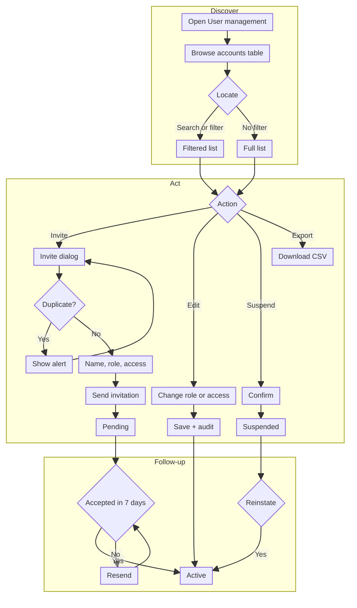

**Actual UI - V1**
![[v1Screenshot 2026-11-13 at 2.11.36 PM.png]]

##### UI-02: **Workspace management**
Create and manage workspaces, their members and enabled data sources.

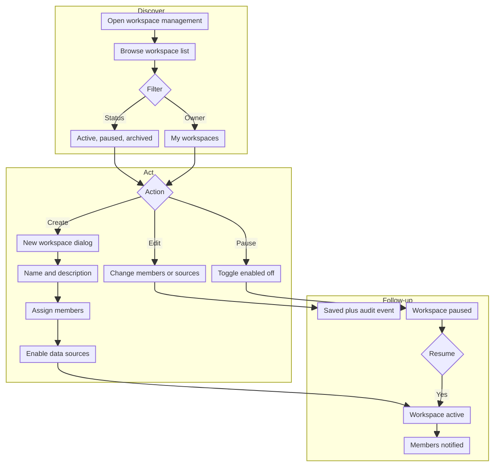
**Inspiration-possibilities:**


**Actual UI - V1**
![[v1Screenshot 2026-11-13 at 2.12.20 PM.png]]

##### UI-03: **Integration settings panel**
Configure external services, providers and sync behaviour for the pipeline.

#op/acc/revisar 

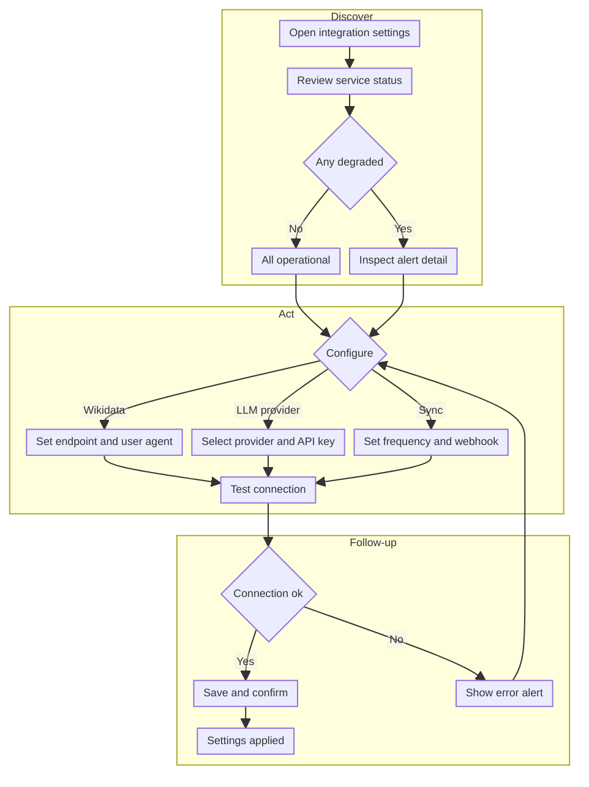
**Inspiration-possibilities:**

##### UI-04: **Governance panel**
Define who can author, correct and publish mappings — and under what authority.

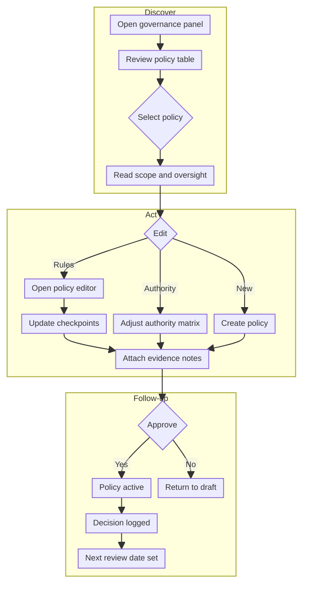
**Inspiration-possibilities:**

##### UI-05: **Data-retention console**
Define how long raw imports, derived data and operational logs are kept across the pipeline.

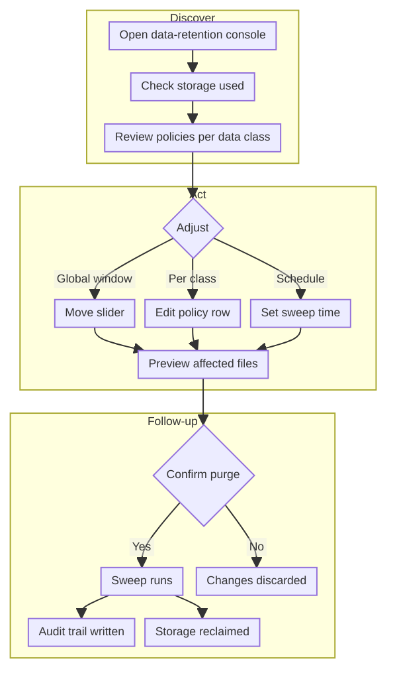

##### UI-06: **Stakeholder registry**
Who participates in the project, at which phase, and with what level of engagement.

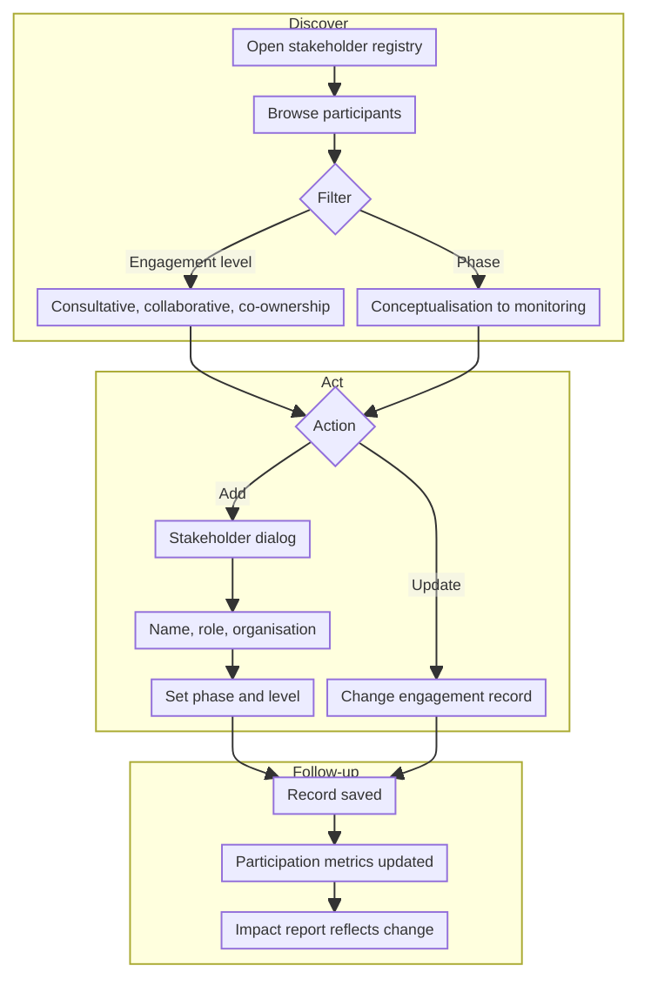

##### UI-07: **Cross-workspace governance dashboard**
Mapping and retrieval regressions, escalations and objections across every workspace.

#op/acc/revisar 

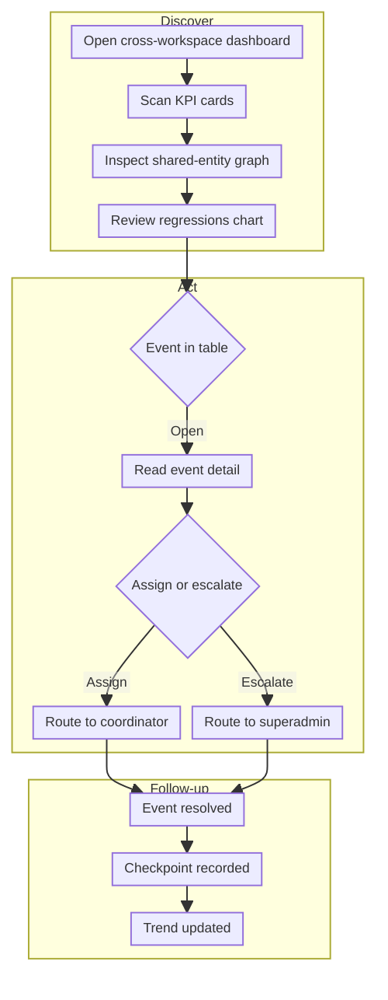

##### UI-08: **Audit logs & session monitor**
Login, mapping and pipeline activity with full traceability and session management.

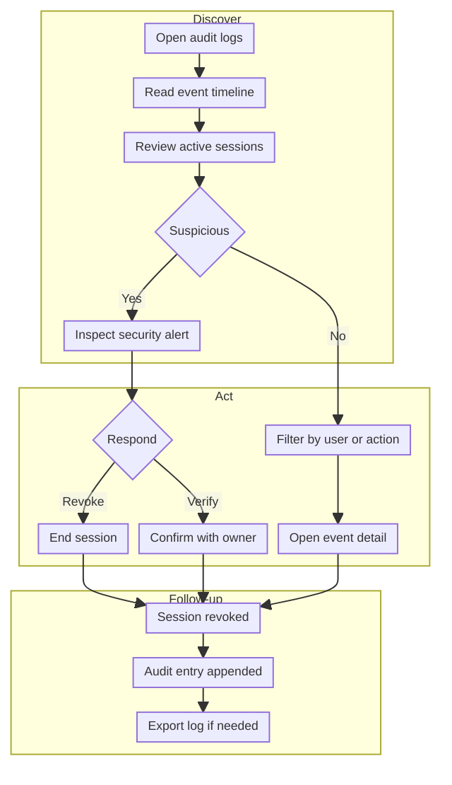


**Actual UI V1**
![[v1Screenshot 2026-11-13 at 2.12.50 PM.png]]

### 13.2 KG pipeline surfaces (coordinator)

| ID        | Surface                                         | Primary user          | Secondary users                     | Journey tasks         | components (named)                                                                                                                                                                                                                                                                                |
| --------- | ----------------------------------------------- | --------------------- | ----------------------------------- | --------------------- | ------------------------------------------------------------------------------------------------------------------------------------------------------------------------------------------------------------------------------------------------------------------------------------------------ |
| **UI-09** | **Source registration** (Fonts)                 | Coordinator           | Superadmin (config)                 | 1.1–1.2               | `Stepper`, `Badge:Barcelona1912`, `TextField:SourceName`, `Select:Type`, `TextField:SourceURL`, `Select:Format`, `Select:PermissionWorkspace`, `Button:RegisterSource`, `Progress:0`, `Alert:SourceRegistered`, `Alert:PossibleDuplicateCensusRawCsvAlreadyExistsInBarcelona1912`, `Badge:Active`, `Button:Close`, `Badge:Expanded`, `Table`, `Badge:Superseded`, `Button:EditSource`, `Button:ReIngest`, `IconButton:Trash`, `Badge:Ingesting`, `Progress:45`, `Button:View`, `Badge:Error`                                                                                                                                                                                                                       |
| **UI-10** | **Ingestion monitor**                           | Coordinator           | Superadmin (monitor)                | 1.4–1.5, M2           | `Badge:Run241`, `Alert:PipelineHealthy`, `Badge:Ingesting`, `Progress:62`, `Badge:Done`, `Progress:100`, `Badge:Queued`, `Progress:0`, `Button:Close`, `Button:RetryRun`, `Button:More`, `DropdownMenu`, `Button:View`, `IconButton:Trash`, `Badge:Failed`, `Alert:1RunFailedInTheLast24h`                                                                                                                                                                                                                               |
| **UI-11** | **Ontology manager — consult / create** (Mapa) | Coordinator | Inquirer (expert: view) | 2.1–2.5 | `Badge:Brigadistas`, `Tabs`, `Table`, `Avatar:A`, `TreeView`, `Badge:Active`, `Button:Close`, `Button:ViewMappings`, `Button:View`, `Badge:NeedsReview`, `Button:OpenGraph`, `Alert:MappingAwareAdjudicationDriftAndCouplingErrorsAreSurfacedHere`, `Switch`, `DropdownMenu`, `Avatar:EG`, `Badge:Q5Inmutable`, `Button:EditClass`, `Avatar:TV`, `Avatar:LF`, `IconButton:PenLine`, `IconButton:Trash`, `Button:EditProperty`, `Button:Restricción`, `Badge:DraftV01`, `SplitButton:Add`, `SplitButton:Edit`, `Button:Validate`, `Button:ReviewOntology`, `Button:ImportExport`, `Button:RunReasoner` |
| **UI-12** | **Mapping editor** (Mapa)                       | Coordinator           | —                                   | 2.2–2.3, 2.7–2.8, C4  | `Badge:Barcelona1912`, `Tabs`, `Select:WorkspaceSelect`, `Select:CSVColumn`, `Combobox:TargetProperty`, `Badge:Direct`, `Progress:98`, `Badge:Active`, `Button:Close`, `Button:Edit`, `Button:Remove`, `Button:EditRule`, `Progress:95`, `Button:View`, `Badge:LLMSuggested`, `Progress:72`, `Badge:Review`, `Progress:61`, `Progress:88`, `Alert:HumanValidationGate`, `Alert:14QTypingSlipsPendingAdjudication`, `Button:Validate`, `Button:Save`, `Button:Adjudicate`                                                                                                                                                                                                                        |
| **UI-13** | **SHACL shapes editor** (Mapa) #op/acc/question | Coordinator           | —                                   | 2.4                   | `Badge:PersonShape`, `Badge:Violation`, `Badge:Active`, `Button:Close`, `Button:ViewValidationReport`, `Button:EditShape`, `Badge:Warning`, `Button:View`, `Button:Edit`, `Badge:Draft`, `Select:FilterSeverity`, `Button:SaveShape`, `Alert:2ShapesFailValidation`                                                                                                                                                                                                                                     |
| **UI-14** | **Competency question registry** (Mapa)         | Coordinator           | Inquirer (expert: contribute, run)  | 2.6, 4.6, S6, E5      | `Button:NewCQ`, `Table`, `Badge:Approved`, `IconButton:Eye`, `IconButton:Edit2`, `IconButton:Share2`, `Badge:NeedsReview`, `Badge:Archived`, `Combobox:TargetClass`, `Select:Property`, `Select:Operator`, `TextField`, `Button:AND`, `Button:OR`, `Badge:0`, `Badge:2`, `Badge:3` — **includes a faceted query builder** (class combobox + property/operator/value facets with AND/OR groups) feeding a generated-SPARQL preview and expected-vs-actual comparison |
| **UI-15** | **Transformation runner** #op/acc/question         | Coordinator           | —                                   | 3.1                   | `Select:Transformer`, `Select:Dataset`, `Button:RunTransformation`, `Button:DryRun`, `Button:More`, `DropdownMenu`, `Progress:35`, `Alert:14RowsSkipped`, `Alert:TransformComplete`                                                                                                                                                                                                                                            |
| **UI-16** | **Staging review** (Inspector)                  | Coordinator, Reviewer | Superadmin (audit)                  | 3.2–3.7               | `Badge:Batch02a`, `Alert:EJReviewStepRequiredBeforeApproval`, `Alert:12Of250TriplesFlagged`, `Progress:78`, `Table`, `Badge:None`, `Progress:94`, `Button:Approve`, `Button:Reject`, `Badge:Drift`, `Progress:71`, `Progress:88`, `Badge:Coupling`, `Progress:64`, `Progress:97`, `Switch`, `Button:ApproveBatch`, `Button:ApproveAndPublish`                                                                                                                                                                                                    |
| **UI-17** | **LLM suggestion panel** (Agents)               | Coordinator           | Superadmin (monitor)                | 5.3, M5               | `Trace:ReasoningPathForWdQ123456WdtP106WdQ11997032`, `Button:RequireHumanGateForNewSuggestions`, `Button:AcceptAndAdd`, `Alert:HypothesesNotHistoryEveryLLMTripleNeedsHumanValidation`, `Table`, `Badge:High`, `Button:Dropdown`, `DropdownMenu`, `Switch`, `Button:Add`, `Button:Review`, `Badge:Med`, `Badge:Low`                                                                                                                                                                                                                            |
| **UI-18** | **Wikidata resolver & alias manager**           | Coordinator           | —                                   | 4.1, 4.5, 5.1–5.2     | `Combobox:ResolveLocalName`, `Button:Accept`, `Badge:MatchScore`, `Progress:92`, `Table`, `Badge:High`, `IconButton:Check`, `Badge:Medium`, `IconButton:Edit2`, `Badge:Ambiguous`, `TextField:NewAlias`, `Button:Add`, `Alert:LocalHSIdentifiersAreValidEvenWithoutAQID`                                                                                                                                                                                                                                             |
| **UI-19** | **Artifact exporter** (Artefactes)              | Coordinator           | Inquirer (expert: consume)          | 6.1–6.5               | `Badge:BundleV3`, `Select:Format`, `Select:Scope`, `Select:Content`, `Progress:0`, `Button:Export`, `Table`, `Badge:Ready`, `Button:Download`, `Badge:Processing`, `Progress:45`, `Badge:Error`, `Alert:FAIRExport`                                                                                                                                                                                                                                    |
| **UI-20** | **Absence registry** (Inspector)                | Coordinator           | Superadmin (taxonomy)               | 4.4, M8               | `Alert:GapClassification`, `Select:AbsenceClassAllClasses`, `Badge:DataAbsent`, `Button:Close`, `Button:LinkCompetencyQuestion`, `Button:ReclassifyGap`, `Button:RegisterGap`, `Badge:NotIngested`, `Button:View`, `Badge:HiddenByPolicy`, `Badge:Uncertain`, `Badge:ArchivalSilence`, `Badge:EthicalRestriction`, `Trace:GapHistoryQ4481`                                                                                                                                                                                                                                     |
| **UI-38** | **Provenance & polyvocality panel**             | Coordinator           | Inquirer (view), Superadmin (audit) | REQ-6.1.1, REQ-11.2.1 | `Table`, `Badge:TwoVoices`, `Badge:Published`, `Badge:SingleVoice`, `Badge:InReview`, `Badge:Queued`, `Trace:RowToPublication`, `Badge:Voice1`, `Badge:Voice2`, `Button:OpenProvenance`, `Button:DualVoiceDiff`, `Alert:PolyvocalityIsADesignRequirementNotAnEdgeCase`                                                                                                                                                                                                                  |
| **UI-39** | **Pipeline observability dashboard**            | Coordinator           | Superadmin                          | REQ-6.4.1, REQ-6.3.3  | `Badge:Healthy`, `LineChart`, `AreaChart`, `Button:Ingestion`, `Button:Transformation`, `Button:Mapping`, `Button:SHACLValidation`, `Button:StagingReview`, `Button:Publication`, `Button:AlertAction`, `Table`, `Badge:Done`, `Badge:InReview`, `Badge:14`, `Badge:Review`, `Badge:12`, `Alert:NoCriticalAlerts`                                                                                                                                                                                                                                      |

#### Surface function

##### UI-09: **Source registration**
Register archival sources and configure their formats, permissions and ingestion parameters.

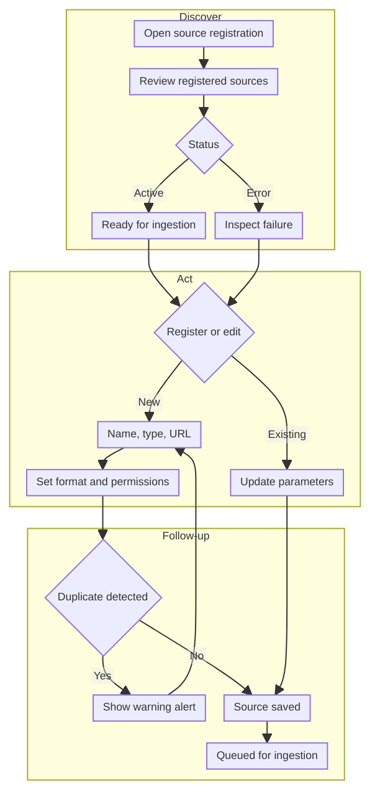

**Actual UI - V1:**


##### UI-10: **Ingestion monitor**
Live status of source ingestion runs across every registered archive.

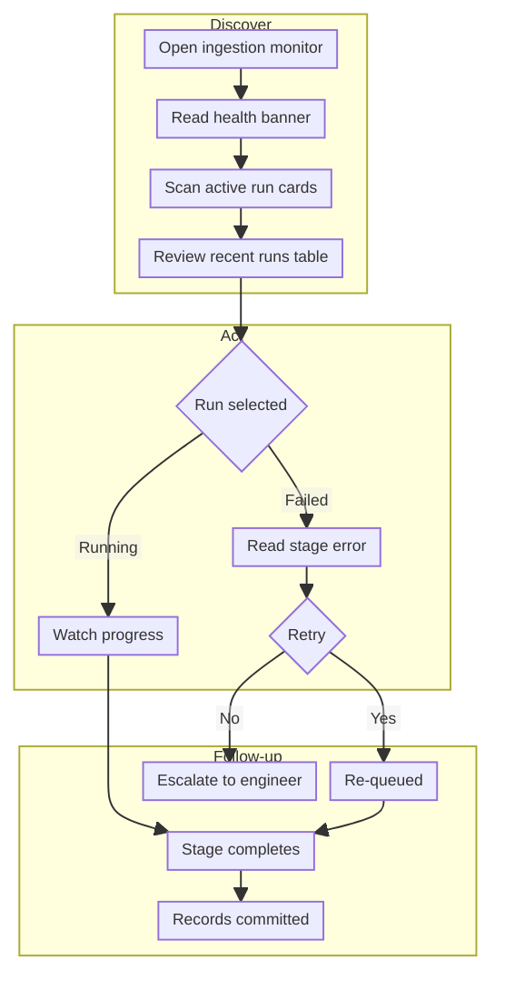

Escalate to coord - Super Admin

**Actual UI - V1:**

![[v1Screenshot 2026-11-13 at 2.21.21 PM.png]]

New run (ingestion)
![[v1Screenshot 2026-11-13 at 2.21.39 PM.png]]

##### UI-11: **Ontology manager**
Consult existing ontologies in depth (UI-11S) or create a new one from an existing base, an upload, or scratch (UI-11C). Classes, properties, relationships and OWL restrictions are shown and edited at their own level.

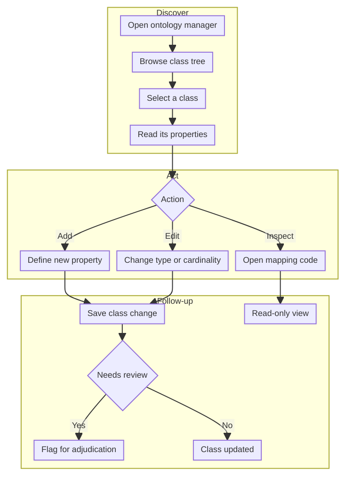
**UI-11 UI: UI-11S and UI-11C**
An ontology is not one flat list. It is **one ontology → many classes → many properties → a relationship graph**, and every level carries its own parameters. Both modes use the same three-level master–detail workspace; only the affordances differ.

| Level | Parameters | Display |
|---|---|---|
| Ontology | IRI/prefix, version, base IRI, license, owner, source, imports, status, counts | header + summary cards + ontology-parameters rail |
| Class | QID, multilingual `rdfs:label` / `rdfs:comment`, `rdfs:subClassOf`, `owl:equivalentClass`, `owl:disjointWith`, `owl:complementOf`, OWL restrictions, provenance | class detail: Overview dashboard + Properties / Relations / Constraints / History tabs |
| Property | label/IRI, datatype, cardinality, domain/range, mapping rules, constraints, usage, provenance | property table **row expansion** |
| Relationship | source class → predicate → target class, domain/range, cardinality, inverse, provenance | graph + edge table |

Rule: class parameters are shown at the **class** level, property parameters at the **property row**. Never flatten all levels into one table.

##### UI-11S: **Consult an existing ontology**
Read-only deep inspection. No Add/Edit/Save; the terminal action is “Use as base”.

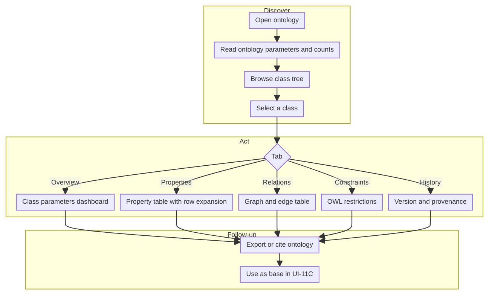

##### UI-11C: **Create a new ontology**
Create from an existing ontology, upload one, or start from scratch. Same workspace in edit mode, plus a draft banner, diff tab, validation panel and publish gate.

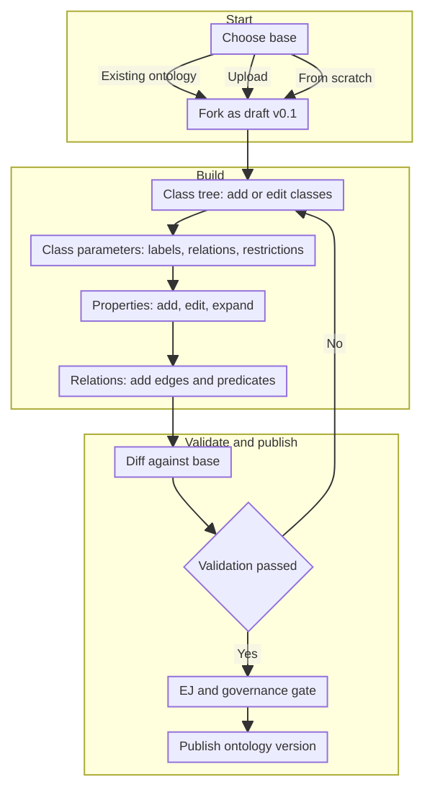

**Shared interaction rules.** Progressive disclosure from ontology to class to property; one class selected at a time; property rows expand in place; relationships use a graph for shape and a table for precision; URL state (`/ontologies/:id/classes/:classId?tab=properties&prop=birth_date`); search across ontology, classes, properties and labels; counts and quality badges (unmapped properties, unlabelled classes, unresolved relations); virtualised lists for large ontologies.

Verify coherence/integrity

**Inspiration- possiblities:**
[[Aura Neo4j.pdf#page=16&rect=1417,-733,2822,6|Aura Neo4j, p.16]]

**


**Actual UI - V1:**
##### UI-12: **Mapping editor**
Map source columns to Wikidata properties

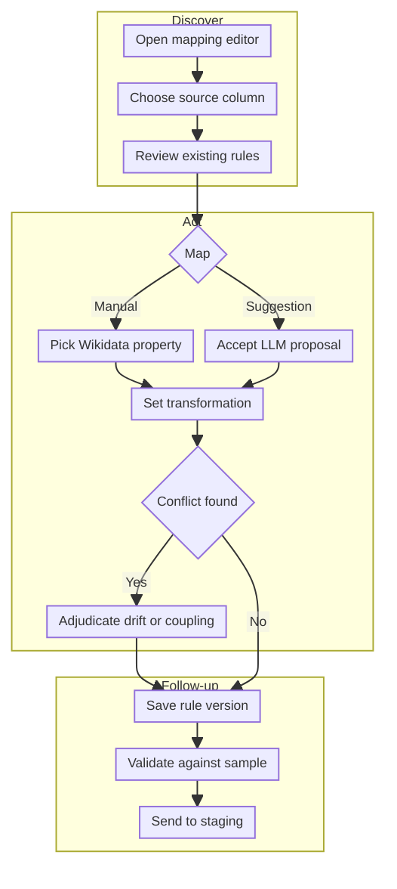

**Actual UI - V1:** Mapping - modelling - validate - Publish 

Mapping info
![[v1Screenshot 2026-11-13 at 2.19.51 PM.png]]

What is a mapping (Connections):
![[v1Screenshot 2026-11-13 at 2.20.01 PM.png]]

New connection/project upload:
![[v1Screenshot 2026-11-13 at 2.20.36 PM.png]]

Mapping
![[v1Screenshot 2026-11-13 at 2.19.00 PM.png]]
![[v1Screenshot 2026-11-13 at 2.19.06 PM.png]]


See Transformations
![[v1Screenshot 2026-11-13 at 2.20.57 PM.png]]

Edit transformations:
![[v1Screenshot 2026-11-13 at 2.21.05 PM.png]]


See Ingestions
![[v1Screenshot 2026-11-13 at 2.49.51 PM.png]]


##### UI-13: **SHACL shapes editor**
Define and validate graph shapes that enforce data constraints before publication.

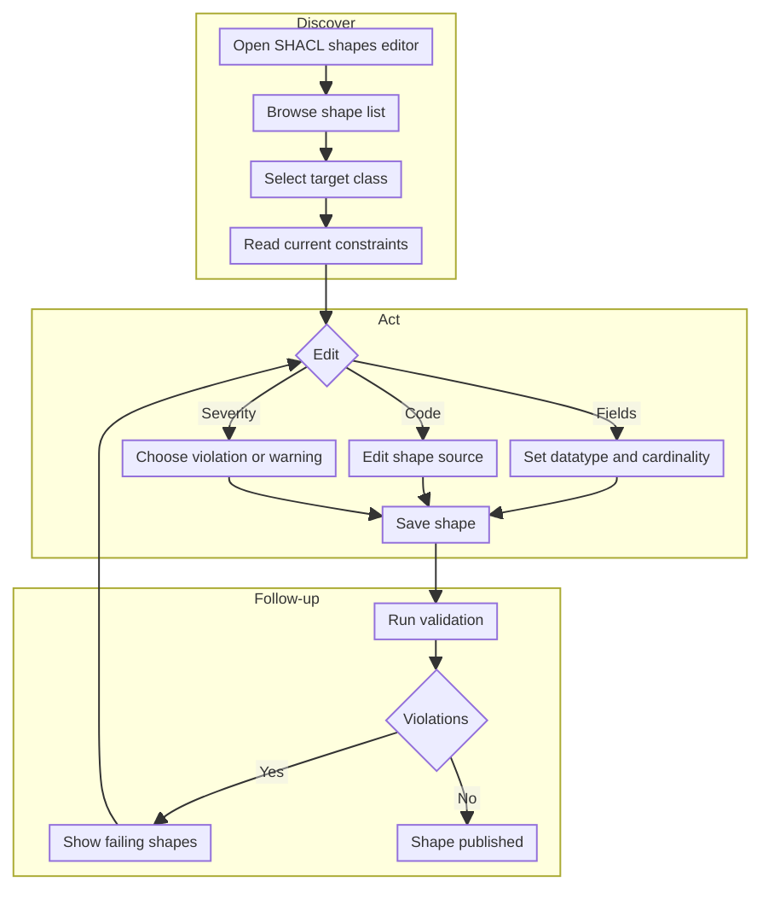

**Actual UI - V1:**
##### UI-14: **Competency question registry**
Register, organise and run competency questions #op/acc/revisar  with a faceted query builder and SPARQL preview.

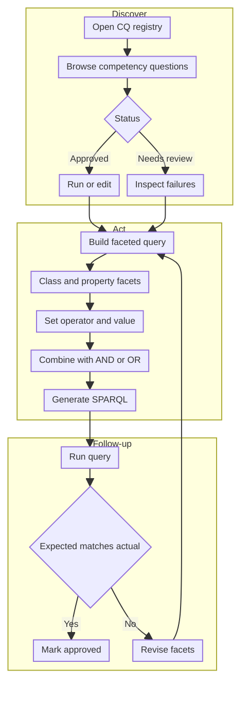

##### UI-15: **Transformation runner**
Convert raw source files into RDF triples using configured transformation rules.

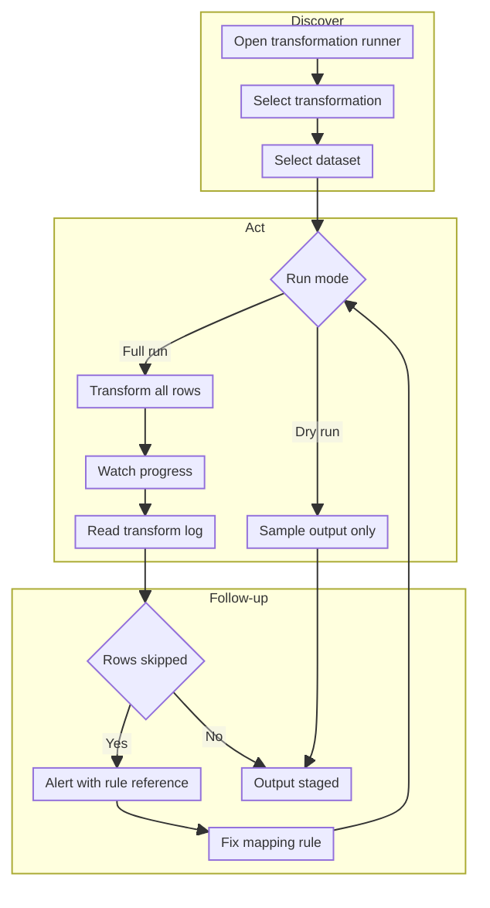


##### UI-16: **Staging review**
Inspect triples staged from the pipeline with EJ checkpoints before they enter the graph.

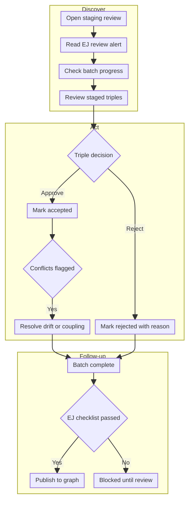

##### UI-17: **LLM suggestion panel**
Review, validate or reject LLM-generated triple suggestions — hypotheses, not history.

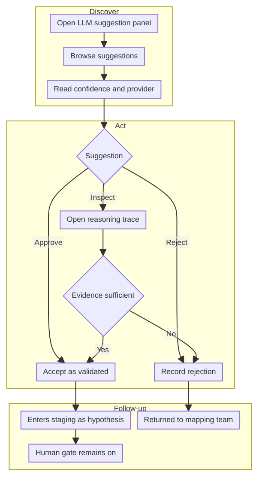

##### UI-18: **Wikidata resolver & alias manager**
Match local names to Wikidata entities and manage known aliases across workspaces.

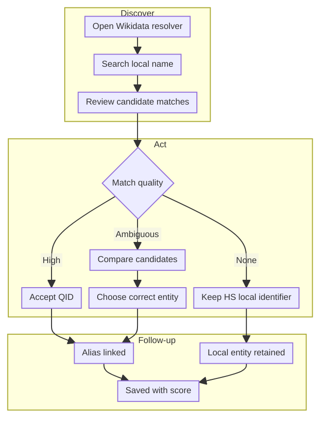

##### UI-19: **Artifact exporter**
Export the graph in FAIR-compliant formats with full provenance and both voices preserved.

```mermaid
%%{init: {"flowchart": {"nodeSpacing": 8, "rankSpacing": 18, "htmlLabels": false, "padding": 4, "curve": "basis"}, "themeVariables": {"fontSize": "9px"}}}%%
flowchart TD
    subgraph Discover[Discover]
        A[Open artifact exporter] --> B[Review recent exports]
        B --> C[Check status and failures]
    end
    subgraph Act[Act]
        C --> D[Choose format]
        D --> E[Choose scope]
        E --> F[Choose content: statements, entities, provenance]
        F --> G[Start export]
        G --> H[Watch progress]
    end
    subgraph FollowUp[Follow-up]
        H --> I{Export ok}
        I -->|Yes| J[Artifact ready to download]
        I -->|No| K[Show error badge]
        K --> D
        J --> L[Provenance and both voices retained]
    end
```

##### UI-20: **Absence registry**
Classify and document data gaps so the graph never implies false non-existence.

```mermaid
%%{init: {"flowchart": {"nodeSpacing": 8, "rankSpacing": 18, "htmlLabels": false, "padding": 4, "curve": "basis"}, "themeVariables": {"fontSize": "9px"}}}%%
flowchart TD
    subgraph Discover[Discover]
        A[Open absence registry] --> B[Browse documented gaps]
        B --> C[Filter by absence class]
    end
    subgraph Act[Act]
        C --> D{Register or update gap}
        D -->|New| E[Select entity and dimension]
        E --> F[Classify absence]
        D -->|Existing| G[Add note or evidence]
        F --> H[Link to competency question]
    end
    subgraph FollowUp[Follow-up]
        H --> I[Gap recorded]
        G --> I
        I --> J[Timeline entry written]
        J --> K[Graph no longer implies non-existence]
    end
```

##### UI-38: **Provenance & polyvocality panel**
Examine every statement's provenance chain and compare conflicting source voices side by side.

```mermaid
%%{init: {"flowchart": {"nodeSpacing": 8, "rankSpacing": 18, "htmlLabels": false, "padding": 4, "curve": "basis"}, "themeVariables": {"fontSize": "9px"}}}%%
flowchart TD
    subgraph Discover[Discover]
        A[Open provenance panel] --> B[Browse KG statements]
        B --> C[Select a statement]
    end
    subgraph Act[Act]
        C --> D[Read provenance chain]
        D --> E[Source row, mapping version, authoriser, date]
        E --> F{Polyvocality}
        F -->|Two voices| G[Compare source A and source B]
        F -->|Single voice| H[Confirm single source]
    end
    subgraph FollowUp[Follow-up]
        G --> I[Disagreement preserved]
        H --> J[Statement kept as is]
        I --> K[Audit trail complete]
        J --> K
    end
```

##### UI-39: **Pipeline observability dashboard**
End-to-end pipeline health, stage volumes, failure rates and trends over time.

```mermaid
%%{init: {"flowchart": {"nodeSpacing": 8, "rankSpacing": 18, "htmlLabels": false, "padding": 4, "curve": "basis"}, "themeVariables": {"fontSize": "9px"}}}%%
flowchart TD
    subgraph Discover[Discover]
        A[Open pipeline observability] --> B[Scan stat cards]
        B --> C[Read volume charts]
        C --> D[Review stage table]
    end
    subgraph Act[Act]
        D --> E{Stage with errors}
        E -->|Yes| F[Inspect stage detail]
        E -->|No| G[Confirm healthy]
        F --> H{Actionable}
        H -->|Yes| I[Assign or retry]
    end
    subgraph FollowUp[Follow-up]
        I --> J[Alert cleared]
        G --> K[No action needed]
        J --> L[Trend updated]
        K --> L
    end
```

### 13.3 Participation & evaluation surfaces (coordinator + superadmin)

| ID | Surface | Primary user | Secondary users | Journey tasks | components (named) |
|----|---------|-------------|-----------------|---------------|-------------------|
| **UI-21** | **Vocabulary review panel** | Coordinator | Superadmin (resolve escalated) | C2, P1 (coord), M7 | `Alert:2CategoriesImposeContestedInterpretiveFrames`, `Combobox:FilterByTermWorkspaceOrFlagReason`, `Button:FlagNewTerm`, `Button:Escalate`, `Table`, `Badge:High`, `Badge:Open`, `Button:Review`, `Badge:Medium`, `Badge:InReview`, `Badge:Escalated`, `Badge:Low`, `Badge:Resolved`, `Trace:ResolutionTimeline` |
| **UI-22** | **Objection management dashboard** | Coordinator | Superadmin (oversee) | C1, P2 (coord), M6 | `Alert:EveryObjectionLinksEntityMappingVersionObjectorResponseAndEvidence`, `Table`, `Badge:Open`, `Button:Respond`, `Badge:AwaitingResponse`, `Badge:Resolved`, `Badge:Dismissed`, `TextField:YourReply`, `Button:SendResponse`, `Button:Reclassify`, `Button:RejectionRationale`, `Trace:ResponseHistory` |
| **UI-23** | **EJ checklist operator** | Coordinator, Coordinator | Superadmin (policy oversight) | 6.6, G5, P5 (coord), E7 | `Badge:FAILS`, `Switch`, `Badge:Passed`, `Progress:83`, `Alert:PublicationBlockedGenderRepresentationCheckFailed`, `Alert:2Of3BatchesPassed`, `Button:ReRunEJCheck`, `Button:Publish` |
| **UI-24** | **Community workshop scheduler** | Coordinator | — | P3 (coord), S5 (coord) | `Calendar`, `TextField:Location`, `TextField:Purpose`, `TextField:Coordinator`, `TextField:Participants`, `TextField:MaxParticipants`, `Button:ScheduleWorkshop`, `Table`, `Badge:Confirmed`, `Button:Edit`, `Badge:Planned`, `Badge:Done`, `Alert:LastWorkshop202610309Participants2CategoriesReviewed` |
| **UI-25** | **Multichannel comparison tool** | Superadmin | Coordinator (results) | E1, E9, M4 | `Alert:InfrastructureVarianceIsValidityEvidenceDivergenceIsDocumentedNotHidden`, `Select:SavedQuery`, `Button:Compare`, `Button:DivergenceReport`, `Table`, `Badge:Match`, `Badge:Truncated`, `Badge:Summarised`, `Badge:Mismatch`, `Alert:XatSummariesMayTruncateSeeREQ382` |
| **UI-26** | **Bias evaluation dashboard** | Superadmin | Coordinator, Inquirer (expert: contribute) | E3, D6, R9 | `Badge:Review`, `BarChart`, `Select:StageFilter`, `Table`, `Button:AssignMitigation`, `Badge:Moderate`, `Badge:Open`, `Badge:Low`, `Badge:Resolved`, `Badge:Critical`, `Badge:InProgress`, `Alert:FairnessMetricsCounterfactualAndSensitivityAnalysesAvailable` |
| **UI-27** | **Participation metrics & impact report** | Superadmin | — | E5, E6, P3 (super) | `BarChart`, `Table`, `Badge:Applied`, `Badge:Cited`, `Badge:FollowUp`, `Progress:72`, `Button:GenerateImpactReport` |

#### Surface function

##### UI-21: **Vocabulary review panel**
Flag, review and resolve contested or sensitive categories with community escalation.

```mermaid
%%{init: {"flowchart": {"nodeSpacing": 8, "rankSpacing": 18, "htmlLabels": false, "padding": 4, "curve": "basis"}, "themeVariables": {"fontSize": "9px"}}}%%
flowchart TD
    subgraph Discover[Discover]
        A[Open vocabulary review] --> B[Browse flagged categories]
        B --> C[Filter by severity or workspace]
    end
    subgraph Act[Act]
        C --> D{Review term}
        D -->|Accept as is| E[Close flag]
        D -->|Contested| F[Escalate to community]
        D -->|Sensitive| G[Propose relabel]
        F --> H[Workshop review]
        H --> I{Consensus}
        I -->|Yes| G
        I -->|No| J[Retain with note]
    end
    subgraph FollowUp[Follow-up]
        G --> K[Term relabelled]
        E --> L[Resolution recorded]
        J --> L
        K --> M[Timeline entry written]
        L --> M
    end
```

##### UI-22: **Objection management dashboard**
Process community corrections and disputed representations with full traceability.

```mermaid
%%{init: {"flowchart": {"nodeSpacing": 8, "rankSpacing": 18, "htmlLabels": false, "padding": 4, "curve": "basis"}, "themeVariables": {"fontSize": "9px"}}}%%
flowchart TD
    subgraph Discover[Discover]
        A[Open objection dashboard] --> B[Browse objections]
        B --> C{Status}
        C -->|Open| D[Needs response]
        C -->|Resolved| E[Read resolution]
    end
    subgraph Act[Act]
        D --> F[Open objection detail]
        F --> G[Read evidence and mapping version]
        G --> H{Decision}
        H -->|Accept| I[Reclassify or correct]
        H -->|Reject| J[Record rationale]
    end
    subgraph FollowUp[Follow-up]
        I --> K[Objector notified]
        J --> K
        K --> L[Trace appended]
        E --> L
    end
```

##### UI-23: **EJ checklist operator**
Verify gender representation, intersectionality, language diversity and provenance before publication.

```mermaid
%%{init: {"flowchart": {"nodeSpacing": 8, "rankSpacing": 18, "htmlLabels": false, "padding": 4, "curve": "basis"}, "themeVariables": {"fontSize": "9px"}}}%%
flowchart TD
    subgraph Discover[Discover]
        A[Open EJ checklist] --> B[Select batch]
        B --> C[Read readiness score]
    end
    subgraph Act[Act]
        C --> D[Verify gender representation]
        D --> E[Check intersectionality coverage]
        E --> F[Confirm language diversity]
        F --> G[Verify community provenance]
        G --> H[Check source diversity]
        H --> I[Classify absences]
    end
    subgraph FollowUp[Follow-up]
        I --> J{All checks passed}
        J -->|Yes| K[Publication unblocked]
        J -->|No| L[Show blocking alert]
        L --> M[Revise batch or evidence]
        M --> D
    end
```

##### UI-24: **Community workshop scheduler**
Plan participatory sessions and manage the community-engagement calendar.

```mermaid
%%{init: {"flowchart": {"nodeSpacing": 8, "rankSpacing": 18, "htmlLabels": false, "padding": 4, "curve": "basis"}, "themeVariables": {"fontSize": "9px"}}}%%
flowchart TD
    subgraph Discover[Discover]
        A[Open workshop scheduler] --> B[Review calendar]
        B --> C[List upcoming workshops]
    end
    subgraph Act[Act]
        C --> D{Schedule}
        D -->|New| E[Pick date]
        E --> F[Set location and capacity]
        D -->|Existing| G[Edit details]
    end
    subgraph FollowUp[Follow-up]
        F --> H[Workshop confirmed]
        G --> H
        H --> I[Participants invited]
        I --> J[Status tracked to done]
    end
```

##### UI-25: **Multichannel comparison tool**
Compare query results across UI, API, SPARQL, Cypher and chat channels — divergence is validity evidence.

```mermaid
%%{init: {"flowchart": {"nodeSpacing": 8, "rankSpacing": 18, "htmlLabels": false, "padding": 4, "curve": "basis"}, "themeVariables": {"fontSize": "9px"}}}%%
flowchart TD
    subgraph Discover[Discover]
        A[Open multichannel comparator] --> B[Select competency question]
        B --> C[Run across channels]
    end
    subgraph Act[Act]
        C --> D[Compare result counts]
        D --> E[Read divergence report]
        E --> F{Divergence class}
        F -->|Match| G[Record agreement]
        F -->|Truncated or summarised| H[Document mediation layer]
        F -->|Mismatch| I[Flag as defect]
    end
    subgraph FollowUp[Follow-up]
        G --> J[Evidence archived]
        H --> J
        I --> J
        J --> K[Validity note attached]
    end
```

##### UI-26: **Bias evaluation dashboard**
Monitor bias metrics across the AI lifecycle: collection, annotation, model design, deployment and monitoring.

```mermaid
%%{init: {"flowchart": {"nodeSpacing": 8, "rankSpacing": 18, "htmlLabels": false, "padding": 4, "curve": "basis"}, "themeVariables": {"fontSize": "9px"}}}%%
flowchart TD
    subgraph Discover[Discover]
        A[Open bias dashboard] --> B[Scan lifecycle scores]
        B --> C[Read score vs baseline chart]
        C --> D[Review findings table]
    end
    subgraph Act[Act]
        D --> E{Stage filter}
        E --> F[Select stage]
        F --> G[Open finding detail]
        G --> H[Assign mitigation]
    end
    subgraph FollowUp[Follow-up]
        H --> I[Metric re-measured]
        I --> J{Within threshold}
        J -->|Yes| K[Finding closed]
        J -->|No| G
    end
```

##### UI-27: **Participation metrics & impact report**
Measure and report participation depth, decisions affected and social impact of community contributions.

```mermaid
%%{init: {"flowchart": {"nodeSpacing": 8, "rankSpacing": 18, "htmlLabels": false, "padding": 4, "curve": "basis"}, "themeVariables": {"fontSize": "9px"}}}%%
flowchart TD
    subgraph Discover[Discover]
        A[Open participation metrics] --> B[Read participant counts]
        B --> C[Review depth chart]
        C --> D[Scan impact register]
    end
    subgraph Act[Act]
        D --> E{Inspect}
        E -->|Contribution| F[Open source workshop or objection]
        E -->|Generate| G[Build impact report]
    end
    subgraph FollowUp[Follow-up]
        F --> H[Link to KG change]
        G --> I[Report exported]
        H --> I
        I --> J[Social impact evidenced]
    end
```

### 13.4 Exploration surfaces (inquirer)

| ID | Surface | Primary user | Secondary users | Journey tasks | components (named) |
|----|---------|-------------|-----------------|---------------|-------------------|
| **UI-28** | **Graph explorer** (Graf) | Inquirer (all levels) | Coordinator (browse, EJ) | N3–N4, F8, E2–E3, C1 | `Combobox:SearchPersonsPlacesSources`, `Select:EntityType`, `Button:Clear`, `Button:OpenSearch`, `Button:RaiseObjection`, `Button:LlinatgePanel`, `NetworkGraph`, `GraphToolbar`, `Badge:Person`, `Table`, `Alert:MissingValue`, `Alert:TwoSourcesDisagreeOnOccupation` |
| **UI-29** | **Visual query builder** (Consultar) | Inquirer (familiarized) | — | F1–F4, F6 | `Combobox:Class`, `Button:AddCondition`, `Select:Property`, `Select:Operator`, `TextField`, `Button:AND`, `Button:OR`, `Button:RunQuery`, `Button:More`, `DropdownMenu`, `Table`, `Badge:High`, `Badge:Medium`, `Alert:FiltersPivotAcrossProvenancePeriodAndClass` |
| **UI-30** | **SPARQL editor** (Consultar) | Inquirer (expert) | Coordinator (CQs) | E1, E5, E8–E9 | `Button:Run`, `Button:SaveQuery`, `Table`, `Badge:Match`, `Button:CompareWithUIQuery`, `Alert:ResultsMayDivergeFromUIAPIChannelsDivergenceIsDocumented`, `Kbd` |
| **UI-31** | **NL chat** (Xat) | Inquirer (novice, familiarized) | — | N1–N2, F7 | `Bubble`, `Trace:GroundingSourcesUsed`, `TextField`, `Button:Send`, `Button:SourceCitation`, `Button:FirstSteps`, `Alert:Info` |
| **UI-32** | **Collection browser** (Acervo) | Inquirer (familiarized) | — | F5 | `Breadcrumbs`, `Combobox:SearchCollections`, `Button:Cards`, `Button:List`, `Badge:2418Records`, `Badge:2Gaps`, `Button:Open`, `Badge:1126Records`, `Badge:340Records`, `Badge:Polyvocal`, `Badge:875Records`, `Badge:1540Records`, `Badge:312Records`, `Pagination` |
| **UI-33** | **Document corpus** (Documents) | Inquirer (novice, familiarized) | Coordinator (upload) | N5, 1.3 | `Breadcrumbs`, `TextField`, `Button:UploadDocument`, `Table`, `Badge:Census`, `Badge:Indexed`, `Button:Open`, `Badge:Letter`, `Badge:Processing`, `Progress:45`, `Badge:Press`, `Badge:Register`, `Progress:72`, `Badge:PendingOCR`, `Alert:Info` |
| **UI-34** | **Map view** (Mapa) | Inquirer (novice, familiarized) | — | N6 | `Breadcrumbs`, `Select:SelectRegion`, `Map`, `MapMarker:ElRaval`, `MapMarker:ElBorn`, `MapMarker`, `MapMarker:Gràcia`, `Badge:Place`, `Table`, `Alert:RelatedPlacesElBornSantPere`, `Button:ExploreRelated` |
| **UI-40** | **Personalisation & adaptation settings** | Inquirer (all levels) | — | REQ-7.7.1 | `Select:SelectLanguage`, `Select:SelectTheme`, `Slider`, `Select:SelectCount`, `Switch`, `Button:ClearHistory`, `Table`, `Button:Eye`, `Button:SavePreferences`, `Alert:PreferencesSaved` |

#### Surface function

##### UI-28: **Graph explorer**
Explore entities, their relationships and provenance through an interactive knowledge-graph visualisation.

```mermaid
%%{init: {"flowchart": {"nodeSpacing": 8, "rankSpacing": 18, "htmlLabels": false, "padding": 4, "curve": "basis"}, "themeVariables": {"fontSize": "9px"}}}%%
flowchart TD
    subgraph Discover[Discover]
        A[Open graph explorer] --> B[Search person, place or source]
        B --> C[View network overview]
    end
    subgraph Act[Act]
        C --> D{Zoom or select}
        D -->|Node| E[Open entity detail]
        D -->|Filter| F[Apply facet]
        E --> G[Read properties and records]
    end
    subgraph FollowUp[Follow-up]
        G --> H{Data quality}
        H -->|Gap| I[Show missing-value note]
        H -->|Conflict| J[Show both voices]
        F --> C
        I --> K[Explore related entity]
        J --> K
    end
```

##### UI-29: **Visual query builder**
Filter by provenance, period and class without writing SPARQL — generated query shown for transparency.

```mermaid
%%{init: {"flowchart": {"nodeSpacing": 8, "rankSpacing": 18, "htmlLabels": false, "padding": 4, "curve": "basis"}, "themeVariables": {"fontSize": "9px"}}}%%
flowchart TD
    subgraph Discover[Discover]
        A[Open visual query builder] --> B[Choose class]
        B --> C[Add facet condition]
    end
    subgraph Act[Act]
        C --> D[Set property, operator, value]
        D --> E{More facets}
        E -->|Yes| F[Combine with AND or OR]
        F --> C
        E -->|No| G[Preview generated SPARQL]
    end
    subgraph FollowUp[Follow-up]
        G --> H[Run query]
        H --> I[Review result table]
        I --> J{Refine}
        J -->|Yes| C
        J -->|No| K[Export or save]
    end
```

##### UI-30: **SPARQL editor**
Direct SPARQL access with full divergence documentation across retrieval channels.

```mermaid
%%{init: {"flowchart": {"nodeSpacing": 8, "rankSpacing": 18, "htmlLabels": false, "padding": 4, "curve": "basis"}, "themeVariables": {"fontSize": "9px"}}}%%
flowchart TD
    subgraph Discover[Discover]
        A[Open SPARQL editor] --> B[Write or paste query]
        B --> C[Run query]
    end
    subgraph Act[Act]
        C --> D[Read result table]
        D --> E[Compare with UI channel]
        E --> F{Divergence}
        F -->|Yes| G[Document mediation layer]
        F -->|No| H[Confirm agreement]
    end
    subgraph FollowUp[Follow-up]
        G --> I[Divergence report saved]
        H --> I
        I --> J[Query reusable for CQ]
    end
```

##### UI-31: **NL chat**
Ask the archive in plain language — grounded answers with citations, source traces and hypothesis labels.

```mermaid
%%{init: {"flowchart": {"nodeSpacing": 8, "rankSpacing": 18, "htmlLabels": false, "padding": 4, "curve": "basis"}, "themeVariables": {"fontSize": "9px"}}}%%
flowchart TD
    subgraph Discover[Discover]
        A[Open NL chat] --> B[Type a question]
        B --> C[Read answer]
    end
    subgraph Act[Act]
        C --> D{Citations}
        D -->|Inspect| E[Open source records]
        D -->|Trace| F[Expand grounding steps]
        E --> G{Answer sufficient}
        F --> G
    end
    subgraph FollowUp[Follow-up]
        G -->|Yes| H[Continue with follow-up]
        G -->|No| I[Rephrase question]
        I --> B
        H --> J[Sources remain labelled]
    end
```

##### UI-32: **Collection browser**
Browse the full inventory of registered collections with search, filtering and polyvocality indicators.

```mermaid
%%{init: {"flowchart": {"nodeSpacing": 8, "rankSpacing": 18, "htmlLabels": false, "padding": 4, "curve": "basis"}, "themeVariables": {"fontSize": "9px"}}}%%
flowchart TD
    subgraph Discover[Discover]
        A[Open collection browser] --> B[Search collections]
        B --> C[Browse collection cards]
    end
    subgraph Act[Act]
        C --> D{Open collection}
        D --> E[Read scope and record count]
        E --> F{View}
        F -->|Cards| G[Scan items]
        F -->|List| H[Sort and compare]
    end
    subgraph FollowUp[Follow-up]
        G --> I[Open a record]
        H --> I
        I --> J[Paginate through results]
    end
```

##### UI-33: **Document corpus**
Full-text search across indexed source documents with provenance and processing status.

```mermaid
%%{init: {"flowchart": {"nodeSpacing": 8, "rankSpacing": 18, "htmlLabels": false, "padding": 4, "curve": "basis"}, "themeVariables": {"fontSize": "9px"}}}%%
flowchart TD
    subgraph Discover[Discover]
        A[Open document corpus] --> B[Search documents]
        B --> C[Browse results table]
    end
    subgraph Act[Act]
        C --> D{Document status}
        D -->|Indexed| E[Open and read]
        D -->|Processing| F[Wait or check progress]
        D -->|Pending OCR| G[Queue OCR]
    end
    subgraph FollowUp[Follow-up]
        E --> H[Cite in research]
        F --> C
        G --> C
        H --> I[Provenance recorded]
    end
```

##### UI-34: **Map view**
Spatial overview of historical records with semantic zoom and place-level detail.

```mermaid
%%{init: {"flowchart": {"nodeSpacing": 8, "rankSpacing": 18, "htmlLabels": false, "padding": 4, "curve": "basis"}, "themeVariables": {"fontSize": "9px"}}}%%
flowchart TD
    subgraph Discover[Discover]
        A[Open map view] --> B[Choose region]
        B --> C[View place markers]
    end
    subgraph Act[Act]
        C --> D{Select place}
        D --> E[Read place detail]
        E --> F[Review records and period]
        F --> G{Zoom}
    end
    subgraph FollowUp[Follow-up]
        G -->|In| H[Semantic zoom to entities]
        G -->|Out| I[Cluster view]
        H --> J[Explore related places]
        I --> J
    end
```

##### UI-40: **Personalisation & adaptation settings**
Adapt the system to how you work — language, theme, query defaults and suggestion preferences.

```mermaid
%%{init: {"flowchart": {"nodeSpacing": 8, "rankSpacing": 18, "htmlLabels": false, "padding": 4, "curve": "basis"}, "themeVariables": {"fontSize": "9px"}}}%%
flowchart TD
    subgraph Discover[Discover]
        A[Open personalisation settings] --> B[Review current preferences]
        B --> C[Check adaptation toggles]
    end
    subgraph Act[Act]
        C --> D{Change}
        D -->|Language or theme| E[Select option]
        D -->|Query defaults| F[Adjust depth or page size]
        D -->|Suggestions| G[Toggle personalisation]
    end
    subgraph FollowUp[Follow-up]
        E --> H[Save preferences]
        F --> H
        G --> H
        H --> I[Confirmation shown]
        I --> J[Defaults applied next session]
    end
```

### 13.5 Help & communication surfaces (all users)

| ID        | Surface                         | Primary user                                          | Secondary users | Journey tasks  | components (named)                                                      |
| --------- | ------------------------------- | ----------------------------------------------------- | --------------- | -------------- | ---------------------------------------------------------------------- |
| **UI-35** | **Help & documentation system** | All users | — | H1–H6, H9, H12 | `Alert:NewTheEJGateExplainedReadThe5MinuteGuide`, `Combobox:SearchHelpArticles`, `Button:GettingStarted`, `Button:RolesAndPermissions`, `Button:TheKGPipeline`, `Button:Glossary`, `Button:ContactSupport`, `Button:FAQ`, `Button:VideoIndex`, `Button:Changelog`, `Button:KeyboardShortcuts`, `Accordion` |
| **UI-36** | **Bug & feature request form** | All users | — | H11 | `Select:Type`, `TextField:Title`, `TextArea:Description`, `Select:WorkspaceAffected`, `Switch`, `Button:Submit`, `Button:Cancel`, `Alert:SubmittedAsTicketT4821` |
| **UI-37** | **General operation shell** | All users (Superadmin, Coordinator, Inquirer) | — | Cross-journey | `WorkspaceSelector`, `LanguageSelector`, `IconButton:HelpCircle`, `IconButton:Moon`, `Badge:Superadmin`, `Avatar:EG`, `Alert:LongPathsCollapseFromTheMiddle`, `Select:Language`, `Select:PreferredLabels`, `IconButton:Sun`, `Breadcrumbs`, `SidebarWithSections`, `Button:Apply`, `Badge:Active`, `Badge:CoordinatorEG`, `Badge:CoordinatorJM`, `Badge:Review`, `Badge:CoordinatorIV`, `Badge:Archived`, `Badge:CoordinatorML`, `Badge:2StillToComply`, `Badge:Complete`, `Badge:InProgress`, `Badge:NeedsReview`, `Badge:NotStarted`, `Badge:2Accomplished`, `Button:OpenWorkspace`, `Button:ReviewAuthorityMatrix`, `Button:NewPolicy`, `Button:ExportAudit`, `Badge:Coordinator`, `Badge:5`, `Badge:1`, `Badge:CuradorDeDatos`, `Badge:Ontólogo`, `Badge:Revisor`, `Badge:Asistente`, `Badge:4StillToComply`, `Badge:Pending`, `Button:DelegateTask`, `Table`, `Badge:OnTrack`, `Badge:OntologyReview`, `Badge:2PendingApprovals`, `Badge:Passed`, `Badge:Blocked`, `Button:ReviewOutputs`, `Button:OpenQualityGates`, `Alert:PublicationIsBlockedUntilTheRevisorApproves`, `ContextMenu`, `Badge:G`, `Badge:C`, `Badge:D`, `Badge:2Accomplishes`, `Badge:4PendingProcesses`, `Badge:Collaborator`, `Badge:ReadOnly`, `Button:OpenIngestionMonitor`, `Button:RunTransformation`, `Button:ReviewStaging`, `Alert:12TriplesNeedAdjudicationBeforePublication`, `Badge:Inquirer`, `TextField:AskOrSearch`, `Button:Search`, `Button:ChangeLevel` |


#### Surface function

##### UI-35: **Help & documentation system**
Guides, glossary, keyboard shortcuts and role-specific documentation for every user.

```mermaid
%%{init: {"flowchart": {"nodeSpacing": 8, "rankSpacing": 18, "htmlLabels": false, "padding": 4, "curve": "basis"}, "themeVariables": {"fontSize": "9px"}}}%%
flowchart TD
    subgraph Discover[Discover]
        A[Open help] --> B[Search articles]
        B --> C[Browse guide cards]
    end
    subgraph Act[Act]
        C --> D{Need}
        D -->|Learn| E[Open getting started]
        D -->|Role| F[Read permissions guide]
        D -->|Concept| G[Consult glossary]
        D -->|Stuck| H[Read FAQ]
    end
    subgraph FollowUp[Follow-up]
        E --> I[Apply in workflow]
        F --> I
        G --> I
        H --> I
        I --> J{Resolved}
        J -->|No| K[Contact support]
    end
```

**Inspiration-possibilities**

![[Aura Neo4j.pdf#page=16&rect=1417,-733,2822,6|Aura Neo4j, p.16]]

##### UI-36: **Bug & feature request form**
Report problems or propose improvements with optional context and notification.

```mermaid
%%{init: {"flowchart": {"nodeSpacing": 8, "rankSpacing": 18, "htmlLabels": false, "padding": 4, "curve": "basis"}, "themeVariables": {"fontSize": "9px"}}}%%
flowchart TD
    subgraph Discover[Discover]
        A[Open request form] --> B[Choose request type]
        B --> C[Bug, feature or question]
    end
    subgraph Act[Act]
        C --> D[Write title and description]
        D --> E[Select affected workspace]
        E --> F[Attach context if useful]
        F --> G[Submit]
    end
    subgraph FollowUp[Follow-up]
        G --> H[Ticket created]
        H --> I[Confirmation shown]
        I --> J[Notify on status change]
    end
```

### 13.6 Operations shell (all roles)

##### UI-37: **General operation shell**
Persistent chrome around every surface: a role-aware top bar, breadcrumbs, and a lateral menu grouped by the design drivers in §14. Designed once per role-mode — UI-37.5 Superadmin, UI-37.6.1 Coordinator working alone, UI-37.6.2 Coordinator leading a team, UI-37.7 Inquirer — with UI-37.1–37.4 supplying the header/navigation, footer, breadcrumb and language-picker patterns.

```mermaid
%%{init: {"flowchart": {"nodeSpacing": 8, "rankSpacing": 18, "htmlLabels": false, "padding": 4, "curve": "basis"}, "themeVariables": {"fontSize": "9px"}}}%%
flowchart TD
    subgraph Discover[Discover]
        A[Open any surface] --> B[Top bar shows role and workspace]
        B --> C[Breadcrumbs show location]
        C --> D[Lateral menu shows permitted groups]
    end
    subgraph Act[Act]
        D --> E{General config}
        E -->|UI language| F[Switch interface language]
        E -->|Label language| G[Switch entity labels]
        E -->|UI mode| H[Toggle light or dark]
        E -->|Help| I[Open help]
        D --> J{Choose group}
        J -->|Governance| K[Admin surfaces]
        J -->|Participation| L[Review surfaces]
        J -->|Provenance| M[Provenance surfaces]
        J -->|Ingestion| N[Pipeline surfaces]
        J -->|Explainability| O[Explanation surfaces]
        J -->|Exploration| P[Graph surfaces]
    end
    subgraph FollowUp[Follow-up]
        F --> Q[Preference persists]
        G --> Q
        H --> Q
        I --> R[Return to current surface]
        K --> S[Breadcrumb updates]
        L --> S
        M --> S
        N --> S
        O --> S
        P --> S
        S --> T[Workspace switch keeps context]
    end
```

**Top bar (all roles).** Left: product mark and current workspace. Right: UI language, label language, UI mode (light / dark), user name, role badge, general help (opens UI-35). Breadcrumbs sit directly under the bar. Language and UI mode are exposed in the bar itself, never buried in a submenu (REQ-1.1.6, REQ-1.1.7). The two language controls are deliberately separate: UI language switches the interface; label language switches Wikidata labels and entity names (REQ-3.3.2) #op/acc/revisar .

**Lateral menu.** Six groups ordered by the §14 design drivers. Each role sees the groups it can act on; a disabled group stays visible with a lock reason instead of disappearing (REQ-1.1.6, REQ-7.6.1, REQ-7.7.1).

| Group | Driver | Superadmin | Coord. alone | Coord. team | Inquirer |
|---|---|---|---|---|---|
| Governance & administration | M1, M2, M9, M10 | full | policy read | policy read | — |
| Participation, trust & epistemic justice | M7–M8, M11 | full | full | full | personalisation only |
| Provenance & observability | M6 | full | full | full | read-only trace |
| Ingestion & mapping | M4 | read-only | full | full + delegation | — |
| Explainability & transparency | M5 | read-only | full | full | read-only |
| KG exploration & historical data | M3 | read-only | full | full | full |
| Team & quality gates | shell affordance | — | — | full | — |

**Workspace gallery (UI-37.5, UI-37.6.1, UI-37.6.2).** Below the process stepper, each operations shell shows the workspaces the user can act on as a gallery of cards — one card per workspace with its owner, dataset and triple counts and current pipeline stage. Selecting a card expands the six general processes with a completion badge per process (Complete, In progress, Needs review, Pending, Not started) and the specialist who owns it, so the coordinator sees at a glance what the workspace has already accomplished and what it still has to comply with. A filter row scopes the gallery by **user role, workspace and advance stage**. The coordinator-with-team variant also lists the roles attached to each workspace — curador de datos, curador ontólogo, revisor, asistente — and the team size (2–8 members).

**Actual UI - V1**
![[v1Screenshot 2026-11-13 at 2.09.47 PM.png]]

![[v1Screenshot 2026-11-13 at 2.05.07 PM.png]]


###### UI-37.5: **Superadmin shell**
All six groups visible, governance first; administrative authority is never more than two clicks away.

**Gallery.** Five workspaces, filterable by user, workspace and advance. The expansion shows the superadmin's four-step sequence (source registration → ingestion → validation → mapping) with a completion badge and the owner of each step, plus each workspace's user count, last audit date and current stage.

![[UI-37.5 with workspace gallery.png]]

```mermaid
%%{init: {"flowchart": {"nodeSpacing": 8, "rankSpacing": 18, "htmlLabels": false, "padding": 4, "curve": "basis"}, "themeVariables": {"fontSize": "9px"}}}%%
flowchart TD
    subgraph Shell[Shell]
        A[Sign in] --> B[Top bar: role Superadmin]
        B --> C[Lateral menu: six groups]
        C --> D[Default: Governance and administration]
    end
    subgraph Config[General config]
        D --> E{Top-bar action}
        E -->|UI language| F[Switch interface]
        E -->|Label language| G[Switch entity labels]
        E -->|UI mode| H[Light or dark]
        E -->|Help| I[Open UI-35]
    end
    subgraph Navigate[Navigate]
        F --> J[Breadcrumb updates]
        G --> J
        H --> J
        I --> J
        J --> K[Switch workspace]
        K --> C
    end
```

###### UI-37.6.1: **Coordinator shell — researcher working alone**
Pipeline first, with explainability and provenance next to the work they explain. The coordinator authors, reviews their own output, and passes the same quality gates alone (REQ-4.5.1, REQ-5.4.1).

**Gallery.** Three workspaces, filterable by user, workspace and advance. The expansion shows the six general processes with completion badges and, per process, what the workspace has already achieved and what remains; the card carries the owner, dataset and triple counts and the stage.


```mermaid
%%{init: {"flowchart": {"nodeSpacing": 8, "rankSpacing": 18, "htmlLabels": false, "padding": 4, "curve": "basis"}, "themeVariables": {"fontSize": "9px"}}}%%
flowchart TD
    subgraph Shell[Shell]
        A[Sign in] --> B[Top bar: Coordinator]
        B --> C[Lateral menu: pipeline first]
        C --> D[Default: Ingestion and mapping]
    end
    subgraph Work[Work alone]
        D --> E[Register source and run ingestion]
        E --> F[Author mapping and stage]
        F --> G[Check own output against sources]
        G --> H[Run EJ checklist]
    end
    subgraph Gate[Quality gate]
        H --> I{Self-check passed}
        I -->|No| F
        I -->|Yes| J[Publish to graph]
        J --> K[Breadcrumb reflects batch]
    end
```

###### UI-37.6.2: **Coordinator shell — leading a team**
Team and quality gates first. The coordinator delegates technical tasks to specialised roles, reviews their outputs, and owns the gates; the same six design-driver groups stay available below (REQ-7.6.1, REQ-10.4.1–10.4.2).

Specialised roles: **curador de datos** (data curation and source hygiene), **curador ontólogo** (class, property and mapping curation), **revisor** (approval and EJ review) and **asistente** (support for curation and review queues) — 2–8 people per workspace. The **investigador** role remains for research-facing work (competency questions, impact narratives).

**Gallery.** Three workspaces; each card lists the specialised roles attached (2–8 members) and the filter includes **user role**, so the coordinator can isolate, for example, every workspace waiting on a revisor. The expansion assigns each of the six general processes to its role owner.


```mermaid
%%{init: {"flowchart": {"nodeSpacing": 8, "rankSpacing": 18, "htmlLabels": false, "padding": 4, "curve": "basis"}, "themeVariables": {"fontSize": "9px"}}}%%
flowchart TD
    subgraph Shell[Shell]
        A[Sign in] --> B[Top bar: Coordinator, team mode]
        B --> C[Lateral menu: team and quality gates first]
        C --> D[Default: Team and quality gates]
    end
    subgraph Delegate[Delegate]
        D --> E{Assign work}
        E -->|Data curation| F[Curador de datos]
        E -->|Ontology curation| G[Curador ontólogo]
        E -->|Review| H[Revisor]
        E -->|Research| I[Investigador]
    end
    subgraph Review[Review and gate]
        F --> J[Review outputs]
        G --> J
        H --> J
        I --> J
        J --> K{Quality gate}
        K -->|Pass| L[Approve and publish]
        K -->|Fail| M[Return with reason]
        M --> E
    end
```

###### UI-37.7: **Inquirer shell**
Exploration first, with three experience levels and personalisation at the edge.

```mermaid
%%{init: {"flowchart": {"nodeSpacing": 8, "rankSpacing": 18, "htmlLabels": false, "padding": 4, "curve": "basis"}, "themeVariables": {"fontSize": "9px"}}}%%
flowchart TD
    subgraph Shell[Shell]
        A[Sign in] --> B[Top bar: role Inquirer]
        B --> C[Lateral menu: exploration first]
        C --> D[Default: KG exploration]
    end
    subgraph Level[Experience level]
        D --> E{Novice}
        D --> F{Familiarized}
        D --> G{Expert}
        E --> H[Guided search and first steps]
        F --> I[Visual query and collections]
        G --> J[SPARQL and exports]
    end
    subgraph Support[Support]
        H --> K[Help and glossary]
        I --> K
        J --> K
        K --> L[Personalisation: language, defaults]
        L --> M[Breadcrumb keeps context]
    end
```

---

# Design requirements → UI mapping

> Primary design drivers per UI. All interfaces inherit **M1.1** (Nielsen's 10 heuristics) and **M1.3** (ISO 9241-11) as baseline. UIs are grouped by the requirement cluster that most strongly drives their design.

### M4 — Ingestion & mapping (UI-09 to UI-13)

| UI | Primary requirements | Secondary requirements |
|----|---------------------|----------------------|
| UI-09 Source registration | **REQ-4.1.1**, **REQ-4.4.1**, **REQ-2.1.1** | REQ-1.1.1, REQ-1.1.5, REQ-4.3.1 |
| UI-10 Ingestion monitor | **REQ-1.1.1**, **REQ-1.2.4**, **REQ-4.4.1** | REQ-1.2.1, REQ-4.3.1 |
| UI-11 Ontology manager | **REQ-4.1.1**, **REQ-3.5.1** | REQ-2.1.1, REQ-4.5.1 |
| UI-11S Ontology consult | **REQ-4.1.1**, **REQ-3.5.1**, **REQ-2.1.3** | REQ-2.1.1, REQ-2.1.2, REQ-4.5.1 |
| UI-11C Ontology create | **REQ-4.1.2**, **REQ-5.4.1**, **REQ-10.4.1–10.4.2** | REQ-1.1.5, REQ-4.5.2, REQ-11.2.7 |
| UI-12 Mapping editor | **REQ-4.1.1**, **REQ-4.1.2**, **REQ-1.4.1**, **REQ-1.4.2**, **REQ-4.5.1** | REQ-1.4.3, REQ-2.1.2, REQ-3.5.1, REQ-4.5.2, REQ-5.4.2 |
| UI-13 SHACL shapes editor | **REQ-4.1.2**, **REQ-1.4.3** | REQ-2.1.2, REQ-4.3.1 |

### M3 — KG exploration & historical-data access (UI-28 to UI-34)

| UI | Primary requirements | Secondary requirements |
|----|---------------------|----------------------|
| UI-28 Graph explorer | **REQ-3.1.1** (7 tasks), **REQ-3.3.1**, **REQ-3.7.1**, **REQ-3.4.1**, **REQ-6.1.1** | REQ-3.1.2, REQ-3.7.2, REQ-6.1.2, REQ-5.6.1 |
| UI-29 Visual query builder | **REQ-3.2.1**, **REQ-3.3.1**, **REQ-3.1.1** | REQ-2.4.1, REQ-3.5.1 |
| UI-30 SPARQL editor | **REQ-3.8.1**, **REQ-1.1.7** | REQ-3.5.1, REQ-3.8.2 |
| UI-31 NL chat | **REQ-3.3.1**, **REQ-5.2.1**, **REQ-5.3.1** | REQ-5.1.1, REQ-5.1.2, REQ-5.6.1 |
| UI-32 Collection browser | **REQ-3.1.1**, **REQ-3.3.1** | REQ-2.1.1, REQ-2.4.2 |
| UI-33 Document corpus | **REQ-3.3.1**, **REQ-2.1.1** | REQ-1.1.1, REQ-2.1.2 |
| UI-34 Map view | **REQ-3.7.1**, **REQ-3.7.2** | REQ-3.1.1 |

### M5 — Explainability & transparency (UI-14, UI-16, UI-17, UI-25)

| UI | Primary requirements | Secondary requirements |
|----|---------------------|----------------------|
| UI-14 CQ registry | **REQ-5.3.1**, **REQ-5.3.2** | REQ-5.6.1, REQ-VAL-4 |
| UI-16 Staging review | **REQ-4.5.1**, **REQ-5.4.1**, **REQ-6.4.1**, **REQ-1.2.1** | REQ-5.6.1, REQ-6.3.1, REQ-6.5.1 |
| UI-17 LLM suggestion panel | **REQ-5.1.1**, **REQ-5.3.1**, **REQ-5.4.1** | REQ-5.1.2, REQ-5.5.1–5.5.2, REQ-5.6.1 |
| UI-25 Multichannel comparator | **REQ-3.8.1**, **REQ-9.3.1**, **REQ-3.8.2** | — |

### M6 — Provenance & observability (UI-05, UI-08, UI-19, UI-20, UI-38, UI-39)

| UI | Primary requirements | Secondary requirements |
|----|---------------------|----------------------|
| UI-20 Absence registry | **REQ-6.3.2**, **REQ-5.6.1**, **REQ-3.4.1** | REQ-6.3.3 |
| UI-05 Data-retention console | **REQ-6.5.1**, **REQ-6.1.1** | — |
| UI-08 Audit logs & sessions | **REQ-6.5.1**, **REQ-8.1.1** | — |
| UI-19 Artifact exporter | **REQ-6.2.1**, **REQ-6.1.1** | REQ-6.1.2 |
| UI-38 Provenance & polyvocality panel | **REQ-6.1.1**, **REQ-11.2.1**, **REQ-11.2.7** | REQ-6.1.2, REQ-11.2.2, REQ-11.2.6, REQ-5.6.1 |
| UI-39 Pipeline observability dashboard | **REQ-6.4.1**, **REQ-6.3.3**, **REQ-6.5.1** | REQ-1.1.1, REQ-6.3.1 |

### M7–M8 & M11 — Participation, trust, ethics & epistemic justice (UI-06, UI-07, UI-21 to UI-24, UI-26, UI-27, UI-40)

| UI | Primary requirements | Secondary requirements |
|----|---------------------|----------------------|
| UI-06 Stakeholder registry | **REQ-8.3.2**, **REQ-8.4.2**, **REQ-7.6.1**, **REQ-11.1.5** | REQ-8.2.2 |
| UI-07 Cross-workspace dashboard | **REQ-10.4.1–10.4.2** | REQ-8.4.1 |
| UI-21 Vocabulary review | **REQ-8.4.2**, **REQ-5.5.1**, **REQ-7.6.2**, **REQ-11.2.4** | REQ-5.5.2 |
| UI-22 Objection dashboard | **REQ-7.6.1**, **REQ-5.4.2**, **REQ-10.3.3**, **REQ-11.1.6** | REQ-7.6.2 |
| UI-23 EJ checklist | **REQ-8.4.2**, **REQ-5.5.1**, **REQ-7.2.1**, **REQ-11.2.5** | REQ-8.2.1 |
| UI-24 Workshop scheduler | **REQ-8.4.1**, **REQ-8.4.2**, **REQ-10.3.2** | REQ-7.6.2 |
| UI-26 Bias dashboard | **REQ-5.5.1**, **REQ-5.5.2**, **REQ-11.2.3** | REQ-8.2.1, REQ-7.4.1 |
| UI-27 Participation metrics | **REQ-7.6.1**, **REQ-7.3.1**, **REQ-11.3.1–11.3.3** | REQ-7.6.2 |
| UI-40 Personalisation & adaptation | **REQ-7.7.1**, **REQ-7.7.2** | REQ-7.2.1 |

### M1, M2, M9, M10 — Governance, admin & evaluation (UI-01 to UI-04, UI-15, UI-18, UI-35, UI-36, UI-37)

| UI | Primary requirements | Secondary requirements |
|----|---------------------|----------------------|
| UI-01 User management | **REQ-8.1.1**, **REQ-8.3.2** | REQ-2.1.2 |
| UI-02 Workspace management | **REQ-2.1.1**, **REQ-8.1.1** | REQ-8.2.1 |
| UI-03 Integration settings | **REQ-3.5.1**, **REQ-6.5.1** | REQ-8.1.1 |
| UI-04 Governance panel | **REQ-8.3.1**, **REQ-10.4.1–10.4.2**, **REQ-6.5.1**, **REQ-11.2.7** | REQ-8.4.1 |
| UI-15 Transformation runner | **REQ-5.4.1**, **REQ-1.1.1** | REQ-1.2.4 |
| UI-18 Wikidata resolver | **REQ-4.1.1**, **REQ-3.5.1**, **REQ-11.2.2** | REQ-3.3.1 |
| UI-35 Help & documentation | **REQ-1.1.10**, **REQ-2.3.1**, **REQ-2.3.2** | REQ-1.1.2 |
| UI-36 Bug & feature form | **REQ-1.1.5**, **REQ-1.1.9** | — |
| UI-37 General operation shell | **REQ-1.1.2**, **REQ-1.1.4**, **REQ-2.1.3**, **REQ-7.6.1**, **REQ-7.7.1** | REQ-1.1.6, REQ-1.1.7, REQ-3.3.2, REQ-8.1.1 |
| UI-37.6.1 Coordinator alone | **REQ-4.5.1**, **REQ-5.4.1**, **REQ-10.4.2** | REQ-1.1.4, REQ-9.2.1 |
| UI-37.6.2 Coordinator with team | **REQ-7.6.1**, **REQ-10.4.1–10.4.2**, **REQ-8.3.2** | REQ-1.1.4, REQ-9.1.1, REQ-9.1.3 |

---

# Platform surface inventory

> Complete list of all 40 interfaces, organised by the four user types. Status measured against the Subframe file on 2026-11-16: all 40 surfaces have a board; **UI-37 General operation shell** is built as four role shells (UI-37.5, UI-37.6.1, UI-37.6.2, UI-37.7), and the three operations shells now carry the workspace gallery. Secondary surfaces are listed in §16.

### Superadmin (8 surfaces)

| #   | Surface                      | Key sub-interfaces                                                                      | Priority |
| --- | ---------------------------- | --------------------------------------------------------------------------------------- | -------- |
| 1   | User management panel        | User table, role assignment, role-per-workspace matrix, auth config (2FA/SSO/session?)  | P0       |
| 2   | Workspace management         | Workspace CRUD, coordinator assignment, sovereignty config, quota management            | P0       |
| 3   | Integration settings         | LLM provider form, Wikidata endpoint config, GraphDB sync, DCAT feed, cloud-write guard | P0       |
| 4   | Governance panel             | Policy version editor, GDPR compliance dashboard, consent table, audit log              | P1       |
| 5   | Data-retention console       | Retention policy editor, clean-up runner, log viewer                                    | P1       |
| 6   | Stakeholder registry         | Stakeholder form, registry table, decision-link panel                                   | P2       |
| 7   | Cross-workspace dashboard    | Vocabulary-overlap detector, conflict alert, shared-community viewer                    | P2       |
| 8   | Audit logs & session monitor | Event log, session list, security alert panel                                           | P1       |

### Coordinator (14 surfaces)

| # | Surface | Key sub-interfaces | Priority |
|---|---------|-------------------|----------|
| 9 | Source registration | Connection-type selector, config form, probe output viewer | P0 |
| 10 | Ingestion monitor | Adapter config, column selector, progress bar, error log | P0 |
| 11 | Ontology manager | **UI-11S** consult: ontology parameters, class tree, class dashboard, property row expansion, relations graph + table, provenance, “Use as base”. **UI-11C** create: same workspace + base selection, draft banner, diff, validation, publish gate | P0 |
| 12 | Mapping editor | Column→property mapper, identity block, transformation blocks, provenance field, draft/publish toggle | P0 |
| 13 | SHACL shapes editor | Cardinality/datatype/range/pattern form, visual constraint builder | P1 |
| 14 | CQ registry | **Faceted query builder** (class + property/operator/value facets, AND/OR groups), CQ list, generated-SPARQL template editor, expected vs. actual comparison, save-as-CQ | P1 |
| 15 | Transformation runner | Source + mapping selector, execution trigger, determinism hash | P1 |
| 16 | Staging review | Batch list, node/edge preview, approve/reject, SHACL report, EJ checklist, job cancel | P0 |
| 17 | LLM suggestion panel | Suggested triples, confidence, Q/P-code validation, accept/reject | P1 |
| 18 | Wikidata resolver + aliases | QID search, match confirmation, HS: identifier management, external links | P1 |
| 19 | Artifact exporter | TTL/RML/pyLODE/DCAT export buttons, SPARQL endpoint info | P1 |
| 20 | Absence registry | Gap classification form, entry list, provenance link, audit log | P1 |
| 38 | Provenance & polyvocality panel | Statement-origin view (Wikidata / archival / curation / community / LLM), source-perspective tabs, dual-voice diff, edit-provenance chain | P1 |
| 39 | Pipeline observability dashboard | Stage coverage, predictive vs. actual, calibrated alert cadence, storytelling export | P1 |

### Coordinator + Superadmin (7 surfaces)

| # | Surface | Key sub-interfaces | Priority |
|---|---------|-------------------|----------|
| 21 | Vocabulary review panel | Flag queue, community input collector, resolution log, escalation | P1 |
| 22 | Objection dashboard | Objection list, response editor, evidence linker, audit trail | P1 |
| 23 | EJ checklist operator | Checklist items with evidence, block/pass gate, pre-publish integration | P1 |
| 24 | Community workshop scheduler | Event creation, attendee list, outcome form, decision linker | P2 |
| 25 | Multichannel comparator | Query selector, side-by-side results, divergence highlighter, report | P1 |
| 26 | Bias evaluation dashboard | Facet selector, probe runner, coverage chart, mitigation log, report export | P2 |
| 27 | Participation metrics & impact | Metrics aggregation, role/phase breakdown, impact report generator | P2 |

### Inquirer (8 surfaces)

| # | Surface | Key sub-interfaces | Priority |
|---|---------|-------------------|----------|
| 28 | Graph explorer | Canvas, node search, entity detail, Llinatge panel, quality badges, objection form | P0 |
| 29 | Visual query builder | Class combobox, condition builder, column config, 4 result views, permalink | P0 |
| 30 | SPARQL editor | Text editor, result export, CQ templates, channel comparison entry | P1 |
| 31 | NL chat | Conversation list, message trace, streaming, first-steps guide | P0 |
| 32 | Collection browser | Faceted browse, entity cards, search, pagination | P1 |
| 33 | Document corpus | Document list, upload, search, reading pane | P1 |
| 34 | Map view | Geospatial entity browser, location filters | P2 |
| 40 | Personalisation & adaptation | Profile/preferences, history-based adaptation, LOD resource recommendations | P2 |

### All users (3 surfaces)

| #   | Surface               | Key sub-interfaces                                                               | Priority |
| --- | --------------------- | -------------------------------------------------------------------------------- | -------- |
| 35  | Help & documentation  | Per-screen Ajuda, searchable KB, video index, FAQ, changelog, keyboard shortcuts | P1       |
| 36  | Bug & feature request | Structured form with context attachment                                          | P2       |
| 37  | General operation shell | Role-aware top bar (UI language, label language, light/dark, user, role, help), breadcrumbs, six-group lateral menu — four role variants (Superadmin, Coordinator alone, Coordinator team, Inquirer) | P1       |

### Development priority matrix

| Priority | UIs to design | Justification |
|----------|-------------|---------------|
| **P0 — Foundation** | 1, 2, 3, 9, 10, 11, 12, 16, 28, 29, 31 | Platform core: user/workspace provisioning, pipeline operation (ingest → map → stage → graph), and primary inquirer exploration. Without these, no pipeline runs and no graph is accessible. |
| **P1 — Governance & quality** | 4, 5, 8, 13, 14, 15, 17, 18, 19, 20, 21, 22, 23, 25, 30, 32, 33, 35, **37, 38, 39** | Everything required for ethical/legal compliance (GDPR, EU AI Act, epistemic justice), pipeline quality (SHACL, CQs, validation), provenance & observability, the shared operation shell, and inquirer depth (SPARQL, collection, docs, help). |
| **P2 — Deep engagement** | 6, 7, 24, 26, 27, 34, 36, **40** | Multi-workspace governance, bias evaluation, community workshops, participation metrics, personalisation, map view, bug reporting. Deepens evaluation, participation, and cross-project coordination. |


---

# 16. Secondary interface inventory

> A secondary interface is a standalone screen, dialog or panel reached from a primary board by a button, row action or checkbox. Status measured against the live Subframe project **HS - Design System** (canvas *General UIs*) on **2026-11-16**. Naming: `UI-xx.n` extends the parent's dash form, matching the page names used in Subframe (e.g. `UI-14.1 CQ detail`). All boards are mirrored locally in `HerStory/UI/design-system/src/pages/` (147 `.tsx` files; UI-13.1 and UI-13.2 removed 2026-11-23, pulled 2026-11-16).

**Summary.** **145 active boards** in the catalogued inventory — 149 pulled, minus **UI-13.1** and **UI-13.2** (deleted 2026-11-23) and **UI-09.1** and **UI-10.1** (documented without a board, removed 2026-11-24): 40 primary surfaces — with UI-37 realised as four role shells (UI-37.5, UI-37.6.1, UI-37.6.2, UI-37.7) and UI-11 as UI-11S and UI-11C — plus **102 active secondary boards**. Secondary coverage: **102 active designed**. The batches in §16.1–16.2 list 100; two further secondaries were created after that audit and are included in the 102 count. The role shells and the UI-11 workspace variants were designed on 2026-11-13 (§16.4); the workspace gallery was added to the three operations shells on 2026-11-16.

## 16.1 Designed secondary interfaces — first batch (73)

| Parent | ID | Secondary interface | Status |
|---|---|---|---|
| UI-01 | UI-01.1 | Invite user | Designed |
| UI-02 | UI-02.1 | Inspect workspace | Designed |
| UI-02 | UI-02.2 | Create workspace | Designed |
| UI-03 | UI-03.1 | Save integration settings | Designed |
| UI-03 | UI-03.2 | Discard changes | Designed |
| UI-04 | UI-04.1 | New policy | Designed |
| UI-04 | UI-04.2 | Review policy | Designed |
| UI-05 | UI-05.1 | Run retention sweep | Designed |
| UI-05 | UI-05.2 | Edit retention rule | Designed |
| UI-06 | UI-06.1 | Add stakeholder | Designed |
| UI-06 | UI-06.2 | Export | Designed |
| UI-06 | UI-06.3 | View stakeholder | Designed |
| UI-07 | UI-07.1 | View governance event | Designed |
| UI-08 | UI-08.1 | Export logs | Designed |
| UI-08 | UI-08.2 | Revoke session | Designed |
| UI-09 | UI-09.2 | Edit source | Designed |
| UI-10 | UI-10.2 | Retry or escalate run | Designed |
| UI-11 | UI-11.1 | Edit property | Designed |
| UI-11 | UI-11.2 | Add class | Designed |
| UI-11 | UI-11.3 | Mapping code inspector | Designed |
| UI-11 | UI-11.4 | Ontology import / export | Designed |
| UI-11 | UI-11.5 | Reasoner + OOPS! runner | Designed |
| UI-11 | UI-11.6 | Edit class — identity (IRI, prefix, origin, version), `rdfs:label` and `rdfs:comment` in ca/en/es/pt, class relations (`subClassOf`, `equivalentClass`, `disjointWith`, `complementOf`), property table, annotations (`skos:altLabel`, `rdfs:seeAlso`, external IDs) and OWL restrictions | Designed |
| UI-12 | UI-12.1 | Edit mapping rule | Designed |
| UI-12 | UI-12.2 | Conflict adjudication | Designed |
| UI-14 | UI-14.1 | CQ detail | Designed |
| UI-14 | UI-14.2 | New CQ | Designed |
| UI-15 | UI-15.1 | Run transformation | Designed |
| UI-15 | UI-15.2 | Dry run report | Designed |
| UI-16 | UI-16.1 | Approve batch | Designed |
| UI-16 | UI-16.2 | Approve and publish | Designed |
| UI-16 | UI-16.3 | Reject triple with reason | Designed |
| UI-16 | UI-16.4 | SHACL report & job cancel | Designed |
| UI-17 | UI-17.1 | Review suggestion | Designed |
| UI-17 | UI-17.2 | Review suggestion (LLM) | Designed — near-duplicate of UI-17.1, see notes |
| UI-17 | UI-17.3 | Reasoning trace | Designed |
| UI-18 | UI-18.1 | Edit alias | Designed |
| UI-18 | UI-18.2 | Candidate comparison | Designed |
| UI-19 | UI-19.1 | Export run | Designed |
| UI-19 | UI-19.2 | Artifact detail | Designed |
| UI-20 | UI-20.1 | View absence | Designed |
| UI-20 | UI-20.2 | Register absence gap | Designed |
| UI-21 | UI-21.1 | Flag new term | Designed |
| UI-21 | UI-21.2 | Review term | Designed |
| UI-22 | UI-22.1 | View document | Designed |
| UI-22 | UI-22.2 | Reclassify objection | Designed |
| UI-23 | UI-23.1 | Publish | Designed |
| UI-24 | UI-24.1 | Edit workshop | Designed |
| UI-25 | UI-25.1 | Comparison result | Designed |
| UI-26 | UI-26.1 | Metric detail | Designed |
| UI-27 | UI-27.1 | Generate impact report | Designed |
| UI-28 | UI-28.1 | Entity search | Designed |
| UI-29 | UI-29.1 | Condition editor | Designed |
| UI-29 | UI-29.2 | Query run results | Designed |
| UI-30 | UI-30.1 | Save query | Designed |
| UI-30 | UI-30.2 | Compare with UI query | Designed |
| UI-31 | UI-31.1 | Source citation | Designed |
| UI-31 | UI-31.2 | Grounding trace | Designed |
| UI-32 | UI-32.1 | Collection detail | Designed |
| UI-33 | UI-33.1 | Upload document | Designed |
| UI-33 | UI-33.2 | Document detail | Designed |
| UI-34 | UI-34.1 | Explore related places | Designed |
| UI-35 | UI-35.1 | Getting started | Designed |
| UI-35 | UI-35.2 | Roles & permissions | Designed |
| UI-35 | UI-35.3 | The KG pipeline | Designed |
| UI-35 | UI-35.4 | Glossary | Designed |
| UI-35 | UI-35.5 | Contact support | Designed |
| UI-36 | UI-36.1 | Submission receipt | Designed |
| UI-38 | UI-38.1 | Statement provenance | Designed |
| UI-38 | UI-38.2 | Dual-voice diff | Designed |
| UI-39 | UI-39.1 | Stage detail | Designed |
| UI-39 | UI-39.2 | Alert action | Designed |
| UI-40 | UI-40.1 | Clear history | Designed |

## 16.2 Designed 2026-11-13 — second batch (27)

> All 27 now have boards in Subframe. The scope column records why each screen exists, taken from the §13 flow nodes and the §15 key sub-interfaces.

| Parent | ID | Secondary interface | Scope |
|---|---|---|---|
| UI-01 | UI-01.2 | Edit role & workspace access | Flow: "Edit → change role or access, save + audit"; §15: role-per-workspace matrix |
| UI-01 | UI-01.3 | Authentication policy (2FA / SSO / session) | §15: auth config |
| UI-02 | UI-02.3 | Edit workspace & membership | Flow: "Edit → change members or sources" |
| UI-02 | UI-02.4 | Sovereignty & quota settings | §15: sovereignty config, quota management |
| UI-04 | UI-04.3 | Authority matrix editor | Flow: "Adjust authority matrix" |
| UI-04 | UI-04.4 | Consent & GDPR view | §15: GDPR compliance dashboard, consent table |
| UI-06 | UI-06.4 | Edit stakeholder record | Flow: "Update → change engagement record" |
| UI-07 | UI-07.2 | Assign / escalate event | Flow: "Assign or escalate" |
| UI-08 | UI-08.3 | Event detail | Flow: "Open event detail" |
| UI-21 | UI-21.3 | Escalate to community review | Flow: "Contested → escalate to community; workshop review" |
| UI-22 | UI-22.3 | Rejection rationale | Flow: "Reject → record rationale" |
| UI-24 | UI-24.2 | Schedule new workshop | Flow: "New → date, location, capacity" |
| UI-25 | UI-25.2 | Divergence report | Flow: "Read divergence report"; §15: report |
| UI-26 | UI-26.2 | Assign mitigation | Flow: "Assign mitigation → re-measure" |
| UI-28 | UI-28.2 | Entity detail | Flow: "Node → open entity detail" |
| UI-28 | UI-28.3 | Objection form | §15: objection form |
| UI-28 | UI-28.4 | Llinatge panel | §15: Llinatge panel |
| UI-31 | UI-31.3 | First-steps guide | §15: first-steps guide |
| UI-34 | UI-34.2 | Place detail | Flow: "Select place → read place detail" |
| UI-35 | UI-35.6 | FAQ | §15: FAQ; flow: "Stuck → read FAQ" |
| UI-35 | UI-35.7 | Video index | §15: video index |
| UI-35 | UI-35.8 | Changelog | §15: changelog |
| UI-35 | UI-35.9 | Keyboard shortcuts sheet | §15: keyboard shortcuts |
| UI-37 | UI-37.1 | Header & lateral navigation | §15: header, general lateral menu |
| UI-37 | UI-37.2 | Footer | §15: footer |
| UI-37 | UI-37.3 | Breadcrumbs | §15: breadcrumbs |
| UI-37 | UI-37.4 | Language picker | §15: language picker |

## 16.3 Notes and defects

- **UI-17 duplicate.** `UI-17.1 Review suggestion` and `UI-17.2 Review suggestion (LLM)` cover the same action; `UI-17.3 Reasoning trace` now carries the drill-down. Consolidate 17.1/17.2 so the parent's two Review buttons point to one board.
- **UI-37 is built as four role shells.** UI-37.5 Superadmin, UI-37.6.1 Coordinator alone, UI-37.6.2 Coordinator with a team and UI-37.7 Inquirer share one chrome; UI-37.1–37.4 remain the pattern boards for header/navigation, footer, breadcrumbs and language picker.
- **UI-11 is two boards, not one.** **UI-11S** is the read-only consult workspace (deep inspection, “Use as base”); **UI-11C** is the creation workspace (fork existing / upload / scratch, draft, diff, validation, publish). UI-11.6 is the shared class editor; UI-11.1 is the property editor.
- **Read vs. edit asymmetry closed.** UI-02.3, UI-06.4 and UI-24.2 complete the view/edit/create paths; no parent is left with a read-only or create-only gap.
- **Possible inline coverage.** UI-04 authority matrix and UI-05 log viewer may already live inside their parent boards; confirm before creating a new board.
- **UI-37.6.2 role vocabulary.** The shell's lateral menu still labels the fourth role *Investigador*, while the team spec now calls it *Asistente* (2–8 people per workspace). Align the label and its badge count in the next pass.

## 16.4 UI-37 role shells (designed 2026-11-13; workspace gallery added 2026-11-16)

| ID | Secondary interface | Scope | Status |
|---|---|---|---|
| UI-37 | General operation shell | Role-aware top bar, breadcrumbs, six-group lateral menu | Designed — realised by 37.5, 37.6.1, 37.6.2, 37.7 |
| UI-37.5 | Superadmin shell | All six groups visible, governance default | Designed 2026-11-13 · gallery 2026-11-16 |
| UI-37.6.1 | Coordinator shell — alone | Pipeline first; author, self-review and pass the gates alone | Designed 2026-11-13 · gallery 2026-11-16 |
| UI-37.6.2 | Coordinator shell — team | Team and quality gates first; delegates to data curator, ontology curator, reviewer, assistant and researcher | Designed 2026-11-13 · gallery 2026-11-16 |
| UI-37.7 | Inquirer shell | Exploration first, three experience levels, personalisation at the edge | Designed 2026-11-13 |

---

# Appendix — Coverage status & gaps (2026-11-13)

> Status of the 40-surface inventory against the Subframe file, and requirement/coverage gaps. Grounded in [[Revisión de Aura Neo4J, open refine y GraphBD]] and the 2026-11-13 Subframe audit.

## A. Surface inventory status

| ID / group | Status (Subframe, 2026-11-13) |
|---|---|
| UI-01 – UI-36 | Designed — board present in canvas *General UIs*; secondary boards listed in §16.1 |
| UI-37 General operation shell | Designed — role shells UI-37.5 (Superadmin), UI-37.6.1 (Coordinator alone), UI-37.6.2 (Coordinator team), UI-37.7 (Inquirer) with top bar, breadcrumbs and lateral menu; the three operations shells carry a workspace gallery with per-process completion (2026-11-16) |
| UI-38 Provenance & polyvocality panel | Designed — primary surface for REQ-6.1.1 / REQ-11.2.1 |
| UI-39 Pipeline observability dashboard | Designed — primary surface for REQ-6.4.1 |
| UI-40 Personalisation & adaptation | Designed — primary surface for REQ-7.7.1 / REQ-7.7.2 |

## B. Requirement → surface traceability

- Requirement assignment is maintained in §14; that table remains authoritative.
- Secondary-surface traceability is maintained in §16.
- Weakly surfaced clusters now closed by UI-38 (statement provenance & polyvocality), UI-39 (pipeline observability), UI-40 (personalisation), UI-35 (help + WCAG documentation content).
- **Doc defect:** REQ-11.1.1 and REQ-11.1.2 are referenced by the P0 priority row ("REQ-11.1.1–11.1.6") but have no definition bullets in §11.1 — the section jumps from the heading to REQ-11.1.3. To be renumbered or defined (not fabricated here). #op/acc/revisar 

## C. Benchmark gaps folded in (from the Aura/GraphDB/OpenRefine review)

- GraphDB review found **no prefix/namespace manager**; the system adopts GraphDB as backend → an NS/prefix panel should be added under UI-11 (Ontology manager). Optional follow-up (Change this to Protegé #op/acc/revisar/fix )
- GraphDB's dense 300-node graph view (readability cliff) informs UI-28 Graph explorer: class-colour coding, edge-type labels and a legend are required (REQ-3.7.1, REQ-3.7.2).
- Aura's import-model editor (silent incomplete-state risk) informs UI-10/UI-12: validation must block "Run import" when identities or mappings are undefined (REQ-1.1.5, REQ-4.4.1).

---

# Component inventory — build requirements for all 40 UIs

> Requirement baseline consolidated from the original per-UI shadcn component lists (pre-2026-11-23); §13 now lists each board's named components. Usage counts measured across the 40-surface inventory. No design-tool state implied — this is the specification of what must exist in the component library before all screens can be built.

## C-1. Primitive layer — 51 components

| Component          | UIs using it | MUI equivalent          | Variants / states required                                                                                     |
| ------------------ | ------------ | ----------------------- | -------------------------------------------------------------------------------------------------------------- |
| Data Table         | 25           | Table                   | header / row / cell, sort-header, filter-input; density compact · comfortable · spacious; row hover · selected |
| Badge              | 23           | Chip                    | success · warning · error · info · neutral                                                                     |
| Alert              | 20           | Alert                   | info · warning · error · success; dismissible                                                                  |
| Button             | 18           | Button                  | primary · secondary · ghost · destructive × sm · md · lg · icon × default · hover · pressed · focus · disabled |
| Select             | 14           | Select                  | default · open · focus · disabled                                                                              |
| Combobox           | 14           | Autocomplete            | default · open · filtering · empty · disabled                                                                  |
| Field              | 13           | FormControl + TextField | label + help + error wrapper; required / optional                                                              |
| Dialog             | 11           | Dialog                  | default · alert · sheet (side) · drawer (bottom)                                                               |
| Code Block         | 11           | Paper + `<code>`        | default · error · copy-hover; SPARQL / SHACL / TTL variants                                                    |
| Tabs               | 10           | Tabs                    | horizontal · vertical · icon-only; active · hover · focus · disabled                                           |
| Progress           | 9            | LinearProgress          | determinate (+ % / label) · indeterminate                                                                      |
| Form               | 8            | Form                    | inline · stacked layout wrapper                                                                                |
| Timeline           | 7            | Timeline                | default · active-latest                                                                                        |
| Collapsible        | 6            | Accordion (single)      | collapsed · expanded                                                                                           |
| Card               | 6            | Card / Paper            | default · actionable · hover · selected                                                                        |
| Switch             | 5            | Switch                  | on · off · focus · disabled                                                                                    |
| Checkbox           | 5            | Checkbox                | unchecked · checked · indeterminate · focus · disabled                                                         |
| Chart              | 4            | Recharts                | bar · line · area · donut; legend · tooltip                                                                    |
| Breadcrumb         | 4            | Breadcrumbs             | default · current                                                                                              |
| Network Graph      | 2            | —                       | canvas: zoom · pan · select · dim                                                                              |
| Radio Group        | 2            | Radio                   | unselected · selected · focus · disabled                                                                       |
| Trace              | 2            | —                       | step list; expandable                                                                                          |
| Input              | 2            | TextField               | text · search; default · hover · focus · error · disabled                                                      |
| Item               | 2            | ListItem                | default · hover · selected                                                                                     |
| Editor (rich text) | 1            | —                       | toolbar + content                                                                                              |
| Slider             | 1            | Slider                  | default · dragging · disabled                                                                                  |
| Toast              | 1            | Snackbar                | success · error · info                                                                                         |
| Tree               | 1            | TreeView                | expand · collapse · select                                                                                     |
| Drag (board)       | 1            | —                       | drag source · target · dragging                                                                                |
| Calendar           | 1            | DateCalendar            | month · week; event markers                                                                                    |
| Diff               | 1            | —                       | side-by-side · inline                                                                                          |
| Hover Card         | 1            | —                       | hidden · visible                                                                                               |
| Tooltip            | 1            | Tooltip                 | hidden · visible                                                                                               |
| Drawer             | 1            | Drawer                  | closed · open                                                                                                  |
| Separator          | 1            | Divider                 | horizontal · vertical                                                                                          |
| Toggle Group       | 1            | ToggleButtonGroup       | single · multi                                                                                                 |
| Message            | 1            | —                       | user · assistant · system                                                                                      |
| Bubble             | 1            | —                       | user · assistant                                                                                               |
| Message Scroller   | 1            | —                       | auto-scroll · jump-to-latest                                                                                   |
| Marker             | 1            | —                       | default · selected · cluster                                                                                   |
| Pagination         | 1            | Pagination              | pages, prev/next; current · disabled                                                                           |
| Empty              | 1            | —                       | empty state + action                                                                                           |
| Map                | 1            | —                       | canvas · zoom · filters                                                                                        |
| Accordion          | 1            | Accordion               | collapsed · expanded                                                                                           |
| Kbd                | 1            | —                       | key chord display                                                                                              |
| Typography         | 1            | Typography              | h1–h6 · body · caption · mono                                                                                  |
| Textarea           | 1            | TextField (multiline)   | default · focus · error · disabled                                                                             |
| App Header         | 1            | AppBar                  | default · scrolled · mobile                                                                                    |
| Footer             | 1            | —                       | default                                                                                                        |
| Nav Rail           | 1            | —                       | collapsed · expanded; item active                                                                              |
| Language Selector  | 1            | —                       | default · open; selected                                                                                       |

## C-2. Composed / domain layer — 103 surface-level composites

> Of these, ≈55 are genuinely reusable across surfaces; the remainder are page-specific assemblies (still worth componentising for consistency, but they compose from the primitives above).

**Superadmin (UI-01–08) — 19**
`UserTable` · `RoleAssignmentMatrix` · `AuthConfigPanel` · `WorkspaceCard` · `SovereigntyConfigPanel` · `QuotaManager` · `ProviderForm` · `IntegrationEndpointConfig` · `DCATFeedConfig` · `CloudWriteGuard` · `PolicyVersionEditor` · `ConsentTable` · `AuditLogTable` · `RetentionPolicyEditor` · `CleanupRunner` · `StakeholderTable` · `DecisionLinkPanel` · `VocabularyOverlapAlert` · `SessionList`

**Coordinator — pipeline (UI-09–16, 38, 39) — 28**
`ConnectionTypeSelector` · `SourceConfigForm` · `ProbeOutputViewer` · `ColumnSelector` · `IngestionProgressPipeline` · `ErrorLogPanel` · `ClassHierarchyTree` · `OntologyImportExport` · `ReasonerRunner` · `ColumnPropertyMapper` · `IdentityBlock` · `TransformationBlock` · `ProvenanceField` · `DraftPublishToggle` · `ShaclConstraintForm` · `FacetedQueryBuilder` · `CqList` · `SparqlTemplateEditor` · `ExpectedVsActual` · `StagingBatchList` · `NodeEdgePreview` · `ShaclReport` · `StatementOriginView` · `SourcePerspectiveTabs` · `DualVoiceDiff` · `EditProvenanceChain` · `StageCoveragePanel` · `AlertFeed`

**Coordinator — enrichment (UI-17–20) — 8**
`SuggestedTripleRow` · `QidCandidateRow` · `AliasRow` · `ExportButtonGroup` · `SparqlEndpointInfo` · `GapClassificationForm` · `AbsenceEntryRow` · `ProvenanceLink`

**Shared governance & evaluation (UI-21–27) — 18**
`VocabularyFlagRow` · `CommunityInputCollector` · `ResolutionLog` · `ObjectionCard` · `ResponseEditor` · `EvidenceLinker` · `EjChecklistItem` · `BlockPassGate` · `WorkshopCard` · `QueryPair` · `SideBySideDiff` · `DivergenceReport` · `FacetSelector` · `ProbeRunner` · `CoverageChart` · `MitigationLog` · `MetricsPanel` · `ImpactReport`

**Inquirer (UI-28–34, 40) — 21**
`GraphCanvas` · `EntityDetailPanel` · `LineagePanel` · `QualityBadge` · `ObjectionForm` · `ConditionBuilder` · `ColumnConfig` · `ResultView` (table / chart / graph / answer) · `PermalinkControl` · `CqTemplatePicker` · `ConversationList` · `MessageThread` · `FirstStepsGuide` · `FacetedBrowse` · `EntityCard` · `DocumentCard` · `DocumentList` · `ReadingPane` · `GeospatialBrowser` · `LocationFilters` · `ProfilePreferences`

**All-users (UI-35–37) — 9**
`PerScreenHelp` · `SearchableKb` · `VideoIndex` · `FaqList` · `Changelog` · `KeyboardShortcutsSheet` · `FeedbackForm` · `LanguageSelector` · `ThemeToggle`

## C-3. Custom visualisation / editor layer — 10

| Component | UIs | Suggested library |
|---|---|---|
| Network Graph canvas | 07, 28 | vis.js · Cytoscape.js · D3 · react-flow |
| Geospatial map | 34 | Leaflet · Mapbox GL |
| Drag-and-drop mapping board | 12 | dnd-kit |
| Diff viewer | 25, 38 | react-diff-viewer · Monaco diff |
| Timeline / provenance chain | 04, 08, 20, 21, 22, 38 | Recharts · vis-timeline |
| Tree (ontology hierarchy) | 11 | react-arborist · D3 |
| Code editor (SPARQL / SHACL) | 13, 14, 30 | Monaco · CodeMirror |
| Rich-text policy editor | 04 | TipTap · Lexical |
| Chat scroller + trace | 31 | custom |
| Calendar / scheduler | 24 | FullCalendar |

## C-4. Totals and critical path

| Layer                          | Entries                 |
| ------------------------------ | ----------------------- |
| Primitives (shadcn)            | 51                      |
| Composed / domain composites   | 103 (≈55 reusable core) |
| Custom visualisation / editors | 10                      |
| **Total inventory entries**    | **164**                 |

**P0 critical path (UIs 01, 02, 03, 09, 10, 11, 12, 16, 28, 29, 31) — 29 primitives:**
Data Table · Badge · Alert · Button · Select · Combobox · Field · Dialog · Code Block · Tabs · Progress · Form · Collapsible · Checkbox · Network Graph · Tree · Drag · Hover Card · Tooltip · Drawer · Separator · Radio Group · Chart · Toggle Group · Message · Bubble · Message Scroller · Trace · Input.

## C-5. Coverage against the shared library (Interfaces system, 130 components)

**Already covered:** Data Table (4) · Badge (4) · Alert (3) · Button (13) · Select / Combobox (8) · Input / Textarea (13) · Dialog · Code Block · Tabs (7) · ProgressBar · Accordion (3) · Card (2) · Switch / Checkbox / RadioGroup (12) · Timeline · Breadcrumb · Pagination (4) · Tooltip · Separator · Toast (3) · Chip (7) · NavItem (6) · AppHeader · ChatBubble · GraphNode / GraphEdge · MapMarker · ConditionRow · FacetRow · DocRow · SuggestionRow · TableToolbar · MetricCard.

**Must be created:** Form / Field wrapper · Slider · Tree · Drag board · Calendar · Diff viewer · Hover Card · Drawer / Sheet · Toggle Group · Message / Bubble / Message Scroller · Item · Empty · Map canvas · Kbd · Typography specimen · Footer · LanguageSelector · ThemeToggle · all 103 composed / domain composites · the 10 custom visualisation / editor components.

**Build order:** primitives (C-1) → P0 critical path → domain composites by family (C-2) → custom visualisation layer (C-3) → audit (token governance, WCAG AA, layer naming) → handoff.

---

# Traceability index

> Generated from `traceability-matrix.json` (v4.0). Regenerate with `/tmp/append_traceability.py`; do not edit by hand.

## T-1. Coverage

| Measure | Count |
|---|---|
| Interfaces designed | 39 |
| Journey tasks catalogued | 158 |
| Journey tasks with ≥1 design requirement | 158 / 158 |
| Journey tasks with an explicit requirement link in their journey map | 68 / 158 |
| User stories referenced | 58 |
| Requirements with at least one interface or task | 88 |

**Provenance of task → requirement links.** `explicit` = the journey map has a Requirements column; `us-citation` = a requirement text cites one of the task's user stories; `task-ui` = the task is exercised in an interface whose requirement mapping covers it; `us-ui` = via a sibling interface sharing the same user story; `domain-fallback` = no user story and no interface link, mapped by domain (support/participation/research).

## T-2. Requirement → interfaces → journey tasks

| Requirement | Level  | Grupo                                                         | Interfaces                                      | Journey tasks                                                         |
| ----------- | ------ | ------------------------------------------------------------- | ----------------------------------------------- | --------------------------------------------------------------------- |
| REQ-1.1.1   | MUST   | Core usability                                                | UI-09, UI-10, UI-15, UI-33, UI-39               | CO-1.1, CO-1.2, CO-1.3, CO-1.4, CO-1.5, CO-3.1, CO-G3, SA-M1          |
| REQ-1.1.2   | MUST   | Core usability                                                | UI-35                                           | IN-H1, IN-H12, IN-H4, IN-H5, IN-H9                                    |
| REQ-1.1.5   | MUST   | Core usability                                                | UI-09, UI-36                                    | CO-1.1, CO-1.2, IN-H11, SA-M2, SA-M3                                  |
| REQ-1.1.7   | SHOULD | Core usability                                                | UI-30                                           | CO-4.3, IN-P4, IN-P6                                                  |
| REQ-1.1.9   | MUST   | Core usability                                                | UI-36                                           | IN-H11                                                                |
| REQ-1.1.10  | SHOULD | Core usability                                                | UI-35                                           | CO-S1, CO-S2, CO-S4, IN-H1, IN-H12, IN-H2, IN-H3, IN-H4 … (+9)        |
| REQ-1.2.1   | MUST   | Core usability                                                | UI-10, UI-16                                    | CO-1.4, CO-1.5, CO-3.3, CO-3.4, CO-3.5, CO-3.6, CO-3.7, CO-G2 … (+1)  |
| REQ-1.2.4   | MUST   | Core usability                                                | UI-10, UI-15                                    | CO-1.4, CO-1.5, CO-3.1, CO-G3                                         |
| REQ-1.4.1   | MUST   | Core usability                                                | UI-12                                           | CO-2.7, CO-G1, CO-G2, CO-G3                                           |
| REQ-1.4.2   | MUST   | Core usability                                                | UI-12                                           | CO-2.7, CO-G1, CO-G2, CO-G3                                           |
| REQ-1.4.3   | SHOULD | Core usability                                                | UI-12, UI-13                                    | CO-2.4, CO-2.7, CO-G1, CO-G2, CO-G3                                   |
| REQ-2.1.1   | MUST   | Information architecture & content quality (M2)               | UI-02, UI-09, UI-11, UI-32, UI-33               | CO-1.1, CO-1.2, CO-1.3, CO-2.1, CO-2.5, SA-G4, SA-U2                  |
| REQ-2.1.2   | MUST   | Information architecture & content quality (M2)               | UI-01, UI-12, UI-13, UI-33                      | CO-1.3, CO-2.4, CO-2.7, CO-G1, CO-G2, CO-G3                           |
| REQ-2.3.1   | MUST   | Information architecture & content quality (M2)               | UI-35                                           | CO-S1, CO-S2, CO-S4, IN-H1, IN-H12, IN-H4, IN-H5, IN-H8 … (+7)        |
| REQ-2.3.2   | SHOULD | Information architecture & content quality (M2)               | UI-35                                           | IN-H1, IN-H12, IN-H4, IN-H5, IN-H9, SA-S1, SA-S2, SA-S3 … (+3)        |
| REQ-2.4.1   | MUST   | Information architecture & content quality (M2)               | UI-29                                           | IN-P6                                                                 |
| REQ-2.4.2   | SHOULD | Information architecture & content quality (M2)               | UI-32                                           | —                                                                     |
| REQ-3.1.1   | MUST   | KG exploration & historical-data access (M3)                  | UI-28, UI-29, UI-32, UI-34                      | CO-5.4, IN-E2, IN-F1, IN-F2, IN-F3, IN-F5, IN-N3, IN-P6               |
| REQ-3.1.2   | SHOULD | KG exploration & historical-data access (M3)                  | UI-28                                           | IN-P6                                                                 |
| REQ-3.2.1   | MUST   | KG exploration & historical-data access (M3)                  | UI-29                                           | IN-F1, IN-F2, IN-P6                                                   |
| REQ-3.3.1   | MUST   | KG exploration & historical-data access (M3)                  | UI-18, UI-28, UI-29, UI-31, UI-32, UI-33        | CO-1.3, CO-4.1, CO-5.1, CO-5.2, CO-5.4, IN-E1, IN-F6, IN-N1 … (+3)    |
| REQ-3.3.2   | MUST   | KG exploration & historical-data access (M3)                  | —                                               | IN-H6, SA-U5                                                          |
| REQ-3.4.1   | SHOULD | KG exploration & historical-data access (M3)                  | UI-20, UI-28                                    | CO-4.4, IN-F7, IN-P6                                                  |
| REQ-3.5.1   | MUST   | KG exploration & historical-data access (M3)                  | UI-03, UI-11, UI-12, UI-18, UI-29, UI-30        | CO-2.1, CO-2.5, CO-2.7, CO-4.1, CO-4.3, CO-5.1, CO-5.2, CO-G1 … (+6)  |
| REQ-3.6.1   | MUST   | KG exploration & historical-data access (M3)                  | —                                               | IN-F4, SA-E10                                                         |
| REQ-3.7.1   | SHOULD | KG exploration & historical-data access (M3)                  | UI-28, UI-34                                    | IN-E2, IN-F3, IN-N3, IN-N6, IN-P6                                     |
| REQ-3.7.2   | SHOULD | KG exploration & historical-data access (M3)                  | UI-28, UI-34                                    | IN-P6                                                                 |
| REQ-3.8.1   | MUST   | KG exploration & historical-data access (M3)                  | UI-25, UI-30                                    | CO-4.3, IN-E1, IN-E7, IN-E9, IN-P4, IN-P6                             |
| REQ-3.8.2   | MUST   | KG exploration & historical-data access (M3)                  | UI-25, UI-30                                    | CO-4.3, IN-E9, IN-P4, IN-P6                                           |
| REQ-4.1.1   | MUST   | Ingestion & mapping authoring (M4)                            | UI-09, UI-11, UI-12, UI-18                      | CO-1.1, CO-1.2, CO-2.1, CO-2.5, CO-2.7, CO-4.1, CO-5.1, CO-5.2 … (+5) |
| REQ-4.1.2   | SHOULD | Ingestion & mapping authoring (M4)                            | UI-12, UI-13                                    | CO-2.4, CO-2.7, CO-G1, CO-G2, CO-G3                                   |
| REQ-4.3.1   | SHOULD | Ingestion & mapping authoring (M4)                            | UI-09, UI-10, UI-13                             | CO-1.1, CO-1.2, CO-1.4, CO-1.5, CO-2.4, SA-R5                         |
| REQ-4.4.1   | MUST   | Ingestion & mapping authoring (M4)                            | UI-09, UI-10                                    | CO-1.1, CO-1.2, CO-1.4, CO-1.5                                        |
| REQ-4.5.1   | MUST   | Ingestion & mapping authoring (M4)                            | UI-11, UI-12, UI-16                             | CO-2.1, CO-2.5, CO-2.7, CO-3.3, CO-3.4, CO-3.5, CO-3.6, CO-3.7 … (+5) |
| REQ-4.5.2   | MUST   | Ingestion & mapping authoring (M4)                            | UI-12                                           | CO-2.7, CO-G1, CO-G2, CO-G3                                           |
| REQ-5.1.1   | MUST   | Explainability & transparency of the KG building process (M5) | UI-17, UI-31                                    | CO-5.3, IN-N4, IN-P6                                                  |
| REQ-5.1.2   | MUST   | Explainability & transparency of the KG building process (M5) | UI-17, UI-31                                    | CO-5.3, IN-E3, IN-E4, IN-F8, IN-P6, SA-E4                             |
| REQ-5.2.1   | MUST   | Explainability & transparency of the KG building process (M5) | UI-31                                           | IN-N1, IN-N2, IN-P6                                                   |
| REQ-5.3.1   | MUST   | Explainability & transparency of the KG building process (M5) | UI-14, UI-17, UI-31                             | CO-2.6, CO-4.3, CO-4.6, CO-5.3, CO-S6, IN-E5, IN-P4, IN-P6 … (+1)     |
| REQ-5.3.2   | MUST   | Explainability & transparency of the KG building process (M5) | UI-14                                           | CO-2.6, CO-4.3, CO-4.6, CO-S6, IN-E5, IN-P4, IN-P6                    |
| REQ-5.4.1   | MUST   | Explainability & transparency of the KG building process (M5) | UI-15, UI-16, UI-17                             | CO-3.1, CO-3.3, CO-3.4, CO-3.5, CO-3.6, CO-3.7, CO-5.3, CO-G2 … (+2)  |
| REQ-5.4.2   | MUST   | Explainability & transparency of the KG building process (M5) | UI-12, UI-22                                    | CO-2.7, CO-G1, CO-G2, CO-G3                                           |
| REQ-5.5.1   | MUST   | Explainability & transparency of the KG building process (M5) | UI-17, UI-21, UI-23, UI-26                      | CO-5.3, IN-P4, SA-E3, SA-M5, SA-R9                                    |
| REQ-5.5.2   | MUST   | Explainability & transparency of the KG building process (M5) | UI-21, UI-26                                    | SA-R4                                                                 |
| REQ-5.6.1   | MUST   | Explainability & transparency of the KG building process (M5) | UI-14, UI-16, UI-17, UI-20, UI-28, UI-31 … (+1) | CO-2.6, CO-3.3, CO-3.4, CO-3.5, CO-3.6, CO-3.7, CO-4.3, CO-4.4 … (+9) |
| REQ-6.1.1   | MUST   | Provenance & observability of ingested data (M6)              | UI-05, UI-19, UI-28, UI-38                      | CO-4.3, CO-6.1, CO-6.2, CO-6.3, CO-6.4, CO-6.5, IN-E3, IN-F8 … (+3)   |
| REQ-6.1.2   | MUST   | Provenance & observability of ingested data (M6)              | UI-19, UI-28, UI-38                             | CO-4.3, CO-6.1, CO-6.2, CO-6.3, CO-6.4, CO-6.5, IN-F8, IN-N4 … (+1)   |
| REQ-6.2.1   | MUST   | Provenance & observability of ingested data (M6)              | UI-19                                           | CO-4.3, CO-6.1, CO-6.2, CO-6.3, CO-6.4, CO-6.5, IN-E6, IN-E7 … (+3)   |
| REQ-6.3.1   | MUST   | Provenance & observability of ingested data (M6)              | UI-16, UI-39                                    | CO-3.3, CO-3.4, CO-3.5, CO-3.6, CO-3.7, CO-G2, IN-E4, IN-F7           |
| REQ-6.3.2   | MUST   | Provenance & observability of ingested data (M6)              | UI-20                                           | CO-4.4, SA-R7                                                         |
| REQ-6.3.3   | MUST   | Provenance & observability of ingested data (M6)              | UI-20, UI-39                                    | CO-4.4                                                                |
| REQ-6.4.1   | MUST   | Provenance & observability of ingested data (M6)              | UI-16, UI-39                                    | CO-3.3, CO-3.4, CO-3.5, CO-3.6, CO-3.7, CO-G2, SA-M1                  |
| REQ-6.5.1   | MUST   | Provenance & observability of ingested data (M6)              | UI-03, UI-04, UI-05, UI-08, UI-16, UI-39        | CO-3.3, CO-3.4, CO-3.5, CO-3.6, CO-3.7, CO-4.3, CO-G2, SA-G1 … (+9)   |
| REQ-7.2.1   | SHOULD | Beyond-task UX (M7)                                           | UI-23, UI-40                                    | IN-P4                                                                 |
| REQ-7.3.1   | SHOULD | Beyond-task UX (M7)                                           | UI-27                                           | —                                                                     |
| REQ-7.4.1   | SHOULD | Beyond-task UX (M7)                                           | UI-26                                           | —                                                                     |
| REQ-7.6.1   | MUST   | Beyond-task UX (M7)                                           | UI-06, UI-22, UI-27                             | IN-N7, SA-E5, SA-M6                                                   |
| REQ-7.6.2   | SHOULD | Beyond-task UX (M7)                                           | UI-21, UI-22, UI-24, UI-27                      | CO-4.3                                                                |
| REQ-7.7.1   | SHOULD | Beyond-task UX (M7)                                           | UI-40                                           | —                                                                     |
| REQ-7.7.2   | SHOULD | Beyond-task UX (M7)                                           | UI-40                                           | —                                                                     |
| REQ-8.1.1   | MUST   | Trust, security, ethics & culture (M8)                        | UI-01, UI-02, UI-03, UI-08                      | CO-4.3, SA-G4, SA-M10, SA-R2, SA-U1, SA-U3, SA-U4                     |
| REQ-8.2.1   | MUST   | Trust, security, ethics & culture (M8)                        | UI-02, UI-23, UI-26                             | IN-E10, IN-P4, SA-G4, SA-M9, SA-U5                                    |
| REQ-8.2.2   | SHOULD | Trust, security, ethics & culture (M8)                        | UI-06                                           | SA-M9                                                                 |
| REQ-8.3.1   | MUST   | Trust, security, ethics & culture (M8)                        | UI-04                                           | SA-G1, SA-G2, SA-G3, SA-G4, SA-G5, SA-M12, SA-P4, SA-P7               |
| REQ-8.3.2   | MUST   | Trust, security, ethics & culture (M8)                        | UI-01, UI-06                                    | SA-P2, SA-U1, SA-U6                                                   |
| REQ-8.4.1   | SHOULD | Trust, security, ethics & culture (M8)                        | UI-04, UI-07, UI-24                             | CO-4.3, SA-E6, SA-G1, SA-G2, SA-G3, SA-G4, SA-G5, SA-M7 … (+4)        |
| REQ-8.4.2   | SHOULD | Trust, security, ethics & culture (M8)                        | UI-06, UI-21, UI-23, UI-24                      | CO-4.3, IN-E10, IN-P4, SA-E7, SA-M6, SA-R8                            |
| REQ-9.2.1   | MUST   | Evaluation methodology                                        | —                                               | SA-E9                                                                 |
| REQ-9.2.2   | MUST   | Evaluation methodology                                        | —                                               | SA-E9                                                                 |
| REQ-9.2.3   | MUST   | Evaluation methodology                                        | —                                               | SA-E9                                                                 |
| REQ-9.3.1   | MUST   | Evaluation methodology                                        | UI-25                                           | IN-E9, IN-P6, SA-E1                                                   |
| REQ-10.1.1  | MUST   | Process & governance                                          | —                                               | SA-U2                                                                 |
| REQ-10.3.2  | SHOULD | Process & governance                                          | UI-24                                           | CO-4.3                                                                |
| REQ-10.3.3  | MUST   | Process & governance                                          | UI-22                                           | —                                                                     |
| REQ-10.4.1  | MUST   | Process & governance                                          | UI-04, UI-07                                    | SA-G1, SA-G2, SA-G3, SA-G4, SA-G5, SA-P4, SA-P6, SA-P7                |
| REQ-11.1.3  | MUST   | Epistemic justice & participatory governance (M11)            | —                                               | SA-P2                                                                 |
| REQ-11.1.5  | MUST   | Epistemic justice & participatory governance (M11)            | UI-06                                           | CO-P4, CO-P6, SA-P3                                                   |
| REQ-11.1.6  | MUST   | Epistemic justice & participatory governance (M11)            | UI-22                                           | CO-C1, CO-G6, CO-P2, CO-S3, CO-S5, IN-H10, IN-H7, IN-P1               |
| REQ-11.2.1  | MUST   | Epistemic justice & participatory governance (M11)            | UI-38                                           | CO-2.2, CO-4.2, CO-C4, CO-P1, IN-P3                                   |
| REQ-11.2.2  | MUST   | Epistemic justice & participatory governance (M11)            | UI-18, UI-38                                    | CO-2.3, CO-4.1, CO-4.5, CO-5.1, CO-5.2                                |
| REQ-11.2.3  | MUST   | Epistemic justice & participatory governance (M11)            | UI-26                                           | IN-P5                                                                 |
| REQ-11.2.4  | MUST   | Epistemic justice & participatory governance (M11)            | UI-21                                           | CO-2.8, CO-6.6, CO-C2, CO-G6, CO-P1, CO-P3, CO-S5, IN-H10 … (+2)      |
| REQ-11.2.5  | MUST   | Epistemic justice & participatory governance (M11)            | UI-23                                           | CO-3.2, CO-6.6, CO-C3, CO-G5, CO-G6, CO-P5, IN-P4, IN-P5              |
| REQ-11.2.6  | MUST   | Epistemic justice & participatory governance (M11)            | UI-38                                           | —                                                                     |
| REQ-11.2.7  | MUST   | Epistemic justice & participatory governance (M11)            | UI-04, UI-38                                    | CO-G4, CO-P2, CO-P6, SA-G1, SA-G2, SA-G3, SA-G4, SA-G5 … (+3)         |
| REQ-11.3.1  | MUST   | Epistemic justice & participatory governance (M11)            | UI-27                                           | CO-P4                                                                 |
| REQ-11.3.2  | MUST   | Epistemic justice & participatory governance (M11)            | —                                               | SA-P5                                                                 |
| REQ-11.3.3  | MUST   | Epistemic justice & participatory governance (M11)            | —                                               | SA-P5                                                                 |

## T-3. Interface → journey tasks → user stories

| Interface                                   | Journey tasks                                           | User stories                                                    | Functional requirements (user stories - backend) |
| ------------------------------------------- | ------------------------------------------------------- | --------------------------------------------------------------- | ------------------------------------------------ |
| UI-01 User management panel                 | SA-U1, SA-U2, SA-U3, SA-U4, SA-U5                       | US-CON-1, US-CON-5, US-PAR-1                                    | RF-CON-1, RF-CON-5                               |
| UI-02 Workspace management                  | SA-G4, SA-U2, SA-U3                                     | US-CON-1, US-PAR-1                                              | RF-CON-1                                         |
| UI-03 Integration settings panel            | SA-R10, SA-R2, SA-R3, SA-R4, SA-R6                      | US-CON-5, US-ENR-1, US-ENR-3, US-GT-3, US-PUB-4, US-PUB-5       | RF-CON-5, RF-ENR-1, RF-ENR-3, RF-GT-3 … (+2)     |
| UI-04 Governance panel                      | SA-G1, SA-G2, SA-G3, SA-G4, SA-G5, SA-M12, SA-P4, SA-P7 | US-PAR-3, US-PAR-4                                              | —                                                |
| UI-05 Data-retention console                | SA-G4                                                   | —                                                               | —                                                |
| UI-06 Stakeholder registry                  | CO-P6, SA-P3, SA-U6                                     | US-PAR-1, US-PAR-4                                              | —                                                |
| UI-07 Cross-workspace governance dashboard  | SA-G4, SA-P6                                            | —                                                               | —                                                |
| UI-08 Audit logs & session monitor          | SA-M10, SA-M11, SA-M12                                  | US-CON-5, US-PAR-3                                              | RF-CON-5                                         |
| UI-09 Source registration                   | CO-1.1, CO-1.2                                          | US-CON-1, US-CON-2, US-CON-3                                    | RF-CON-1, RF-CON-2, RF-CON-3                     |
| UI-10 Ingestion monitor                     | CO-1.4, CO-1.5, SA-M2                                   | US-CON-2, US-CON-4, US-JOB-2, US-JOB-3                          | RF-CON-2, RF-CON-4, RF-JOB-2, RF-JOB-3           |
| UI-11 Ontology manager                      | CO-2.1, CO-2.5                                          | US-GT-1, US-VAL-1, US-VAL-2                                     | RF-GT-1, RF-VAL-1, RF-VAL-2                      |
| UI-12 Mapping editor                        | CO-2.2, CO-2.3, CO-2.7, CO-2.8, CO-C4                   | US-EJ-1, US-EJ-2, US-GT-2, US-GT-3, US-GT-4, US-GT-6 … (+4)     | RF-GT-2, RF-GT-3, RF-GT-4, RF-GT-6 … (+3)        |
| UI-13 SHACL shapes editor                   | CO-2.4                                                  | US-GT-5                                                         | RF-GT-5                                          |
| UI-14 Competency question registry          | CO-2.6, CO-4.6, CO-S6, SA-E5                            | US-EJ-3, US-EVAL-1, US-INC-1, US-VAL-4                          | RF-VAL-4                                         |
| UI-15 Transformation runner                 | CO-3.1                                                  | US-TRF-1, US-TRF-2, US-TRF-3, US-TRF-4                          | RF-TRF-1, RF-TRF-2, RF-TRF-3, RF-TRF-4           |
| UI-16 Staging review                        | CO-3.2, CO-3.3, CO-3.4, CO-3.5, CO-3.6, CO-3.7          | US-EJ-4, US-EJ-5, US-ENR-3, US-JOB-2, US-JOB-3, US-NEO-4 … (+5) | RF-ENR-3, RF-JOB-2, RF-JOB-3, RF-NEO-4 … (+5)    |
| UI-17 LLM suggestion panel                  | CO-5.3, SA-M5                                           | US-EJ-5, US-ENR-3                                               | RF-ENR-3                                         |
| UI-18 Wikidata resolver & alias manager     | CO-4.1, CO-4.5, CO-5.1, CO-5.2                          | US-EJ-2, US-ENR-1, US-ENR-2, US-ID-3, US-ID-4                   | RF-ENR-1, RF-ENR-2, RF-ID-3, RF-ID-4             |
| UI-19 Artifact exporter                     | CO-6.1, CO-6.2, CO-6.3, CO-6.4, CO-6.5                  | US-PUB-1, US-PUB-2, US-PUB-3, US-PUB-4, US-PUB-5                | RF-PUB-1, RF-PUB-2, RF-PUB-3, RF-PUB-4 … (+1)    |
| UI-20 Absence registry                      | CO-4.4, SA-M8                                           | US-EJ-6, US-EVAL-4                                              | —                                                |
| UI-21 Vocabulary review panel               | CO-C2, CO-P1, SA-M7                                     | US-EJ-1, US-PAR-2                                               | —                                                |
| UI-22 Objection management dashboard        | CO-C1, CO-P2, SA-M6                                     | US-PAR-3, US-PAR-4                                              | —                                                |
| UI-23 EJ checklist operator                 | CO-6.6, CO-G5, CO-P5, SA-E7                             | US-EJ-3, US-EJ-4, US-EJ-6, US-INC-2, US-PAR-2                   | —                                                |
| UI-24 Community workshop scheduler          | CO-P3, CO-S5                                            | US-PAR-2, US-PAR-3, US-VAL-4                                    | RF-VAL-4                                         |
| UI-25 Multichannel comparison tool          | SA-E1, SA-E9, SA-M4                                     | US-EVAL-1, US-EVAL-2                                            | —                                                |
| UI-26 Bias evaluation dashboard             | SA-E3, SA-R9                                            | US-BIAS-1, US-EVAL-3                                            | —                                                |
| UI-27 Participation metrics & impact report | SA-E5, SA-E6, SA-P3                                     | US-INC-1, US-INC-3, US-PAR-1, US-PAR-4                          | —                                                |
| UI-28 Graph explorer                        | CO-C1, IN-E2, IN-E3, IN-F8, IN-N3, IN-N4                | US-EJ-1, US-EJ-2, US-EVAL-5, US-NEO-4, US-PAR-3                 | RF-NEO-4                                         |
| UI-29 Visual query builder                  | IN-F1, IN-F2, IN-F3, IN-F4, IN-F6                       | US-EVAL-1                                                       | —                                                |
| UI-30 SPARQL editor                         | IN-E1, IN-E5, IN-E8, IN-E9                              | US-EJ-3, US-EVAL-1, US-PUB-3, US-PUB-5, US-VAL-4                | RF-PUB-3, RF-PUB-5, RF-VAL-4                     |
| UI-31 NL chat                               | IN-F7, IN-N1, IN-N2                                     | US-EVAL-1, US-EVAL-5                                            | —                                                |
| UI-32 Collection browser                    | IN-F5                                                   | US-ID-4                                                         | RF-ID-4                                          |
| UI-33 Document corpus                       | CO-1.3, IN-N5                                           | —                                                               | —                                                |
| UI-34 Map view                              | IN-N6                                                   | —                                                               | —                                                |
| UI-35 Help & documentation system           | IN-H1, IN-H12, IN-H2, IN-H3, IN-H4, IN-H5, IN-H6, IN-H9 | —                                                               | —                                                |
| UI-36 Bug & feature request form            | IN-H11                                                  | —                                                               | —                                                |
| UI-38 Provenance & polyvocality panel       | —                                                       | US-EJ-1, US-EJ-2, US-PAR-4                                      | —                                                |
| UI-39 Pipeline observability dashboard      | —                                                       | —                                                               | —                                                |
| UI-40 Personalisation & adaptation settings | —                                                       | —                                                               | —                                                |

## T-4. Known gaps

- [[revisar congruencia entre journey code y journey map]]

- `UI-26` references journey code(s) D6 that do not exist in any journey map.
- Interfaces with no user story in their sources: UI-05, UI-07, UI-33, UI-34, UI-35, UI-36, UI-39, UI-40 — their journey rows carry `—` or list only `REQ-*` codes.

# Research/Development tasks


## UIs tasks:

[[Crear drafts de UIs]]
[[Hacer journey maps con tres niveles básicos de uso]]
[[Complementar diagrama de flujo de acciones del sistema]]
[[Hacer un informe del diagrama funcional de la capacidad NeSy 0]]
[[Download literature of Advait Sarkar about provocations]] #HCI/provocations 
[[Esbozar diagrama de flujo+cardsorting - yo estoy completando los flujos de información]]
[[revisar congruencia entre journey code y journey map]]
[[Avisar si vale la pena tener usuario de Subframe]]

 [[Revisar la lógica de integración de las UIs priorizadas]]
 [[Crear interacciones prototipadas en conjunto de uis priorizadas según Reporte de sintesis UX]]

 - [[Exportar el trabajo realizado en Subframe (astro)]]
 - [[reconciliar todas uis y conectar las interacciones básicas]]
 - [[Asegurar que el código de los componentes incluya la funcionalidad del mismo, agregar comentarios de funcionalidad]]
 - [[Hacer una evaluación del prototipo con Requirements — Design requirements for the historical-data → Wikidata KG system]]


