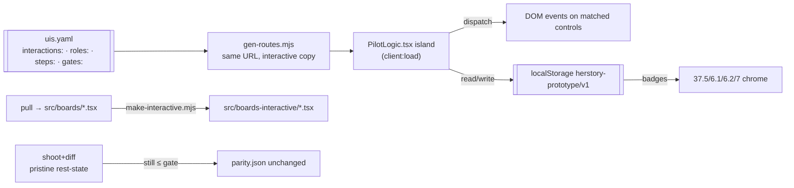

---
tags:
  - op/project/plan
status: awaiting-approval
target: "astrocodebase - prototype"
interaction_source: "HerStory UIs.md §13.6 + surface flows"
---

# Interactive prototype plan — four shells first

Plan only. Implemented after approval (§9). Builds on the existing static prototype:
149 boards, 101 verified / 27 deviated / 21 failed, parity-gated, role drawer already
shipped on every page (`PrototypeNav.astro`).

## 0. What "actionable" means here

| Layer | Means | Not included |
|---|---|---|
| L0 Navigation | lateral menu → board routes, role switch, workspace switch, breadcrumbs, help → UI-35, deep links | — |
| L1 Mock state | filters, workspace-gallery expansion, process stepper badges, toggles/tabs/accordions/selects/dialogs; state in `localStorage` | no backend, no auth, no data fetching |
| L2 Pipeline flow | gates: approve in UI-16 flips the shell badge; blocked gates show a reason; 37.6.2 delegation assigns role owners; 37.7 experience levels route to UI-28/29/30/31 | no real graph writes |

Non-goals (unchanged contract): no real data/auth/backend; **never modify
`HerStory UIs.md`**; the pixel gate keeps protecting the design rest-state.

## 1. Interaction truth — read from the inventory (§13.6 + surface flows)

**Shell chrome (all roles).** Top bar: product mark + workspace, UI language, label
language, UI mode (light/dark), user, role badge, help → UI-35. Breadcrumbs under the
bar. Lateral menu = **six groups** ordered by the §14 design drivers, visibility per
role (from the §13.6 matrix):

| Group (driver) | Superadmin | Coord alone | Coord team | Inquirer |
|---|---|---|---|---|
| Governance & administration (M1,M2,M9,M10) | full | policy read | policy read | — |
| Participation, trust & epistemic justice (M7–M8,M11) | full | full | full | personalisation only |
| Provenance & observability (M6) | full | full | full | read-only trace |
| Ingestion & mapping (M4) | read-only | full | full + delegation | — |
| Explainability & transparency (M5) | read-only | full | full | read-only |
| KG exploration & historical data (M3) | read-only | full | full | full |
| Team & quality gates (shell affordance) | — | — | full | — |

Group → surfaces, per the doc's own mapping:
- Governance & admin → UI-01..UI-08
- Ingestion & mapping (M4) → **UI-09→UI-13** (source registration → ingestion → ontology UI-11S/11C → mapping → SHACL)
- Explainability (M5) → UI-14, UI-16, UI-17, UI-25
- Provenance & observability (M6) → UI-05, UI-08, UI-19, UI-20, UI-38, UI-39
- Participation/EPJ (M7–M8,M11) → UI-06, UI-07, UI-21..24, UI-26, UI-27, UI-40
- KG exploration (M3) → UI-28..UI-34
- Governance/admin (M1,M2,M9,M10) → UI-01..04, UI-15, UI-18, UI-35, UI-36

**Workspace gallery (37.5/37.6.1/37.6.2).** Cards per workspace (owner, dataset,
triple counts, stage); filter by user/workspace/advance; expansion shows the
general processes with one completion badge each (Complete · In progress · Needs
review · Pending · Not started) and per-step owner. 37.5 shows the superadmin's
four-step sequence (source → ingestion → validation → mapping); 37.6.2 lists team
roles attached (curador de datos · curador ontólogo · revisor · asistente, 2–8
people) and keeps investigador for research work.

**37.7 Inquirer.** Experience levels: novice → guided search/UI-31 first-steps;
familiarised → visual query/UI-29 + collections/UI-32; expert → SPARQL/UI-30 + exports.

**Board code ground truth (verified 2026-11-18):** all four shells' menus and
gallery controls are no-op handlers today — e.g. 37.5 renders "Mapping",
"Provenance and observability", "Users", gallery users ("coordinator: EG…");
37.6.2 renders "Team and quality gates", "Gate", "Blocked", "Passed", "Workload",
"review", "revisor", "asistente", "ontólogo" as static chips; 37.7 renders "KG
exploration", "Search", "Chat". Nothing navigates.

## 2. Provisional starting point — the four shells as the entry hub

1. **The four shells are the entry points.** `/ui/ui-37-5-…`, `-37-6-1-…`,
   `-37-6-2-…`, `-37-7-…` each expose the interaction hub for its role. From any
   shell you can reach every surface that role can act on.
2. **Link topology (L0).** Every lateral-menu group maps to a board route by the
   table in §1. Menu items that have no designed board yet (documented gaps UI-09.1,
   UI-10.1) render as disabled entries with the lock reason, matching the doc rule
   "a disabled group stays visible instead of disappearing".
3. **Main pipeline (provisional).** For the coordinator the canonical run is
   UI-09 → UI-10 → UI-11S/11C → UI-12 → UI-13 → UI-14 → UI-15 → UI-16 → UI-17 →
   UI-38 → UI-39 with UI-16 as the gate. The shell stepper shows this as the default
   "Ingestion & mapping" process; 37.5 additionally shows its four-step admin
   sequence.
4. **Role switcher.** Top-bar role control (Superadmin / Coordinator alone /
   Coordinator team / Inquirer) jumps between the four shells and persists
   (`localStorage`), exactly like the existing drawer's role tabs.

## 3. Interaction layers in the Astro codebase

**Key structural decision — interactive copies vs pristine parity boards.**

Vendored boards stay byte-identical so the pixel gate keeps measuring the design.
Each pilot (the 4 shells first, then pipeline surfaces) gets **one interactive
copy** in `src/boards-interactive/<Id>.tsx`, built by the pull pipeline as
`copy + interactions`:

- Pull writes the pristine board as today (`src/boards/`).
- `scripts/make-interactive.mjs` copies a board, then applies a **data-attribute
  patch**: matches no-op handlers by signature (e.g. `onClick={() => {}}` on an
  element whose text matches a menu label) and rewrites them to dispatch events
  (`data-ui-action="nav:ui-09"`, `data-ui-action="gallery:expand"`,
  `data-ui-action="gate:approve"`).
- The interactive copy is routed at the **same URL** via a route-level switch:
  `uis.yaml` entry gains `interactive: true`; `gen-routes.mjs` imports the
  interactive copy when present, else the pristine board.
- Parity: `shoot.mjs` targets pristine copies for the gate; interactive copies are
  captured in their **rest state** and compared too — any visual drift in the rest
  state still fails. `uis.yaml` status `interactive` records this split.

**Runtime.** One small island per pilot, `src/components/PilotLogic.tsx`
(`client:load`), reads the board's `interactions:` config:

```yaml
interactions:
  gallery: { filter: [role, workspace, advance], expand: true }
  steps: [source-registration, ingestion, validation, mapping]
  gates: [{ id: staging, surface: UI-16, action: approve, next: mapping }]
  nav:
    "Governance & administration": { role: superadmin, surfaces: [UI-01..UI-08] }
    "Ingestion & mapping": { role: [coordinator-alone, coordinator-team], surfaces: [UI-09, UI-10, UI-11S, UI-11C, UI-12, UI-13] }
```

State machine lives in `localStorage` under `herstory-prototype/v1`:
`{ role, workspace, stepCompletion: { stepId: "complete|in-progress|needs-review|pending|not-started" }, gates: { id: "passed|blocked" }, delegated: { stepId: roleOwner } }`.
Breadcrumbs and the shell badges render straight from that store, so UI-16
"Approve" → store update → 37.6.x badge flips. Seven-group lateral menu visibility
comes from §1's matrix (encoded in `roles:` nav schema).

**Board-lab against no-ops:** labels in the shells are the join keys
("Team and quality gates", "Ontology review", "review", "Passed", "Blocked"…).
`make-interactive.mjs` logs every matched control; unmatched ones are listed as
manual-wire TODOs in the board's `interactions:` notes, never silently dropped.

## 4. Data flow



## 5. YAML additions (all curated, `gen` preserves like `signoffs`/`roles`)

`interactions:` per board (schema in §3), `cruise:` top-level for the four shells
(`groups:`, `matrix:` from §1 table), `steps:`/`gates:` per shell. `check:yaml`
gains a rule: an `interactive: true` entry must list its `interactions` file
existing on disk.

## 6. Phases

| # | Phase | Steps | Acceptance |
|---|---|---|---|
| P0 | Shell entry hub | `make-interactive.mjs` copy+patch for the 4 shells; same-URL routing; menu items navigate to board routes per §2; role switch jumps shells; breadcrumbs show "Shell → Group → Surface" | from any shell, every permitted surface reachable in ≤ 2 clicks; role persists on reload; pristine parity still green |
| P1 | Shell chrome live | top-bar: UI language, label language, mode (toggles `html[data-theme=dark]`), help→UI-35; workspace switch; gallery filter + card expansion; stepper + process badges from the store | each control visibly changes the shell; badges persist; rest-state shots still within gate |
| P2 | Coordinator pipeline | 37.6.1 wired through UI-09/10/11S/12/13/16 + stubs for dialogs/selects/toggles on those copies; UI-16 Approve → step badge "Complete", Reject → "Needs review" + reason | gate flow round-trips end to end; step state survives reload; 8 boards interactive |
| P3 | Team mode | 37.6.2: delegation assigns role owners per step; gates list (Blocked/Passed/Pending) driven by store; role filter isolates workspace | delegating a step renders its owner chip; a blocked gate disables publish |
| P4 | Superadmin & inquirer | 37.5 admin-first jumps (governance ≤ 2 clicks, four-step sequence); 37.7 experience levels → UI-31/29/32/30 paths | each level lands on the designed surface |
| P5 | Hardening | deep links (`?role=&ws=&step=`), keyboard (drawer, escape), mobile top bar collapse, README + demo walkthrough; parity re-run on all pristine boards | no verified board regresses; walkthrough script runs in 15 min |

Pilot set proposed: 4 shells + UI-09, 10, 11S, 11C, 12, 13, 14, 15, 16, 17, 38, 39
(the coordinator pipeline). Swap any of these.

## 7. Risks

| Risk | Mitigation |
|---|---|
| Interactive copies drift from the design (`make-interactive` rewrites) | rest-state shots still compared to the same references; drift fails |
| Label matching in `make-interactive` misses or miswires a control | logs every match; unmatched controls become visible TODO notes, never silently dropped |
| localStorage schema changes mid-prototype | versioned key `herstory-prototype/v1`; reads migrate or reset on version bump |
| Hydration payload growth (13 islands) | one shared island; boards stay outside the island except the pilot logic |
| Pull overwrites interactive copies | `make-interactive` re-runs after every pull; parity sources remain the source of truth |
| Independently: UI-07/UI-34 style canvas-graph boards in later phases | deferred; scope is the shells + pipeline listed in P2 |

## 8. Verification model

- Pixel gate unchanged (pristine copies) — must remain ≥ current counts (101 verified).
- Per-interaction smoke: scripted Playwright walk (shell → surface → action → state
  change) with assertions on `localStorage` and DOM, run as `npm run demo`.
- Manual acceptance per phase by the user at the pilot set.

## 9. Approval gates

1. **Interactive copies** (`src/boards-interactive/`) at the same URLs, exempt from
   pixel *pass* but checked at rest-state — approve?
2. **Pilot scope** = 4 shells + the 12 coordinator-pipeline boards above (or your list).
3. **Label-key wiring** — menu items joined by their rendered text; unmatched ones
   flagged, not hidden. (Recommended.)
4. **State store** = `localStorage herstory-prototype/v1`; no backend. (Recommended.)
5. **Post-pull regeneration** — every Subframe pull re-runs `make-interactive.mjs`.

Known gaps respected, not invented: UI-09.1 / UI-10.1 render as disabled menu
entries with the lock reason (doc rule), never as fake pages.
