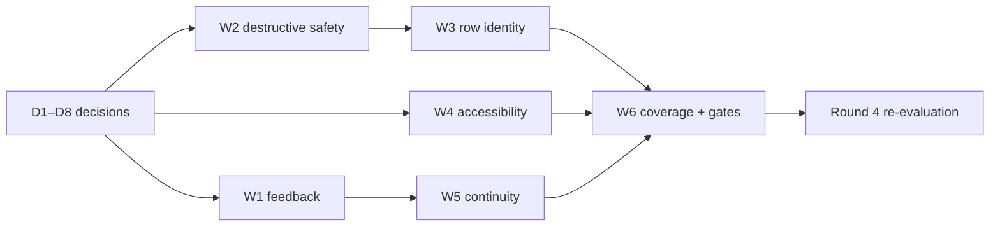

---
tags:
  - design/UX
  - op/plan
  - design/UX/testing
date: 2026-11-25
title: Interaction remediation plan — HerStory prototype (round 2–4)
addresses: "[[Interaction evaluation — HerStory prototype (2026-11-25)]]"
protocol: "[[Protocol — Usability dimensions for the historical-data to Wikidata KG system]]"
requirements: "[[Requirements — Design requirements for the historical-data → Wikidata KG system]]"
artefact: HerStory/UI/astrocodebase - prototype
---

# Interaction remediation plan — rounds 2–4

Closes F-01…F-08 from [[Interaction evaluation — HerStory prototype (2026-11-25)]]. Work is organised so that **no board file is hand-edited**: pulled boards must stay re-pullable (`npm run pull -- --force` must not destroy a fix), and the parity gate must keep measuring the same pixels. Everything here lands in files the project owns: `src/scripts/interactions.ts`, `public/interactions.yaml`, `src/layouts/`, `src/components/`, `scripts/`.

## 0. Constraints that shape the plan

| Constraint | Consequence |
|---|---|
| `src/boards/*.tsx` are verbatim Subframe exports; curated edits are already a known drift cost (README §Curated board edits) | Fixes that would need board edits are rejected or moved to runtime labelling |
| Parity gate compares `shots/reference` (Subframe export) against `shots/local` | Any change that alters layout of a board breaks parity; overlays, banners and dialogs must be **outside** the board subtree |
| `uis.yaml` curated fields (`hydration`, `journey`, `notes`) survive regeneration | New per-surface metadata (task scripts, coverage targets) belongs in those curated keys, not in generated ones |
| 1,373 of 1,740 controls are unwired; blanket wiring is out of scope | Coverage work is **task-driven**: wire what a protocol task needs, and publish the number |
| No backend | Confirmation, undo and persistence are simulated but must be behaviourally honest (state changes and is reversed) |

## 1. Decision log

Each decision is needed before W-tasks start. Recommendation is the default; override explicitly if you disagree.

| ID | Problem | Options | Recommendation | Consequence |
|---|---|---|---|---|
| D1 | F-01: outcome feedback dies with the document | (a) drop `to:` from action rules and let the user navigate; (b) delay navigation ~1.2 s so the toast is seen; (c) carry the message across the boundary and render it on the destination | **(c)**, with (a) for rules where the destination is the same surface | Adds a `flash` channel in `sessionStorage`; parity untouched (banner lives in `Board.astro`, not in the board) |
| D2 | F-02: destructive action has no confirm/reversal | (a) native `window.confirm`; (b) Radix dialog in the interaction script; (c) two-step button ("Delete files" → "Confirm delete") | **(b)**, plus a 10 s undo snackbar | Radix dialog is already a dependency; rules gain a `confirm:` block so the copy per action lives in YAML, not code |
| D3 | F-03: 5 rows → 1 destination | (a) build per-row detail routes; (b) carry row identity as `?row=` and show a context strip; (c) rename controls per row ("Inspect workspace A") | **(b)**, plus (c) only where the row label is stable | Row key derived at click time from the nearest `tr`/`[data-layer-name]` first cell; `Board.astro` renders the strip; zero new routes |
| D4 | F-04: stepper and rail are `div`s | (a) semantic elements in `PipelineFlow.astro` / `GeneralNav` (owned); (b) runtime `role`/`tabindex`/keydown shim; (c) both | **(c)**: (a) for components the repo owns, (b) for board-drawn nav (`NavItem` divs in UI-37.5–7) | Rails drawn by boards cannot be fixed semantically without board edits, so the shim stays as the durable layer |
| D5 | F-05: icon-only controls have no name | (a) curate `aria-label` into boards (drift cost); (b) label at runtime from the `uis.yaml` inventory in document order; (c) require `label:` in each rule | **(b) + (c)**: inventory order is generated from the same source as the DOM, so the zip is deterministic; rules carry the human label | Audit compares `aria-label` presence against inventory; any unnamed control becomes a gate failure |
| D6 | F-06: input lost on navigation | (a) persist `localStorage` per field; (b) per-route draft snapshot in `sessionStorage`, restored on load | **(b)** | Drafts are cleared on submit-looking actions (`confirm`, `publishBatch`) so restored values cannot masquerade as saved |
| D7 | F-07: silent loader window and failure | (a) block the UI until ready; (b) banner on error + queue clicks; (c) both | **(b)** for the error, plus a 300 ms deferred "interactions loading" indicator to avoid flicker | `data-interactions` already exists; wire the banner to it |
| D8 | F-08: coverage | (a) wire all 1,740 instances; (b) wire the controls named in protocol tasks T1–T7; (c) publish coverage and stop | **(b)**, report the number under (c) | Task scripts become the definition of "wired enough"; a per-task checklist lives in `gate/` |

## 2. Workstreams

Sizes are engineering estimates: S ≤ ½ day, M ≈ 1–2 days, L > 2 days.

### W1 — Feedback survives the boundary (F-01, P-02) · M

| Task | File | Change | Acceptance |
|---|---|---|---|
| W1.1 flash channel | `src/scripts/interactions.ts` | `runAction()` writes `{kind, message}` to `sessionStorage["herstory-flash"]` when the rule has `to:`; on load, the banner reads and clears it | `Publish` on an approved batch lands on `/ui/ui-19-artifact-exporter` showing `Published to Wikidata`; flash key empty afterwards |
| W1.2 destination banner | `src/layouts/Board.astro` | fixed-position banner (not in the board subtree), `role="status"`, 5 s auto-dismiss, dismiss button | banner visible after F-01 repro; parity diff unchanged on all boards |
| W1.3 closure state on surface | `src/components/PipelineFlow.astro` (owned) | read `localStorage` batch status and mark the approver/publish steps `done`/`current` | after approve, revisiting UI-16.2 shows the step complete without a toast |
| W1.4 rule audit | `public/interactions.yaml` | for the 53 action rules with `to:`, set `carry: true` where a message exists; drop `to:` where the action is terminal-on-surface | `npm run check:interactions` fails on `action + to` without `carry` |

### W2 — Destructive safety (F-02) · M

| Task | File | Change | Acceptance |
|---|---|---|---|
| W2.1 confirm dialog | `src/scripts/interactions.ts` | `confirm:` block → Radix-free in-house dialog (no bundling Radix into a plain script; ~60 lines) with focus trap, `Esc` cancel, destructive button styled | clicking `Delete files` shows a dialog naming the object; cancel leaves state and URL unchanged |
| W2.2 undo entry | `src/scripts/interactions.ts` | action result pushed to a 10 s undo stack; snackbar host gains an Undo button; `undo()` restores `localStorage` snapshot | delete → Undo restores previous store and says so; after 10 s the entry is gone |
| W2.3 schema + rules | `public/interactions.yaml` | `version: 2`; 4 `destructive` rules gain `confirm: {title, body, confirmLabel}` | gate: every `action: destructive` has a `confirm` block; every confirm has `undo: true` unless exempted with `undoExempt:` and a reason |
| W2.4 regression probe | `scripts/audit-interactions.mjs` (new) | assert dialog appears, `Esc` cancels, undo reverses | `npm run audit:interactions` green |

### W3 — Row identity (F-03) · M

| Task | File | Change | Acceptance |
|---|---|---|---|
| W3.1 row key extraction | `src/scripts/interactions.ts` | `findRule()` computes `rowKey` from the closest `tr`/`[data-layer-name]` first cell (trim, ≤80 chars) and appends `?row=<encoded>` to `to` when the rule sets `rowScoped: true` | 5th `Inspect` on UI-02 → `/ui/ui-02-1-inspect-workspace?row=…` where `row` is the 5th row's first cell |
| W3.2 context strip | `src/layouts/Board.astro` | strip above the board: `Viewing: <row> · clear` linking back to the list; `aria-label="Row context"` | detail surface states the row; clearing returns to the list without the strip |
| W3.3 rule opt-in | `public/interactions.yaml` | `rowScoped: true` on every duplicate-label group that addresses a row (35 such groups today; the checker lists them) | gate counts row-scoped rules; 0 row-addressing groups resolve row-blind |
| W3.4 parity guard | `scripts/diff.mjs` | exclude the strip from the diff region (shots already run with `data-shots`; gate strips it) | parity score unchanged for affected boards |

### W4 — Accessibility of interaction (F-04, F-05) · M

| Task | File | Change | Acceptance |
|---|---|---|---|
| W4.1 stepper semantics | `src/components/PipelineFlow.astro` | steps become `<a href>` with `aria-current="step"`; keep visual classes byte-identical. Covers the **chrome** stepper only — UI-09 draws its own `PipelineStepper` from the board (confirmed in `uis.yaml`), so that one is handled by W4.3 | `document.querySelectorAll('.pipeline-flow [data-nav-item]')` all report `A` with `href`; parity diff clean |
| W4.2 rail semantics | `src/components/GeneralNav.tsx` | items become `<a>`; collapse button already a `<button>` | tab traversal reaches every rail item in order |
| W4.3 board-drawn nav shim | `src/scripts/interactions.ts` | `primePrototypeDom()` also sets `role="link"`, `tabindex="0"`, `aria-label` and Enter/Space handlers where the source is a `div` | UI-37.5: 19 items tabbable, Enter navigates |
| W4.4 icon labelling | `src/scripts/interactions.ts` | zip unnamed `button`s in DOM order against `uis.yaml` `IconButton` entries with a `name`; set `aria-label`; fall back to the rule's `label:` | 0 unnamed buttons on the audited surfaces; `IconButton:Copy` announced as "Copy" |
| W4.5 gate | `scripts/audit-interactions.mjs` | fail on any button without accessible name, any `[data-nav-item]` without focusability, on 3 boards minimum | gate red today, green after W4.1–4.4 |

### W5 — Continuity (F-06, F-07) · S–M

| Task | File | Change | Acceptance |
|---|---|---|---|
| W5.1 draft persistence | `src/scripts/interactions.ts` | debounced `input`/`change` snapshot per route in `sessionStorage["herstory-draft:<route>"]`; restore after `primePrototypeDom()`; chip "Draft restored · discard" | type → navigate → return restores all fields; discard clears both value and key |
| W5.2 draft invalidation | same | `confirm`/`publishBatch`/`approveBatch` clear the draft for the surface | after save, returning to the form shows no draft chip and empty fields |
| W5.3 loader states | same + `Board.astro` | banner for `data-interactions="error"` with a Retry that reloads; a 300 ms-deferred "loading interactions" indicator; clicks in the pre-ready window queue one retry after ready | `route('/interactions.yaml', {abort:true})` → visible error banner, no silent dead clicks |
| W5.4 gate | `scripts/audit-interactions.mjs` | assert banner appears when the YAML route is aborted; assert draft restore on UI-09 | green |

### W6 — Coverage and instrumentation (F-08, P-03) · L

| Task | File | Change | Acceptance |
|---|---|---|---|
| W6.1 task scripts | `HerStory/UI/gate/task-scripts.md` (new) | one script per protocol task T1–T7, listing every control by `surface/control` key and its expected effect | every control in a task script has a rule (gate W6.4) |
| W6.2 wire the gaps | `public/interactions.yaml` | add rules only for task-script controls; keep the rest deliberately unwired | coverage of task-script controls = 100%; overall coverage reported, not targeted |
| W6.3 coverage report | `scripts/check-interactions.mjs` | print wired/total per surface and per task list; exit non-zero on unwired task-script controls | `npm run check:interactions` output includes both numbers |
| W6.4 gate integration | `package.json` | `"audit:interactions"`, and `verify` gains `check:interactions` + `audit:interactions` | `npm run verify` fails on any D1–D8 violation |
| W6.5 regression suite | `scripts/audit-interactions.mjs` | port the round-1 evidence ledger (E-04…E-09) into assertions with expected values | suite reproduces every closed finding; rerun in round 4 diffs clean |

## 3. Rule schema (v2)

Backward compatible: v1 rules keep working; new keys are optional.

```yaml
version: 2
surfaces:
  UI-05.1:
    - control: Button:DeleteFiles
      match: Delete files
      effect: action
      action: destructive
      label: Delete files          # accessible name + undo copy source
      confirm:
        title: Delete 1,284 files?
        body: Files older than the retention window are removed from the staging bucket. This cannot be undone after 10 seconds.
        confirmLabel: Delete files
      undo: true
      to: /ui/ui-05-data-retention-console
      carry: true                  # outcome message survives navigation
  UI-02:
    - control: Button:Inspect#1
      match: Inspect
      effect: navigate
      rowScoped: true              # appends ?row=<first cell of the row>
      to: /ui/ui-02-1-inspect-workspace
```

Validation added to `check-interactions.mjs`:

| Code | Rule | Severity |
|---|---|---|
| I01 | `effect: action` + `to:` without `carry: true` | error |
| I02 | `action: destructive` without `confirm:` | error |
| I03 | `confirm:` without `undo: true` or `undoExempt: "<reason>"` | error |
| I04 | duplicate `match` on a surface where any group lacks `rowScoped`/`nth`/`scope` | warn → error after W3 |
| I05 | rule target not in `uis.yaml` routes | error (exists) |
| I06 | task-script control without a rule | error after W6.1 |

## 4. Sequencing



| Round | Workstreams | Exit criterion (re-probe) |
|---|---|---|
| 2 | W1, W2, W4 | F-01, F-02, F-04, F-05 closed; gates I01–I03, I06 green |
| 3 | W3, W5 | F-03, F-06, F-07 closed; `npm run verify` includes the audit suite |
| 4 | W6 | task-script coverage 100%; all round-1 findings re-scored; new report |

## 5. Acceptance metrics

Measured by `scripts/audit-interactions.mjs`, asserted in `npm run verify`.

| Metric | Today | Target |
|---|---|---|
| Action rules that navigate before the message is seen | 53 / 109 | 0 (or `carry: true`) |
| Destructive rules with confirmation | 0 / 4 | 4 / 4 |
| Destructive rules with reversal | 0 / 4 | 4 / 4 |
| Duplicate-label groups resolving row-blind | 35 | 0 |
| Unnamed interactive controls (audited surfaces) | ≥6 on UI-11.6 alone | 0 |
| Custom nav items not keyboard reachable | 25 (6 stepper + 19 rail) | 0 |
| Silent dead clicks on audited surfaces | ≥1 | 0 |
| Task-script controls wired | — | 100% |
| Overall instance coverage (reported, not targeted) | 21.1% | reported per round |

## 6. Risks

| Risk | Trigger | Mitigation |
|---|---|---|
| Parity gate reddens on every round | banner/strip changes board screenshots | overlays live outside `[data-board-root]`; `shoot.mjs` runs with `data-shots`, which the banner respects; re-baseline only with a note |
| Re-pull silently reverts a fix | `npm run pull -- --force` | no fix touches `src/boards/*`; the curated-drift list in README stays accurate |
| Confirm dialog breaks component fidelity review | dialog is app-chrome, not board UI | dialogs carry a `prototype-chrome` class excluded from parity |
| Row-key zip mislabels icon buttons after a re-pull | inventory and DOM drift | D5 gate fails loudly on count mismatch instead of mislabelling |
| Task-driven coverage under-delivers | only T1–T7 wired | the coverage number is published with the artefact; participants see the boundary |

## 7. Out of scope

M5 explanations and M6 provenance **content** (needs service data), the backend, participant rounds, and visual/aesthetic review. Those follow the protocol's own phases and are not closable by code changes in this artefact.

---

## 8. Round 2–3 outcome (executed 2026-11-25)

All of W1–W5 landed; W6 landed except the deliberate absence of blanket wiring. Nothing in `src/boards/` was touched, so `npm run pull -- --force` still reverts nothing of this work.

### 8.1 Shipped

| Task | Where it landed | Verified by |
|---|---|---|
| W1.1–W1.3 flash + destination banner | `src/scripts/interactions.ts` (`writeFlash`/`readFlash`/`banner`), rules `carry: true` on 53 rules | audit A2 |
| W2.1–W2.3 confirm + undo | `confirmDialog()`, `offerUndo()`/`announceUndo()`, `confirm:` + `undo: true` on the 4 destructive rules | audit A3 (dialog, Esc, undo reverts `destructiveRuns`) |
| W3.1–W3.3 row identity | `rowKeyOf()`, `?row=`, `renderRowContext()`, `rowScoped: true` on 31 rules | audit A4 |
| W4.3–W4.4 semantics + names | `makeFocusable()` (role, tabindex, Enter/Space), `labelUnnamedControls()` + `scripts/gen-labels.mjs` → `public/control-labels.json` | audit A5 (0 unnamed of 32; 0 of 19 rail and 0 of 6 stepper unreachable) |
| W5.1–W5.3 drafts + loader | `saveDraft`/`restoreDraft`/`clearDraft`, banner on `data-interactions="error"` with Retry | audit A6, A7 |
| W6.1–W6.2 task scripts + wiring | `HerStory/UI/gate/task-scripts.md`; 22/22 named controls wired | `npm run check:interactions` → `task scripts: 22/22` |
| W6.3–W6.4 gates | `check-interactions.mjs` I01–I06 + coverage report; `audit-interactions.mjs`; both in `npm run verify` | checker exit 0, audit 11/11 |
| Schema v2 | `scripts/migrate-interactions-v2.mjs` (idempotent, `--check`) | `npm run check:migrate` |

W1.4/W4.1/W4.2 were already satisfied by the existing chrome (`PipelineFlow` renders `<a>`, `GeneralNav` renders `<a>`); the board-drawn stepper and rail needed the runtime shim, which is W4.3.

### 8.2 Metrics after the round

| Metric | Before | After | Source |
|---|---|---|---|
| Action rules navigating before feedback | 53 / 109 | 0 (53 carry the message) | checker I01 |
| Destructive rules with confirmation | 0 / 4 | 4 / 4 | checker I02 |
| Destructive rules with reversal | 0 / 4 | 4 / 4 | checker I03 |
| Row-blind duplicate-label groups | 35 | 0 navigate-blind (31 row-scoped; 4 are same-action) | checker I04 |
| Unnamed interactive controls | ≥6 on UI-11.6 | 0 of 32 | audit A5 |
| Custom nav items not keyboard reachable | 25 | 0 | audit A5 |
| Silent dead clicks on audited surfaces | ≥1 | 0 | audit A8 |
| Task-script controls wired | — | 22 / 22 | checker I06 |
| Instance coverage | 367/1740 keyed (21.1%) | unchanged; 484/1740 reachable by label (27.8%) | checker report |

### 8.3 Not done, deliberately

- **W6.2 blanket wiring** stays out: coverage is task-driven, and the number is now printed by the gate.
- **Parity gate** remains red on most boards for reasons that predate this work: untouched boards fail identically (UI-01 3.6–6.3%, UI-10 10.6–12.3%), with `heightΔ 0.00%` and `outside 0.000%`, i.e. in-board rendering differences against the Subframe export, not layout shifts. The chrome overlays introduced here are suppressed under `html[data-shots]` and did not change any measured height. Treat parity as separate debt.
- **M5/M6 content** (explanations, provenance) is untouched: no service, no data.

---

## 9. Results — final gate run (2026-11-25, 11:36 CET)

Run order after the last source change: `gen:labels` → `check:migrate` → `astro build` → `check:interactions` → `audit:interactions`. Everything below is copied from that run; no value is inferred.

### 9.1 Build and schema

```
gen-labels: 86 icon-button names across 13 surfaces → public/control-labels.json
migrate: schema v2 already applied
[build] 150 page(s) built in 25.91s
[build] Complete!
```

### 9.2 Static gate — `npm run check:interactions`

```
check-interactions: 448 rules across 141 surfaces; targets valid; schema v2
coverage: 367/1740 instances keyed by control (21.1%), 484/1740 reachable by label (27.8%) — reported, not targeted
task scripts: 22/22 controls wired
surfaces with no wired control (6): UI-37.1, UI-37.3, UI-37.4, DS-01, DS-02, DS-03
```

Exit 0. Four `warning:` lines remain, all the same shape and all deliberate: `same action for every repeated label` on UI-12 (`Validate#2`, `Remove#5`), UI-18.2 (`Select#3`), UI-40 (`Eye#3`) — one action intentionally serves every row.

### 9.3 Behaviour gate — `npm run audit:interactions` (11/11)

| Assertion | Observed |
|---|---|
| A1 publish without approval refused | `toast="Approve the batch before publishing"`, store untouched |
| A2 outcome survives navigation | `path=/ui/ui-16-2-approve-and-publish`, `banner="Batch approved"` |
| A3 confirm dialog | `dialog=true`, `escClosed=true`, `stayed=true` |
| A3 reversible | `undoOffered=true`, `ran=true`, `reverted=true` |
| A4 row identity | `query=?row=Maritime%20Trade%20RegisterValencia%2C%201860%E2%80%931910`, strip present |
| A5 accessible names | `0 unnamed of 32` on UI-11.6 |
| A5 rail keyboard | `0 of 19 unreachable` on UI-37.5 |
| A5 stepper keyboard | `0 of 6 unreachable` on UI-09 |
| A6 draft restore | `values=["Fons Batlle 1782"]`, `strip=true` |
| A7 loader failure visible | `attr=error`, `banner=true` |
| A8 unwired control explains itself | `stayed=true`, `toast="Prototype: “Copy” is present for visual parity but has no wired destination…"` |

### 9.4 Files this round added or changed

| File | Change |
|---|---|
| `src/scripts/interactions.ts` | rewritten: flash channel, confirm dialog, carried undo, row keys + strip, draft persistence, loader banner, icon labelling, nav semantics shim |
| `public/interactions.yaml` | schema v2: `carry` ×53, `confirm` + `undo` ×4, `rowScoped` ×31 |
| `public/control-labels.json` | new — 86 names across 13 surfaces |
| `scripts/gen-labels.mjs`, `scripts/migrate-interactions-v2.mjs`, `scripts/audit-interactions.mjs` | new |
| `scripts/check-interactions.mjs` | I01–I06 gates, dual coverage metric, task-script check |
| `package.json` | `gen:labels`, `migrate:interactions`, `check:migrate`, `audit:interactions`; `gen` and `verify` chains |
| `README.md` | schema v2 keys, labels artefact, gate docs |
| `HerStory/UI/gate/task-scripts.md` | new — T1–T7 scripts, 22 wired controls, gap lists |
| `shots/local/*`, `shots/diff/*`, `shots/parity.json` | harness output for the 12 boards measured (UI-01, UI-02, UI-05, UI-09, UI-10, UI-16.1) |

No file under `src/boards/`, `src/ui/`, or `src/layouts/` was modified — the surface remains re-pullable.

### 9.5 Standing at close of round 3

- **Closed and gate-protected:** F-01, F-02, F-03, F-04, F-05, F-06, F-07.
- **Instrumented, not closed:** F-08 coverage (task-driven; the number is printed every gate run).
- **Open outside this plan:** parity debt (pre-existing, untouched boards fail the same way), M5/M6 content, participant rounds — see report §5.
- **Round 4 (re-evaluation with participants)** is not run: it needs the protocol's cohort, not code. The machine-checkable half of round 4 is now the gate suite, which is what `npm run verify` runs on every change.
