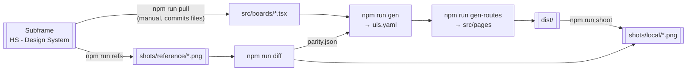

# HerStory UI prototype — Astro, static, Subframe-free

Static Astro build of the HerStory boards. One route per surface, generated from
`uis.yaml`; React islands only where a board actually needs behaviour. Nothing at
build time or run time talks to Subframe.

```
npm install
npm run dev            # http://localhost:4321
npm run build          # dist/ — 149 routes + index + token reference
npm run verify         # build → screenshots → pixel gate → refresh uis.yaml
```

## What lives where

| Path | Role |
|---|---|
| `uis.yaml` | **Source of truth for routes and status.** Generated by `npm run gen`; `hydration`, `journey`, `notes` are curated and survive regeneration. Each surface also carries `components:` — every design-system instance in its board, named by its content (`<Button>Search</Button>` → `Button:Search`, props verbatim under `config`), derived from the board code on each regeneration. |
| `src/boards/*.tsx` | Board code pulled verbatim from Subframe (one file per surface). Do not hand-edit: re-pull instead. |
| `src/ui/` | The design system: 93 components synced from the Subframe library, `theme.css` tokens, `tailwind.config.cjs` (verbatim), self-hosted fonts. |
| `src/ui/core/` | Vendored subset of `@subframe/core` (component sources + the Feather icons actually used). ISC licence, `src/ui/core/LICENSE`. |
| `src/pages/ui/*.astro` | One generated route per board. Do not hand-edit (header says so). |
| `src/pages/ds/tokens.astro` | Hand-written token reference, parsed from `theme.css`. |
| `src/layouts/GeneralScreen.astro` | Persistent chrome for wrapped UI routes: UI-37.1 header, conditional breadcrumbs, task-aware foldable rail, content slot, footer. Header/rail are React islands (`GeneralHeader`, `GeneralNav`) driven by `general-nav-config.tsx`. |
| `public/interactions.yaml` | **Single source of behaviour links.** Schema v2. Matches a control on a surface to an effect (`navigate` / `back` / `action`) plus the optional keys `carry`, `confirm`, `undo`, `rowScoped`, `label`. Edit this file only; no route or code change is needed for a link edit. 448 rules across 141 surfaces, including the role-shell sidebar items. |
| `src/scripts/interactions.ts` | Runtime: fetches `/interactions.yaml`, matches clicks by surface + visible control text (`nth`/`scope` for duplicates), navigates, carries outcome messages across the navigation, confirms destructive actions with a dialog + 10 s undo, keeps per-route input drafts, labels icon-only controls from `/control-labels.json`, and makes board-drawn nav keyboard operable. Loaded by `Board.astro` on every route. |
| `public/control-labels.json` | Accessible names for icon-only controls, generated from the `IconButton` inventory in document order (`npm run gen:labels`). The runtime zips unnamed buttons against it, and refuses to guess when the counts disagree. |
| `src/pages/prototype.astro` | Generated coverage report at `/prototype`: every control per surface, wired / simulated / local / not wired, plus the prototype's limits. |
| `scripts/` | `pull`, `sync`, `vendor-core`, `refs`, `gen-yaml`, `gen-routes`, `gen-labels`, `shoot`, `diff`, `check-interactions`, `audit-interactions`, `migrate-interactions-v2`. |
| `vendor/subframe-snapshot/manifest.json` | Provenance: page id, canvas, `lastModifiedAt`, sha256 per board + theme + component list. |
| `shots/{reference,local,diff}` | Parity oracle, current render, heat maps. |

## The pipeline



Subframe is a **design source touched by hand**, never a dependency: after
`npm run pull`, the repo builds with the package absent and the project deleted.

## Adding or changing a board

1. Change it in Subframe.
2. `npm run pull -- --all` (or `-- --only UI-37.5`). Files are sha-guarded: a local
   file that diverged from the manifest needs `--force`.
3. `npm run sync` if a shared component changed or a board references a new one.
4. `npm run vendor-core` if the board introduced new icons.
5. `npm run gen && npm run gen-routes && npm run build`.
6. `npm run refs -- --only UI-37.5 && npm run shoot -- --only UI-37.5 && npm run diff -- --only UI-37.5`.
7. `npm run gen` again to record the measured parity.

## Curated board edits

Pulled boards are normally untouched, but the prototype intentionally removes the
small `HERSTORY · <role/section>` eyebrow from every UI board (106 occurrences)
and normalises the three existing `ProcessStepper` label sets (UI-09, UI-11C,
UI-11S). These edits make `npm run pull` treat those files as diverged: re-pull
with `--force` only if you intend to lose them, then re-apply. The design-system
`HERSTORY DESIGN SYSTEM · v2` heading is deliberately kept.

Because the reference exports still contain the eyebrow, parity shrank by the
height of one caption line on affected boards until the design source drops it.

## Parity gate

Two numbers per board per viewport (`shots/parity.json`, surfaced in `uis.yaml`):

| Metric | What it catches |
|---|---|
| `ratio` — pixelmatch at full resolution | everything, including glyph rasterisation |
| `ratio8` — pixelmatch on 8× area-averaged images | layout, spacing, colour, missing/extra elements |
| `heightDelta`, `widthDelta` | canvas-size drift |

Status: `verified` ≤ 0.1 % `ratio8`, `deviated` ≤ 2 %, `failed` above — plus the
size deltas must stay ≤ 1 %. `deviated` entries must carry a `notes:` line
explaining why; a curated deviation survives regeneration.

**Measured 2026-11-24** against live exports: **99 boards verified**, 27
deviated, 21 above the 2 % bar, 2 represented. The remaining failures are
concentrated in dense table boards: their diff maps show full-width 1–2
device-pixel rule offsets (the 8× gate still sees them as whole-row changes)
with the text raster shifted by the same rounding, not missing sections. Those
maps are in `shots/diff/`; the per-viewport numbers are in `shots/parity.json`.

**Why the gate is structural, not raw-pixel.** The reference exports are rasterised
by Subframe's Linux renderer (FreeType); this harness runs Chromium on macOS
(CoreText). Same font files, same advances at integer level, but glyph coverage
differs, which pins the full-resolution ratio at ~0.3–0.5 % on text-heavy boards
(measured: UI-01 header crop 0.074 %, whole-board row pitch identical at 88 px @2×).
`ratio8` is blind to that and still moves by whole percent on a real break.

Two rendering rules the harness encodes, both measured, both non-obvious:

- **Mobile lays out at the breakpoint max (767 px), not at the export width.** Some
  exports are padded to an 800 px canvas; rendering at 800 instead of 767 turned a
  0.06 % match into 7.4 % (UI-37.5).
- **Flatten alpha before diffing.** A board that ships a modal scrim exports as
  `rgba(0,0,0,153)`; the local screenshot composites it onto white. Flattening both
  to white took UI-11.6 from 5.2 % to 0.001 %.
- **Vendored module CSS is cascade-layered.** `vendor-core` wraps every copied
  `*.module.css` in `@layer subframe-core` so unlayered Tailwind utilities win
  whatever the load order. Without it, the progress indicator's `height:100 %`
  beat the `h-2` utility and the track rendered 0 px tall (UI-10 was 7 % off).
  This mirrors Subframe's own fullscreen-dialog module.
- **Prototype chrome is not board content.** The general-screen shell, navigation
  and the pipeline flow collapse under `html[data-shots]` so a board lays out at
  the full reference canvas width; measured against the old full-page capture the
  shell pushed UI-01 to 7.4 % off.

References now export with the width-based API (`export_image` renders at its
display width; desktop defaults to 1440 css, mobile is requested at the breakpoint
max 767). Very tall boards that would exceed the pixel cap are re-exported at
1× automatically (`scripts/refs.mjs`).

## Auth for the pull

`scripts/lib/mcp.mjs` reuses the harness OAuth grant in `~/.omp/agent/agent.db`
(`mcp_oauth:profile:default:https://mcp.subframe.com/mcp`) and refreshes it before
use — the access token lives one hour. Override with `SUBFRAME_ACCESS_TOKEN`,
`SUBFRAME_REFRESH_TOKEN`, `SUBFRAME_CREDENTIAL_DB`, `SUBFRAME_PROJECT_ID`.

The pull refuses to run in CI by design; regenerate references deliberately.

## Non-goals

No backend, no auth, no data fetching: the boards are visual parity targets and
controls move inside the prototype only. `UI-09.1` and `UI-10.1` have no
source board in Subframe and are carried in `uis.yaml` as `missing-source`.

## Interactions — edit YAML, not code

`public/interactions.yaml` is the only place a link target is defined.

```yaml
surfaces:
  UI-16.1:
    - control: Button:ApproveBatch
      match: Approve batch
      effect: navigate
      to: /ui/ui-16-2-approve-and-publish
```

- **Change a link:** edit `to`, reload the page. In `npm run dev` the YAML is
  served live; a production build copies it to `dist/interactions.yaml` (no route
  regeneration).
- **Match rules:** per surface (`data-ui-id`, with the page's `meta[ui-id]` as
  fallback for Radix portals), by visible control text. Use `nth: 2` for a
  repeated label or `scope: "row text"` to narrow to a row/layer.
- **Effects:** `navigate` (requires `to`), `back`, and `action`.
  `action` runs a named handler, may carry a guard, then optionally navigates:
  ```yaml
  - control: Button:Publish
    match: Publish
    effect: action
    action: publishBatch
    to: /ui/ui-19-artifact-exporter
  ```
  Built-in actions: `approveBatch`, `publishBatch` (guards on approval),
  `sendToStaging`, `acceptSuggestion`. They persist in
  `localStorage["herstory-prototype/v1"]` and show a toast. Generic actions mark
  the prototype boundary without pretending: `confirm` (saved locally),
  `simulate` (no live service), `download` (no file generated), `external`,
  `destructive` (simulated, counted in `destructiveRuns`, reversible), and
  `copy`. Add a new action in `src/scripts/interactions.ts` only when a new
  behaviour class is needed.
- **Schema v2 keys** (see `scripts/migrate-interactions-v2.mjs`):
  `carry: true` — the outcome message survives the navigation the action
  triggers (required by the gate whenever an `action` also has `to`);
  `confirm: {title, body, confirmLabel}` — dialog before a destructive action,
  which must also set `undo: true` (or `undoExempt: "<reason>"`);
  `rowScoped: true` — append `?row=<first cell of the row>` to the destination,
  and the destination shows a "Viewing: …" strip;
  `label: "…"` — accessible name / dialog copy for controls without text.
- **No silent dead controls:** a click on a control that has no matching rule
  shows a one-time toast naming the control and pointing at `/prototype`, where
  every surface lists what is wired and why the rest is not. Screenshot runs
  (`html[data-shots]`) suppress the toast.
- **Portals:** menus/dropdown items render outside `[data-board-root]`; the
  runtime falls back to the page surface and matches `role=menuitem`/`option`.
- **Validate:** `npm run check:interactions` checks surface ids, control keys,
  duplicate rules, actions, target routes, the v2 gates (I01 action+`to` without
  `carry`; I02 destructive without `confirm`; I03 confirm without `undo`; I04
  row-blind duplicate label; I06 task-script control without a rule), and prints
  coverage. `npm run audit:interactions` drives the built site in Chromium and
  asserts the behaviour the schema promises (guard, carried feedback, confirm +
  undo, row identity, accessible names, keyboard nav, drafts, loader failure,
  no silent dead controls). Both run inside `npm run verify`.
- **Routes:** adding a link between existing screens needs only YAML. A brand-new
  destination screen still needs its normal route to exist.

### Coverage and honest gaps

`/prototype` is generated from the same two YAML files and reports, per surface,
which controls navigate, which run a simulated action, which are local inputs or
static visuals, and which are not wired. It also states the limits once:

- no backend, auth, persistence beyond `localStorage`, or live data;
- no file upload/download, SPARQL execution, reasoner, OWL/OOPS, LLM call, or
  Wikidata write;
- tables and charts render the board's seeded values;
- icon-only controls cannot be text-matched without editing the pulled board;
- external pages are not embedded.

The coverage page is the answer to “why did this click do nothing?”; the toast
is the inline pointer to it.

## General screen

Every routed UI renders inside `src/layouts/GeneralScreen.astro`, except:

- `/` — the temporary role picker;
- `UI-37.*` — the four role shells and their pattern boards already provide
  their own header/nav/footer chrome.

The general screen follows `HerStory/UI/General UI.svg` and the live shell
boards. The header is the **UI-37.1** header: logo, workspace selector, language,
help, theme, user, role badge and avatar, at its 120 px height. The rail is the
task navigation from **UI-37.5 / 37.6.1 / 37.6.2 / 37.7**, not the full surface
inventory: sections and items change with the role chosen on the start screen or
in the prototype panel (`localStorage["herstory-role"]`, with
`herstory-prototype/v1.role` as fallback). Every rail item is a real link.

The rail collapses to a 64 px icon column and expands to 240 px on hover or
keyboard focus; the choice persists in `localStorage["herstory-nav-collapsed"]`.
Below 900 px it starts collapsed. Breadcrumbs are rendered by the shell only when
the board does not already draw its own (collections, corpus, map), so no page
shows two breadcrumb rows. `UI-37.*` keeps its own board chrome.

Header controls are the only general controls: theme (`herstory-theme`), language
(`herstory-language`), workspace (`herstory-workspace`) and help all work there.
The old sticky `PipelineChrome` strip is gone. `PipelineFlow` renders inside the
content header for every **primary** pipeline surface: one six-stage navigation
stepper (Source registration → Ingestion → Ontology → Mapping → Validation →
Publish). The secondary process stepper is the one already inside the board
(UI-09, UI-11C, UI-11S); only its labels were normalised, and it stays in its
original position. Those three boards are curated exceptions: a `pull --force`
would overwrite the labels. UI-09's in-board stages are marked as controls so the
YAML navigates them.
